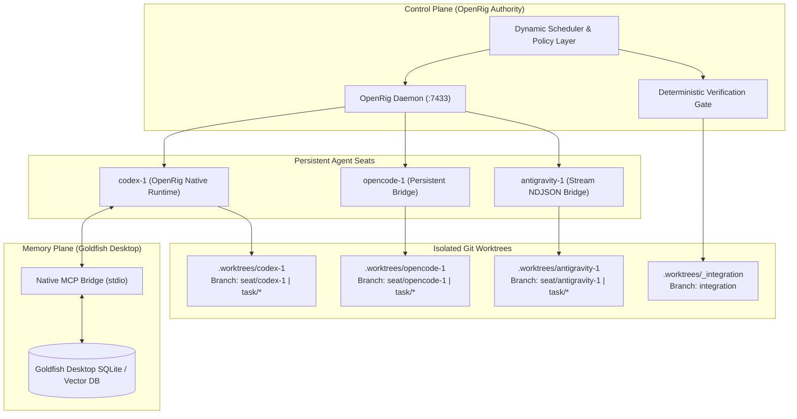
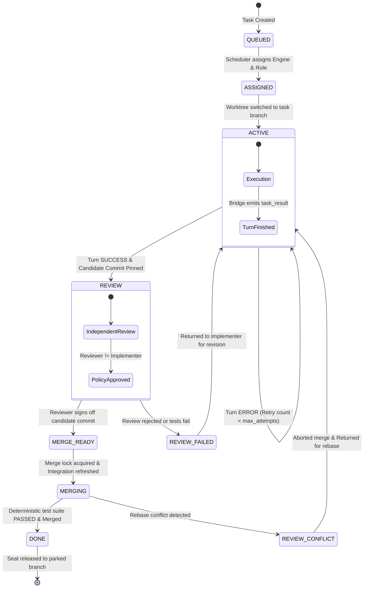
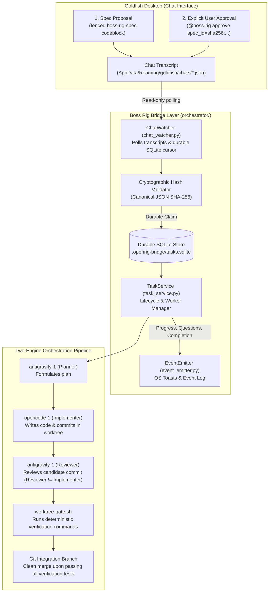

# Boss Rig — Open-Source Shared Plane Harness (Built on OpenRig)

[](https://openrig.dev)
[-teal.svg)](https://github.com/NandhaKishorM/laya)
[](https://python.org)
[](https://git-scm.com)
[](LICENSE)

**Boss Rig** is a local-first **Shared Plane** conversational orchestration bridge built on **OpenRig (`0.7.19`)**.

It turns natural requests in **Goldfish Desktop** (or any JSONL-emitting brain) into verified Git commits in under 3 minutes: screening build intent in ~50ms via **Laya (`0.4.31`, text-only `vega=False`)** with zero-dependency heuristic fallback, enforcing HMAC-signed human approval in **`TaskService`**, dispatching isolated coding work across **`codex-1`**, **`antigravity-1`**, and **`opencode-1`** inside per-seat Git worktrees, and merging only after independent review and **`worktree-gate.sh`** deterministic verification pass.

---

## 🎬 Demo

- **[Watch the Boss Rig Shared Plane Demo (`boss-rig-demo.mp4`)](docs/assets/boss-rig-demo.mp4)**

*How it works:* We use **Goldfish** to capture live project context and natural build requests, pass them through **Boss Rig's Shared Plane** (`Laya` intent routing → HMAC approval → isolated `codex-1` / `antigravity-1` / `opencode-1` worktrees → `worktree-gate.sh`), and deliver verified build results and `_integration` paths right back into the original conversation flow via `/reports/latest`, Companion Inbox, and desktop notifications.

---

## ⚡ 60-Second Quickstart & 3-Terminal Runbook

```bash
# 1. Create your declarative Shared Plane config
cp plane.example.yaml plane.yaml

# 2. Run read-only environment & seat diagnostics (expects 8/8 [PASS])
python -m plane.daemon doctor
```

Run the live stack across three terminals:

| Terminal | Component | Command |
| :--- | :--- | :--- |
| **Terminal 1** *(WSL)* | OpenRig Control Daemon (`:7433`) | `wsl -e bash -lc "rig daemon status \|\| rig daemon start"` |
| **Terminal 2** *(Host)* | Companion Inbox UI & REST API (`:8383`) | `python -m orchestrator.bridge_cli serve --port 8383` → open `http://127.0.0.1:8383/inbox` |
| **Terminal 3** *(Host)* | Shared Plane Listener / Router / Speaker | **Default (`propose_first`):** `python -m plane.daemon up --live`<br>**Hands-free sandbox opt-in:** `python -m plane.daemon up --live --auto-approve-sandbox` |

### Shared Plane Architecture Flow

```mermaid
flowchart LR
    GF["Goldfish Desktop\n(Strictly Read-Only Chats + DB)"]
    LIST["GoldfishChatListener\n(6-turn recent_context;\nstrips quotes & report markers)"]
    LAYA["Laya 0.4.31 (~50ms)\n(Classifies isolated message only;\nHeuristicRouter fallback)"]
    GATE_AUTH["HMAC-Signed Approval Gate\npropose_first (/inbox click)\nor --auto-approve-sandbox\n(.disposable-live-repo + integration only)"]
    IMPL["codex-1 Implementer\n(.worktrees/codex-1\nauto-commit excluding seat logs)"]
    REV["antigravity-1 Reviewer\n(Read-Only Role Guard;\nreviewer != implementer)"]
    MERGE["worktree-gate.sh\n(Deterministic verify + merge\n-> .worktrees/_integration)"]
    SPK["CompositeSpeaker\n(latest_report.md + Files Changed\n+ _integration path + Toasts + MCP)"]

    GF -->|Read-only poll| LIST
    LIST -->|"message only"| LAYA
    LIST -->|"6-turn Observed UI context"| GATE_AUTH
    LAYA -->|PROPOSE_BUILD| GATE_AUTH
    GATE_AUTH -->|Verified TaskSpec| IMPL
    IMPL -->|Candidate SHA| REV
    REV -->|PASS| MERGE
    MERGE -->|integration commit| SPK
```



### Key Shared Plane Guarantees
- **Strictly Read-Only Goldfish Boundary**: Reads `<APPDATA>/goldfish/chats/*.json` and `goldfish.db` (`?mode=ro&immutable=1`) without ever writing to Goldfish files or modifying Goldfish Desktop.
- **Router Isolation & Loop-of-Doom Prevention**: Laya inspects only the stripped latest user message (`state={"message": sanitized}`), ignoring `role != "user"`, blockquotes, fenced codeblocks, and `[SHARED PLANE]` / `[SHARED PLANE REPORT]` markers, while deduplicating every message ID in SQLite.
- **Safety-First Dispatch (`propose_first` default)**: Natural build requests stage `PENDING_APPROVAL` proposals in `.openrig-bridge/tasks.sqlite` for one-click approval in Companion Inbox (`/inbox`). Passing `--auto-approve-sandbox` (or `dispatch.mode: auto_dispatch_sandbox` in `plane.yaml`) auto-approves **only** when the target repository is an allowlisted `.disposable-live-repo` on `integration`—never `main` and never `git push`.
- **Independent Review & Clean Integration**: Enforces $Reviewer \ne Implementer$ (for `codex-1` builds, skips the redundant planner turn and routes directly `codex-1` → read-only `antigravity-1` → `worktree-gate.sh`), auto-commits clean implementer changes excluding `.openrig-*-seat.log`, and records changed files + `_integration` path in `latest_report.md`.

---

## ✅ Verified Live Proof, Scope (`v1.0.0`) & `v1.1` Roadmap

### Verified Capabilities in `v1.0.0`
- **Text-Based `Observed UI` Multi-Turn Handoff**: Carries up to 6 turns (`recent_context`) from Goldfish chat into `SpecBuilder` while isolating Laya intent classification.
- **End-to-End Multi-Agent Builds (`DONE`)**: Live builds on `.disposable-live-repo` verified across both approval-gated `/inbox` dispatch and hands-free `--auto-approve-sandbox` (`codex-1` implementer + read-only `antigravity-1` / `opencode-1` reviewer → deterministic `worktree-gate.sh` merge into `integration`).
- **Cross-Platform Windows ↔ WSL Execution**: Threaded loopback HTTP server (`ThreadingHTTPServer` with idle-socket timeout), threaded non-blocking `SeatBridgeProcess` / `codex_seat_runner.py` readers, Windows→WSL path translation (`to_wsl_path`), bidirectional relative worktree `gitdir` normalization, and accurate `failed_stage` reporting.
- **Offline Regression Suite**: 115 offline tests across 14 modules + `python -m plane.daemon doctor` (8/8 `[PASS]`).

### `v1.1` Roadmap
- Direct UI snapshot `--image` forwarding from Goldfish captures to Codex (`codex exec -i`).
- Interactive repository picker in the Companion Inbox (`/inbox`) UI.
- Greenfield repository scaffolding workflow for new projects outside `.disposable-live-repo`.
- Chat-driven dispatch mode & model selection toggles (`@rig mode ...`, per-role model overrides).

---

## 🏛️ Core Architectural Principles & Invariants

1. **Single Control Plane (OpenRig Exclusivity)**:
   OpenRig (`@openrig/cli`) is the **sole** orchestration and control authority. No competing orchestrators (e.g., Temporal, Inngest, LangGraph, AutoGen) or multi-agent frameworks are introduced.
2. **Engine Identity != Task Role**:
   Persistent engine identities (`codex-1`, `opencode-1`, `antigravity-1`) are strictly decoupled from transient task roles (`planner`, `implementer`, `reviewer`, `verifier`, `debugger`, `coordinator`). Any engine can perform any role on any task dynamically.
3. **Physical Git Worktree Isolation**:
   Every agent seat operates inside its own persistent Git worktree (`.worktrees/codex-1`, `.worktrees/opencode-1`, `.worktrees/antigravity-1`). Active tasks run on ephemeral task branches (`task/<task_id>`). Released or crashed seats return to dedicated parking branches (`seat/<seat_id>`).
4. **Agent Turn Success is NEVER Software "DONE"**:
   An agent completing its turn transitions the task to `REVIEW`. Only deterministic local verification (test suite execution against the candidate tree) followed by an atomic merge lock and clean merge into `integration` can transition a task to `DONE`.
5. **Independent Review Policy**:
   Self-review is strictly forbidden by policy. If engine $E$ was the implementer on task $T$, the reviewer MUST be an engine $R \ne E$.
6. **Commit-Pinned Verification**:
   The implementer's candidate git commit SHA is pinned before review or verification begins, preventing race conditions or uncommitted worktree drifts.
7. **Process-Group Isolation & Watchdog Enforcement**:
   Persistent bridge processes use process-group sessions (`start_new_session=True`, `os.killpg`) to ensure child timeouts (`SIGTERM` -> `SIGKILL`) cleanly reclaim all child subprocesses without leaving zombie threads or hanging pipes.

---

## 📐 System Architecture

### 1. High-Level Topology



---

### 2. Task Lifecycle State Machine



---

## 🔄 3×3 Interchangeability Matrix

The system enforces complete decoupling between **Engine Identity** and **Task Role**. Every engine is verified across all roles:

| Engine Identity | Planner Role | Implementer Role | Reviewer Role |
| :--- | :---: | :---: | :---: |
| **`codex-1`** | ✅ Verified | ✅ Verified | ✅ Verified |
| **`opencode-1`** | ✅ Verified | ✅ Verified | ✅ Verified |
| **`antigravity-1`** | ✅ Verified | ✅ Verified | ✅ Verified |

*Verified in test suite: `tests/test_interchangeability_matrix.py` (9/9 combinations passing).*

---

## 📂 Repository Structure

```text
Boss_Rig/
├── config/
│   ├── rig.yaml                        # OpenRig seat topology declaration
│   └── agents/                         # Neutral agent role profiles
├── orchestrator/                       # Core orchestration framework & bridge services
│   ├── __init__.py
│   ├── models.py                       # TaskRecord, TaskSpec, TaskState, BridgeEvent schemas
│   ├── policy.py                       # Independent review, commit pinning & repo path checks
│   ├── store.py                        # Durable SQLite task, cursor & event store (tasks.sqlite)
│   ├── task_service.py                 # Core bridge task coordinator & worker thread manager
│   ├── chat_watcher.py                 # Goldfish transcript file watcher & spec hash validator
│   ├── server.py                       # Authenticated REST API daemon (localhost:8383)
│   ├── mcp_server.py                   # Model Context Protocol (MCP) server for Boss Rig tools
│   ├── bridge_cli.py                   # Unified CLI for watcher, server, and task management
│   ├── event_emitter.py                # OS notifications & out-of-band JSON event logging
│   ├── security.py                     # Recursive process-tree killer & path normalizer
│   ├── dispatcher.py                   # Seat bridge process manager & OpenRig sender
│   └── engine.py                       # High-level task lifecycle coordinator
├── scripts/
│   ├── worktree-gate.sh                # Worktree isolation manager & deterministic gate
│   ├── opencode-seat-runner.sh         # OpenCode persistent seat entrypoint
│   ├── opencode_seat_runner.py         # OpenCode process-group & JSON envelope bridge
│   ├── antigravity-seat-runner.sh      # Antigravity persistent seat entrypoint
│   └── antigravity_seat_runner.py      # Antigravity stream-NDJSON protocol bridge
├── tests/
│   ├── test_bridge_e2e.py              # End-to-end watcher, spec hash, recovery & safety tests (18 tests)
│   ├── test_server_api.py              # REST API bearer authentication & endpoint tests (4 tests)
│   ├── test_mcp_server.py              # Native stdio MCP server tools test (1 test)
│   ├── test_worktree_gate.py           # Worktree isolation & merge lock unit tests (5 tests)
│   ├── test_opencode_bridge.py         # OpenCode persistent bridge unit tests (5 tests)
│   ├── test_antigravity_bridge.py      # Antigravity stream bridge unit tests (7 tests)
│   ├── test_scheduler_and_policy.py    # Policy engine & role assignment tests (4 tests)
│   ├── test_store_and_idempotency.py   # SQLite storage, transitions & event deduplication (6 tests)
│   ├── test_interchangeability_matrix.py # 3x3 Engine x Role matrix acceptance tests (9 tests)
│   └── test_end_to_end_workflow.py     # Full multi-role E2E pipeline & crash recovery (2 tests)
├── deep-research-report.md             # Comprehensive architectural research document
├── orchestrator-implementation-plan.md # 8-milestone engineering plan
└── README.md
```

---

## 🌉 Goldfish → Boss Rig Execution Bridge

### 1. Architectural Overview & Context
Goldfish Desktop provides persistent contextual memory and chat capabilities, but (as of v0.1.63) does not support outbound shell execution, custom chat-tool registration, or direct orchestrator dispatch.

To enable operators to develop specifications inside Goldfish and have Boss Rig execute them autonomously without manual copy-paste, Boss Rig provides a **durable, filesystem-based execution bridge**:



### 2. Cryptographic Spec Proposal & Approval Flow
Execution requires a two-step explicit protocol to ensure that assistant text, historical quotes, or accidental mentions never trigger execution.

#### Step 1: Immutable Specification Proposal
The specification block is formatted inside a fenced `boss-rig-spec` markdown codeblock containing strict JSON:
````markdown
```boss-rig-spec
{
  "acceptance_criteria": [
    "hello.py exists",
    "say_hello() returns 'hello'"
  ],
  "allowed_merge_target": "integration",
  "assigned_agents": {
    "implementer": "opencode-1",
    "planner": "antigravity-1",
    "reviewer": "antigravity-1"
  },
  "constraints": [
    "Do not touch files outside .disposable-live-repo",
    "No network calls in generated application code or verification tests"
  ],
  "goal": "Implement say_hello() function in hello.py returning 'hello'",
  "repo": "<REPO_ROOT>/.disposable-live-repo",
  "spec_version": 1,
  "timeout_sec": 600,
  "verification_commands": [
    "python -c \"import hello; assert hello.say_hello() == 'hello'\""
  ]
}
```
````

The canonical SHA-256 hash is computed deterministically:

```math
\text{spec\_id} = \text{sha256}(\text{canonical\_json}(\text{spec\_dict}))
```

*(using `sort_keys=True` and compact separators `(',', ':')`)*.

#### Step 2: Explicit User Approval Command
Only an explicit follow-up message authored by `role: "user"` triggers dispatch:
```text
@boss-rig approve spec_id=sha256:7c0c5a548ae93924417d623e06f77969cd993690f057407d3c094281bc0160b9
```

#### Strict Safety Invariants for Approval Detection:
- **Authorship Verification**: Only messages with `role == "user"` are parsed. Messages with `role == "assistant"` or `role == "system"` are ignored.
- **Quote & Codeblock Stripping**: Markdown blockquotes (`>`) and nested codeblocks are stripped before scanning for `@boss-rig approve` to ensure quoted examples or documentation snippets cannot trigger execution.
- **Startup Baselining**: When the watcher initializes, all existing transcript messages are recorded as `BASELINED` / `IGNORED`. Restarting the watcher will **never** replay historical approvals.
- **Transactional Deduplication**: Approvals are claimed in SQLite (`bridge_processed_events`) with an atomic transaction before dispatch. Replay attempts are rejected with `DUPLICATE_APPROVAL`.

---

### 3. First-Class Three-Engine Routing & Optional Seat Hold Policy
Boss Rig treats all three seats as first-class enabled agents in `plane.yaml`:
1. **`codex-1`** (OpenAI Codex seat)
2. **`opencode-1`** (OpenCode seat)
3. **`antigravity-1`** (Antigravity seat)
4. **Independent Review Invariant**: `PolicyEngine.select_reviewer(...)` strictly enforces $Reviewer \ne Implementer$ and prefers a distinct third engine ($Reviewer \ne Planner$) whenever three enabled seats are available.
5. **Optional Seat Hold Control**: Any seat can still be temporarily paused by the operator using `python -m orchestrator.cli seat hold <seat_id>` (`SeatMode.MANUAL_HOLD`) and resumed via `python -m orchestrator.cli seat release <seat_id>`.

---

### 4. Interactive Two-Way Question Loop
When an agent encounters ambiguous requirements, it pauses execution and awaits operator clarification:
1. **Transition to `WAITING_FOR_USER`**: The task worker thread emits a `question_asked` event and enters a wait state on a `threading.Event`.
2. **Question Event**: Stored in `bridge_user_questions` table with a unique `question_id`, `task_id`, and prompt. Dispatched to the operator via OS notifications and EventEmitter.
3. **Operator Answer**: The user answers via CLI or REST API:
   ```bash
   python -m orchestrator.bridge_cli answer <question_id> "<operator_answer_text>"
   ```
4. **Scope Validation & Resumption**: The answer is validated against scope expansion rules (it cannot alter the repository path or core acceptance criteria). The worker thread is unblocked and resumes implementation turn with the answer appended to context.

---

### 5. Security Controls & Sandbox Reality
> [!WARNING]
> **Worktrees are NOT a Security Sandbox**: Git worktrees provide isolated directories and clean Git branches so concurrent agents do not overwrite each other's uncommitted work. However, worktrees do **not** provide kernel sandboxing (namespaces, cgroups, chroot, or network isolation). Agent processes execute on the host with the standard user permissions of the operator account.

Boss Rig enforces strict defense-in-depth controls:
- **Repository Boundary Enforcement**: All file writes and git operations are validated via `normalize_repo_path`. Path traversal attempts (`../`) and paths outside the authorized repository root are rejected with `PolicyViolation`.
- **Target Repository Isolation**: Worktree provisioning, branch checkouts, and merge verification gates strictly target the repository specified in the approved specification (e.g. `.disposable-live-repo`), never Boss Rig's own working tree.
- **Process-Tree Termination**: On cancellation or timeout, `kill_process_tree(pid)` recursively queries the process hierarchy and forcefully terminates all child subprocesses (using `taskkill /F /T` on Windows and `os.killpg` on POSIX) to prevent runaway background compilers or tests.
- **Verification Gate**: Candidate code is evaluated against `verification_commands` inside the candidate tree before any merge lock is acquired. Unverified or failing code can never reach `integration`.

---

### 6. Bridge Service Interfaces

The Boss Rig Bridge provides three transport mechanisms:

#### A. File Watcher CLI (`orchestrator/bridge_cli.py`)
```bash
# Start watcher in safe dry-run mode (default, logs detections without dispatching agents)
python -m orchestrator.bridge_cli watch --interval 0.5

# Start watcher in live execution mode
python -m orchestrator.bridge_cli watch --live --interval 0.5

# Inspect active bridge tasks and questions
python -m orchestrator.bridge_cli status
python -m orchestrator.bridge_cli questions
```

#### B. Authenticated REST API (`orchestrator/server.py`)
```bash
# Start REST server & Companion Inbox UI on localhost:8383
python -m orchestrator.bridge_cli serve --port 8383
```
- **Authentication**: Requires `Authorization: Bearer <token>` (stored at `.openrig-bridge/auth.token`).
- **Endpoints**:
  - `GET /health`: Health and engine status check.
  - `POST /tasks`: Submit and claim task.
  - `GET /tasks/<id>`: Retrieve task record and lifecycle state.
  - `POST /tasks/<id>/cancel`: Abort task and terminate child process tree.
  - `GET /questions`: List pending questions.
  - `POST /questions/<id>/answer`: Submit answer and resume waiting task.
  - `GET /reports/latest`: Retrieve the latest `[SHARED PLANE REPORT]` build summary and markdown.

#### C. Model Context Protocol (MCP) Server (`orchestrator/mcp_server.py`)
Exposes Boss Rig directly to MCP-compatible host applications over stdio:
- Tools: `task_submit`, `task_propose`, `task_status`, `task_result`, `task_list`, `task_events`, `task_questions`, `task_answer`, `task_cancel`, `get_latest_build_report`.

---

### 7. Current Status & Known Limitations

| Component | Status | Verification & Limitations |
| :--- | :---: | :--- |
| **Shared Plane Loop (`plane/`)** | ✅ **Verified** | Read-only Goldfish + JSONL bus listeners, Laya (`vega=False`) + `HeuristicRouter` fallback, `SpecBuilder`, `ReportFileSpeaker`, `/reports/latest`, and MCP `get_latest_build_report`. |
| **Chat Watcher** | ✅ **Verified** | Verified live in dry-run with actual Goldfish transcript files. Ignores assistant messages, blockquotes, and historical baseline. |
| **Spec Hash Validation** | ✅ **Verified** | Canonical JSON SHA-256 calculation matches across watcher and task submission. |
| **Three-Engine Workflow** | ✅ **Verified** | `codex-1`, `opencode-1`, and `antigravity-1` enabled with $Reviewer \ne Implementer$ enforced and optional `MANUAL_HOLD` per seat. |
| **Question Loop** | ✅ **Verified** | Verified with CLI and REST API answering loops; scope expansion guarded. |
| **Crash Recovery & Cancel** | ✅ **Verified** | Process tree killed cleanly; state recovered from SQLite without task replay. |
| **Same-Chat Delivery** | ⚠️ **Limitation** | Goldfish Desktop lacks outbound tool calling or bidirectional chat injection. Results are delivered via `.openrig-bridge/reports/latest_report.md`, Windows toast alerts, Companion Inbox (`/inbox`), `/reports/latest`, and MCP `get_latest_build_report`. |

---

## 🚀 Quickstart & Setup

### Prerequisites
- **Operating System**: Linux or WSL2 (Ubuntu 22.04+)
- **Node.js**: v22.x LTS
- **Python**: v3.10+
- **Git**: v2.40+
- **tmux**: v3.2+
- **OpenRig**: `@openrig/cli` (`npm install -g @openrig/cli`)
- **Coding Engines**:
  - `codex` CLI
  - `opencode` CLI
  - `agy` (Antigravity CLI)
  - `goldfish-mcp` (Goldfish Desktop)

---

### 1. Initialize Seats & Worktrees

```bash
# Initialize isolated seat worktrees
./scripts/worktree-gate.sh init-seat codex-1
./scripts/worktree-gate.sh init-seat opencode-1
./scripts/worktree-gate.sh init-seat antigravity-1
```

Each command sets up:
- Persistent directory `.worktrees/<seat_id>/`
- Dedicated parked branch `seat/<seat_id>` tracking `integration`
- Clean git state ready to accept transient task assignments

---

### 2. Launch OpenRig Control Plane

```bash
# Verify environment preflight
rig preflight

# Launch OpenRig daemon and seats
rig up ./rig.yaml --yes
```

---

### 3. Run the Verification Test Suite

Run the 14 offline test modules (`test_shared_plane`, `test_windows_dispatcher`, `test_codex_bridge`, `test_antigravity_completion_semantics`, `test_antigravity_stream_protocol`, `test_scheduler_and_policy`, `test_store_and_idempotency`, `test_operator_intervention`, `test_goldfish_context_priming`, `test_fault_injection`, `test_mcp_server`, `test_server_api`, `test_bridge_e2e`, `test_conversational_bridge_e2e`):

```bash
python -m unittest tests.test_shared_plane tests.test_windows_dispatcher tests.test_codex_bridge tests.test_antigravity_completion_semantics tests.test_antigravity_stream_protocol tests.test_scheduler_and_policy tests.test_store_and_idempotency tests.test_operator_intervention tests.test_goldfish_context_priming tests.test_fault_injection tests.test_mcp_server tests.test_server_api tests.test_bridge_e2e tests.test_conversational_bridge_e2e -v
```

**Expected Output:**
```text
Ran 115 tests in ~46s

OK
```

---

## 🛠️ CLI & Subsystem Reference

### `scripts/worktree-gate.sh`
The core worktree manager and deterministic merge gate:

```bash
# Provision persistent worktree for an agent seat
./scripts/worktree-gate.sh init-seat <seat_id>

# Switch seat to ephemeral task branch
./scripts/worktree-gate.sh assign <task_id> <seat_id>

# Check current task lifecycle state
./scripts/worktree-gate.sh status <task_id>

# Deterministically verify candidate tree, merge into integration, mark DONE
./scripts/worktree-gate.sh review <task_id> <seat_id> "<verification_test_command>"

# Release seat back to its clean parked branch
./scripts/worktree-gate.sh release <task_id> <seat_id>

# Reset a crashed or dirty seat worktree back to its parked branch
./scripts/worktree-gate.sh reset-seat <seat_id>
```

---

### Bridge Task Envelope Format

Tasks are passed to bridges as single-line NDJSON envelopes:

```json
{
  "task_id": "T-101",
  "role": "implementer",
  "goal": "Implement add(a, b) in calc.py with verification tests",
  "requirements": {
    "filesystem_write": true,
    "shell": true,
    "git": true
  },
  "acceptance_criteria": [
    "calc.py defines add and multiply",
    "verification command passes"
  ],
  "test_commands": [
    "python3 -c 'import calc; assert calc.add(2, 3) == 5'"
  ],
  "attempt": 1,
  "max_attempts": 2,
  "timeout_sec": 60
}
```

### Bridge Output Lifecycle Events

Bridges stream structured events back to the supervisor:

```json
{"version": 1, "source": "bridge", "runtime": "opencode", "seat_id": "opencode-1", "task_id": "T-101", "role": "implementer", "event": "task_started", "status": "RUNNING", "attempt": 1, "data": {}}
{"version": 1, "source": "bridge", "runtime": "opencode", "seat_id": "opencode-1", "task_id": "T-101", "role": "implementer", "event": "progress", "status": "RUNNING", "attempt": 1, "data": {"step": "tool_call"}}
{"version": 1, "source": "bridge", "runtime": "opencode", "seat_id": "opencode-1", "task_id": "T-101", "role": "implementer", "event": "task_result", "status": "SUCCESS", "attempt": 1, "data": {"exit_code": 0}}
```

---

## 🛡️ Failure Modes & Recovery Guarantees

| Failure Scenario | Mitigation & Guarantee |
| :--- | :--- |
| **Agent Hang / Infinite Loop** | Persistent bridge watchdog terminates child process group via `os.killpg(SIGTERM)` followed by `SIGKILL` after timeout, emitting `task_timeout` (exit code 124). Bridge stays alive for subsequent tasks. |
| **Malformed Task Envelope** | Bridge validates incoming JSON schema, safely rejects invalid inputs with `INVALID_JSON` (exit code 2) without crashing the seat runner. |
| **Flaky / Hallucinated "DONE"** | Agent completion transitions task ONLY to `REVIEW`. Software cannot transition to `DONE` without passing the deterministic local test suite. |
| **Concurrent Merge Collisions** | Atomic `mkdir`-based merge lock (`.merge.lock`) ensures exactly one merge transaction at a time against `integration`. |
| **Dirty Seat Worktree Crash** | `reset-seat <seat>` forcefully cleans uncommitted files (`git clean -fd`), resets to `HEAD`, and switches back to the parked seat branch. |

---

## 🛠️ Boss Rig Operator CLI & Daily Operations

Boss Rig provides a production CLI for controlling the orchestrator and inspecting seat state:

```bash
# 1. Bootstrap environment and seats
./scripts/bootstrap.sh

# 2. Inspect active seats, branches, and task summary
./scripts/boss-orchestrator status

# 3. Run an autonomous feature workflow
./scripts/boss-orchestrator run "Implement string utility" \
  --verify "python3 -c 'import string_util; assert string_util.clean(\" A \") == \"A\"'" \
  --planner antigravity-1 \
  --implementer opencode-1 \
  --reviewer codex-1

# 4. Show task record, transitions, and audit provenance
./scripts/boss-orchestrator task show <task_id>

# 5. Pause, resume, or cancel tasks
./scripts/boss-orchestrator pause <task_id>
./scripts/boss-orchestrator resume <task_id>
./scripts/boss-orchestrator stop <task_id>

# 6. Reclaim stale locks and recover crashed seats
./scripts/boss-orchestrator recover --force
```

For detailed daily operational walkthroughs, see the **[Operator Guide](docs/OPERATOR_GUIDE.md)**.

---

## 🌐 Conversational Control Bridge & Companion Inbox (v0.2)

Boss Rig includes an approval-gated conversational task bridge connecting **Goldfish Desktop**, **Boss Rig TaskService**, and external clients such as **ChatGPT**:

- **Discuss & Scope**: Discuss requirements naturally in Goldfish Desktop or ChatGPT (`@boss-rig scope a task to...`). Proposals are staged in `PENDING_APPROVAL` without executing code.
- **Cryptographic Human Approval**: Tasks require explicit approval bound to the canonical SHA-256 spec hash, verified with single-use cryptographic nonces to prevent replay and forgery attacks.
- **Operator Companion Inbox Dashboard**: Local browser UI at `http://127.0.0.1:8383/inbox` for one-click proposal review, interactive agent question answering, and real-time execution timeline monitoring.
- **Durable Event Outbox**: Strictly monotonic per-task timeline sequencing (`bridge_task_outbox`) tracking task progression and full candidate/merge commit evidence.
- **External Client Adapters**: OpenAPI 3.1 action definitions and reverse-proxy architecture for ChatGPT Custom Actions. See **[ChatGPT Adapter Guide](docs/CHATGPT_ADAPTER.md)**.

### Launching the Bridge Services

```bash
# Start the Local Task Server & Companion Inbox UI (http://127.0.0.1:8383/inbox)
python -m orchestrator.bridge_cli serve --port 8383

# Start the Goldfish Desktop Chat Watcher in safe dry-run mode
python -m orchestrator.bridge_cli watch

# Enable live automated dispatch
python -m orchestrator.bridge_cli watch --live
```

---

## 📊 Live Verification Reports & Evidence

All multi-agent capabilities are proven against real models in isolated Git worktrees:

- **[Live 3×3 Interchangeability Matrix Report](docs/LIVE_INTERCHANGEABILITY_REPORT.md)**: Proves `ENGINE != ROLE` across all 9 combinations of `codex-1`, `opencode-1`, and `antigravity-1` in `planner`, `implementer`, and `reviewer` roles.
- **[Live Role-Rotated End-to-End Workflow Report](docs/LIVE_E2E_REPORT.md)**: Documents Workflows A, B, and C with full candidate commit pinning, independent review enforcement, and deterministic gate pass.
- **[Live Concurrency & Lock Contention Report](docs/LIVE_CONCURRENCY_REPORT.md)**: Proves 3-way simultaneous task execution, atomic merge lock contention, and automatic integration revalidation.

---

## 📄 License & Attributions
- **Boss Rig / Shared Plane**: Licensed under the [MIT License](LICENSE). See [CONTRIBUTING.md](CONTRIBUTING.md) for adapter contribution guidelines.
- **OpenRig (`@openrig/cli`)**: Invoked via CLI as the underlying orchestration authority (Apache License 2.0).
- **Laya (`NandhaKishorM/laya`)**: Invoked via package import for System-1 intent classification (Apache License 2.0).
- **Goldfish Desktop**: Integrated strictly via read-only inspection of local transcripts and SQLite memory snapshots.
