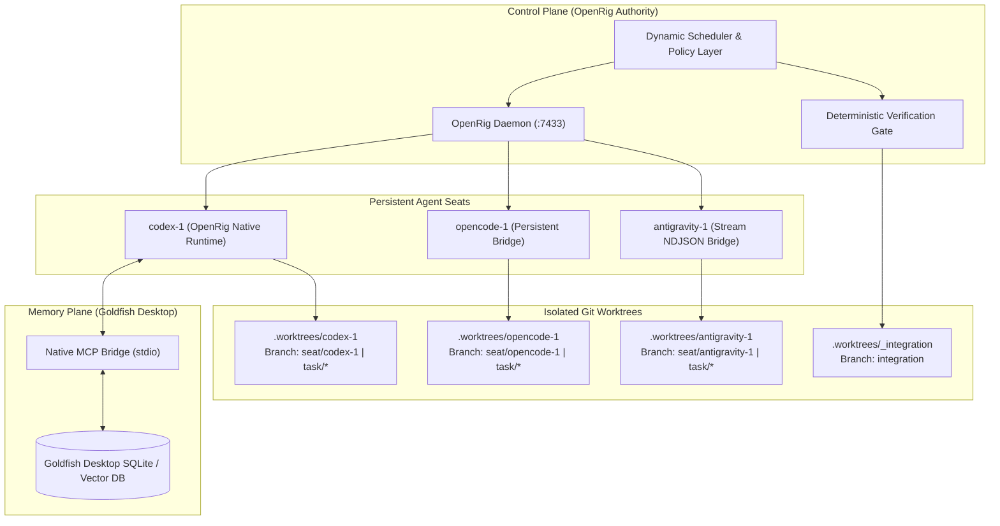
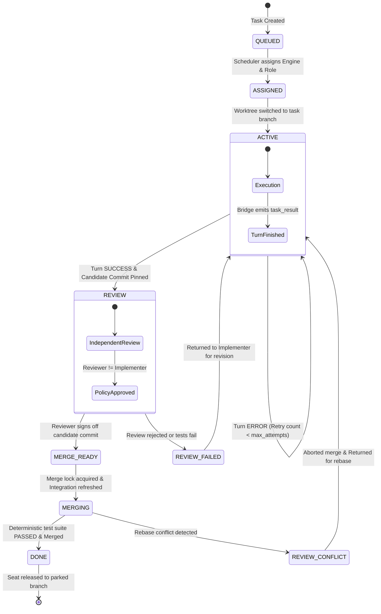

# Boss Rig: Local-First Multi-Agent Coding Orchestration System

[](https://openrig.dev)
[](https://python.org)
[](https://git-scm.com)
[](LICENSE)
[](tests/)

**Boss Rig** is a production-minded, local-first multi-agent coding orchestration system centered exclusively on **OpenRig** as the primary orchestration and control authority.

It coordinates three persistent autonomous coding engines—**Codex**, **OpenCode**, and **Antigravity**—over physically isolated Git worktrees, backed by **Goldfish Desktop** for persistent contextual memory, and enforced by a **deterministic verification and merge gate**.

---

## 🏛️ Core Architectural Principles & Invariants

1. **Single Control Plane (OpenRig Exclusivity)**:
   OpenRig (`@openrig/cli`) is the **sole** orchestration and control authority. No competing orchestrators (e.g., Temporal, Inngest, LangGraph, AutoGen) or multi-agent frameworks are introduced.
2. **Engine Identity != Task Role**:
   Persistent engine identities (`codex-1`, `opencode-1`, `antigravity-1`) are strictly decoupled from transient task roles (`planner`, `implementer`, `reviewer`, `verifier`, `debugger`, `coordinator`). Any engine can perform any role on any task dynamically.
3. **Physical Git Worktree Isolation**:
   Every agent seat operates inside its own persistent Git worktree (`.worktrees/codex-1`, `.worktrees/opencode-1`, `.worktrees/antigravity-1`). Active tasks run on ephemeral task branches (`task/<task_id>`). Released or crashed seats return to dedicated parking branches (`seat/<seat_id>`).
4. **Agent Turn Success is NEVER Software "DONE"**:
   An agent completing its turn transitions the task to `REVIEW`. Only deterministic local verification (test suite execution against the candidate tree) followed by an atomic merge lock and clean merge into `integration` can transition a task to `DONE`.
5. **Independent Review Policy**:
   Self-review is strictly forbidden by policy. If engine $E$ was the implementer on task $T$, the reviewer MUST be an engine $R \ne E$.
6. **Commit-Pinned Verification**:
   The implementer's candidate git commit SHA is pinned before review or verification begins, preventing race conditions or uncommitted worktree drifts.
7. **Process-Group Isolation & Watchdog Enforcement**:
   Persistent bridge processes use process-group sessions (`start_new_session=True`, `os.killpg`) to ensure child timeouts (`SIGTERM` -> `SIGKILL`) cleanly reclaim all child subprocesses without leaving zombie threads or hanging pipes.

---

## 📐 System Architecture

### 1. High-Level Topology



---

### 2. Task Lifecycle State Machine



---

## 🔄 3×3 Interchangeability Matrix

The system enforces complete decoupling between **Engine Identity** and **Task Role**. Every engine is verified across all roles:

| Engine Identity | Planner Role | Implementer Role | Reviewer Role |
| :--- | :---: | :---: | :---: |
| **`codex-1`** | ✅ Verified | ✅ Verified | ✅ Verified |
| **`opencode-1`** | ✅ Verified | ✅ Verified | ✅ Verified |
| **`antigravity-1`** | ✅ Verified | ✅ Verified | ✅ Verified |

*Verified in test suite: `tests/test_interchangeability_matrix.py` (9/9 combinations passing).*

---

## 📂 Repository Structure

```text
Boss_Rig/
├── config/
│   ├── rig.yaml                        # OpenRig seat topology declaration
│   └── agents/                         # Neutral agent role profiles
├── orchestrator/                       # Core orchestration framework
│   ├── __init__.py
│   ├── models.py                       # TaskRecord, TaskState, BridgeEvent schemas
│   ├── policy.py                       # Independent review & commit pinning policy rules
│   ├── dispatcher.py                   # Seat bridge process manager & OpenRig sender
│   └── engine.py                       # High-level task lifecycle coordinator
├── scripts/
│   ├── worktree-gate.sh                # Worktree isolation manager & deterministic gate
│   ├── opencode-seat-runner.sh         # OpenCode persistent seat entrypoint
│   ├── opencode_seat_runner.py         # OpenCode process-group & JSON envelope bridge
│   ├── antigravity-seat-runner.sh      # Antigravity persistent seat entrypoint
│   └── antigravity_seat_runner.py      # Antigravity stream-NDJSON protocol bridge
├── tests/
│   ├── test_worktree_gate.py           # Worktree isolation & merge lock unit tests (5 tests)
│   ├── test_opencode_bridge.py         # OpenCode persistent bridge unit tests (5 tests)
│   ├── test_antigravity_bridge.py      # Antigravity stream bridge unit tests (7 tests)
│   ├── test_scheduler_and_policy.py    # Policy engine & role assignment tests (4 tests)
│   ├── test_interchangeability_matrix.py # 3x3 Engine x Role matrix acceptance tests (9 tests)
│   └── test_end_to_end_workflow.py     # Full multi-role E2E pipeline & crash recovery (2 tests)
├── deep-research-report.md             # Comprehensive architectural research document
├── orchestrator-implementation-plan.md # 8-milestone engineering plan
└── README.md
```

---

## 🚀 Quickstart & Setup

### Prerequisites
- **Operating System**: Linux or WSL2 (Ubuntu 22.04+)
- **Node.js**: v22.x LTS
- **Python**: v3.10+
- **Git**: v2.40+
- **tmux**: v3.2+
- **OpenRig**: `@openrig/cli` (`npm install -g @openrig/cli`)
- **Coding Engines**:
  - `codex` CLI
  - `opencode` CLI
  - `agy` (Antigravity CLI)
  - `goldfish-mcp` (Goldfish Desktop)

---

### 1. Initialize Seats & Worktrees

```bash
# Initialize isolated seat worktrees
./scripts/worktree-gate.sh init-seat codex-1
./scripts/worktree-gate.sh init-seat opencode-1
./scripts/worktree-gate.sh init-seat antigravity-1
```

Each command sets up:
- Persistent directory `.worktrees/<seat_id>/`
- Dedicated parked branch `seat/<seat_id>` tracking `integration`
- Clean git state ready to accept transient task assignments

---

### 2. Launch OpenRig Control Plane

```bash
# Verify environment preflight
rig preflight

# Launch OpenRig daemon and seats
rig up ./rig.yaml --yes
```

---

### 3. Run the Verification Test Suite

Run the full unified test suite across all 6 test modules:

```bash
python3 -m unittest discover -s tests -p 'test_*.py' -v
```

**Expected Output:**
```text
Ran 32 tests in 290.765s

OK
```

---

## 🛠️ CLI & Subsystem Reference

### `scripts/worktree-gate.sh`
The core worktree manager and deterministic merge gate:

```bash
# Provision persistent worktree for an agent seat
./scripts/worktree-gate.sh init-seat <seat_id>

# Switch seat to ephemeral task branch
./scripts/worktree-gate.sh assign <task_id> <seat_id>

# Check current task lifecycle state
./scripts/worktree-gate.sh status <task_id>

# Deterministically verify candidate tree, merge into integration, mark DONE
./scripts/worktree-gate.sh review <task_id> <seat_id> "<verification_test_command>"

# Release seat back to its clean parked branch
./scripts/worktree-gate.sh release <task_id> <seat_id>

# Reset a crashed or dirty seat worktree back to its parked branch
./scripts/worktree-gate.sh reset-seat <seat_id>
```

---

### Bridge Task Envelope Format

Tasks are passed to bridges as single-line NDJSON envelopes:

```json
{
  "task_id": "T-101",
  "role": "implementer",
  "goal": "Implement add(a, b) in calc.py with verification tests",
  "requirements": {
    "filesystem_write": true,
    "shell": true,
    "git": true
  },
  "acceptance_criteria": [
    "calc.py defines add and multiply",
    "verification command passes"
  ],
  "test_commands": [
    "python3 -c 'import calc; assert calc.add(2, 3) == 5'"
  ],
  "attempt": 1,
  "max_attempts": 2,
  "timeout_sec": 60
}
```

### Bridge Output Lifecycle Events

Bridges stream structured events back to the supervisor:

```json
{"version": 1, "source": "bridge", "runtime": "opencode", "seat_id": "opencode-1", "task_id": "T-101", "role": "implementer", "event": "task_started", "status": "RUNNING", "attempt": 1, "data": {}}
{"version": 1, "source": "bridge", "runtime": "opencode", "seat_id": "opencode-1", "task_id": "T-101", "role": "implementer", "event": "progress", "status": "RUNNING", "attempt": 1, "data": {"step": "tool_call"}}
{"version": 1, "source": "bridge", "runtime": "opencode", "seat_id": "opencode-1", "task_id": "T-101", "role": "implementer", "event": "task_result", "status": "SUCCESS", "attempt": 1, "data": {"exit_code": 0}}
```

---

## 🛡️ Failure Modes & Recovery Guarantees

| Failure Scenario | Mitigation & Guarantee |
| :--- | :--- |
| **Agent Hang / Infinite Loop** | Persistent bridge watchdog terminates child process group via `os.killpg(SIGTERM)` followed by `SIGKILL` after timeout, emitting `task_timeout` (exit code 124). Bridge stays alive for subsequent tasks. |
| **Malformed Task Envelope** | Bridge validates incoming JSON schema, safely rejects invalid inputs with `INVALID_JSON` (exit code 2) without crashing the seat runner. |
| **Flaky / Hallucinated "DONE"** | Agent completion transitions task ONLY to `REVIEW`. Software cannot transition to `DONE` without passing the deterministic local test suite. |
| **Concurrent Merge Collisions** | Atomic `mkdir`-based merge lock (`.merge.lock`) ensures exactly one merge transaction at a time against `integration`. |
| **Dirty Seat Worktree Crash** | `reset-seat <seat>` forcefully cleans uncommitted files (`git clean -fd`), resets to `HEAD`, and switches back to the parked seat branch. |

---

## 📄 License
This project is licensed under the MIT License - see the [LICENSE](LICENSE) file for details.
