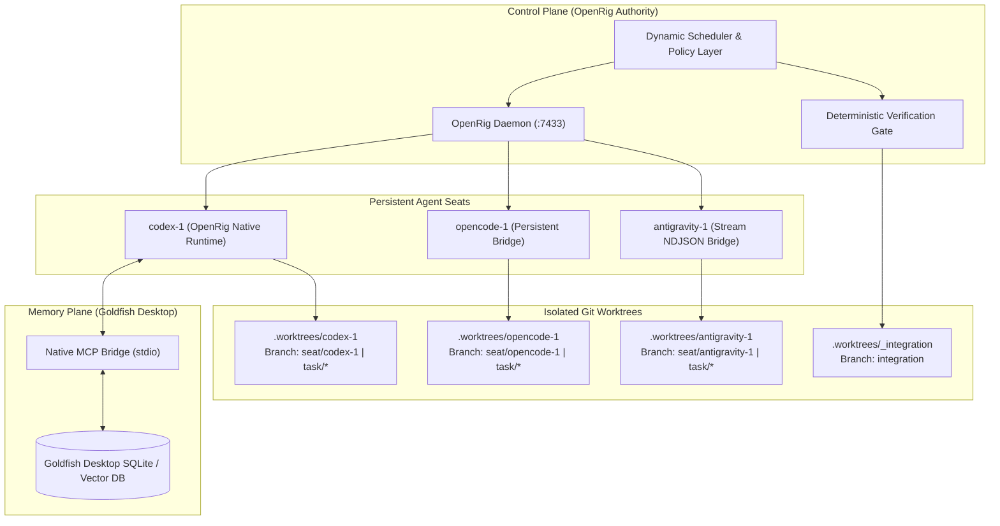
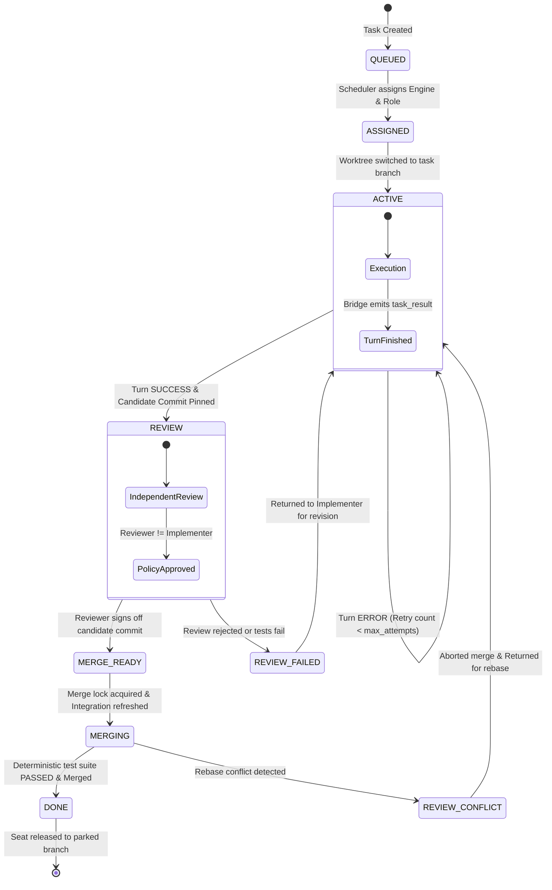
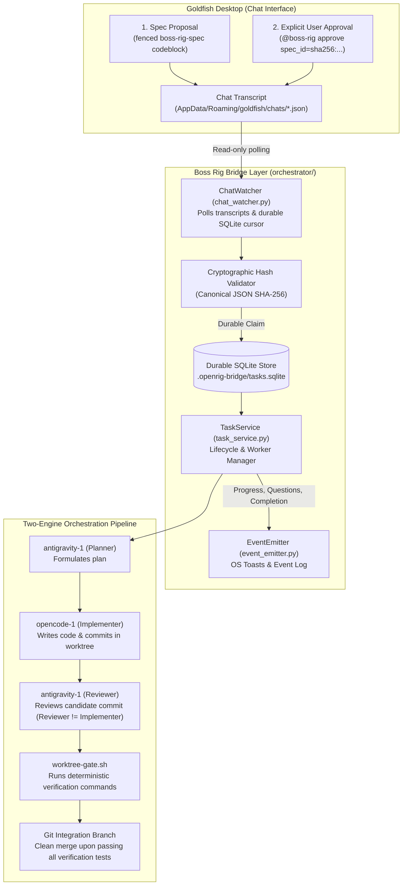

# Boss Rig: Local-First Multi-Agent Coding Orchestration System

[](https://openrig.dev)
[](https://python.org)
[](https://git-scm.com)
[](LICENSE)
[](tests/)

**Boss Rig** is a production-minded, local-first multi-agent coding orchestration system centered exclusively on **OpenRig** as the primary orchestration and control authority.

It coordinates three persistent autonomous coding engines—**Codex**, **OpenCode**, and **Antigravity**—over physically isolated Git worktrees, backed by **Goldfish Desktop** for persistent contextual memory, and enforced by a **deterministic verification and merge gate**.

---

## 🏛️ Core Architectural Principles & Invariants

1. **Single Control Plane (OpenRig Exclusivity)**:
   OpenRig (`@openrig/cli`) is the **sole** orchestration and control authority. No competing orchestrators (e.g., Temporal, Inngest, LangGraph, AutoGen) or multi-agent frameworks are introduced.
2. **Engine Identity != Task Role**:
   Persistent engine identities (`codex-1`, `opencode-1`, `antigravity-1`) are strictly decoupled from transient task roles (`planner`, `implementer`, `reviewer`, `verifier`, `debugger`, `coordinator`). Any engine can perform any role on any task dynamically.
3. **Physical Git Worktree Isolation**:
   Every agent seat operates inside its own persistent Git worktree (`.worktrees/codex-1`, `.worktrees/opencode-1`, `.worktrees/antigravity-1`). Active tasks run on ephemeral task branches (`task/<task_id>`). Released or crashed seats return to dedicated parking branches (`seat/<seat_id>`).
4. **Agent Turn Success is NEVER Software "DONE"**:
   An agent completing its turn transitions the task to `REVIEW`. Only deterministic local verification (test suite execution against the candidate tree) followed by an atomic merge lock and clean merge into `integration` can transition a task to `DONE`.
5. **Independent Review Policy**:
   Self-review is strictly forbidden by policy. If engine $E$ was the implementer on task $T$, the reviewer MUST be an engine $R \ne E$.
6. **Commit-Pinned Verification**:
   The implementer's candidate git commit SHA is pinned before review or verification begins, preventing race conditions or uncommitted worktree drifts.
7. **Process-Group Isolation & Watchdog Enforcement**:
   Persistent bridge processes use process-group sessions (`start_new_session=True`, `os.killpg`) to ensure child timeouts (`SIGTERM` -> `SIGKILL`) cleanly reclaim all child subprocesses without leaving zombie threads or hanging pipes.

---

## 📐 System Architecture

### 1. High-Level Topology



---

### 2. Task Lifecycle State Machine



---

## 🔄 3×3 Interchangeability Matrix

The system enforces complete decoupling between **Engine Identity** and **Task Role**. Every engine is verified across all roles:

| Engine Identity | Planner Role | Implementer Role | Reviewer Role |
| :--- | :---: | :---: | :---: |
| **`codex-1`** | ✅ Verified | ✅ Verified | ✅ Verified |
| **`opencode-1`** | ✅ Verified | ✅ Verified | ✅ Verified |
| **`antigravity-1`** | ✅ Verified | ✅ Verified | ✅ Verified |

*Verified in test suite: `tests/test_interchangeability_matrix.py` (9/9 combinations passing).*

---

## 📂 Repository Structure

```text
Boss_Rig/
├── config/
│   ├── rig.yaml                        # OpenRig seat topology declaration
│   └── agents/                         # Neutral agent role profiles
├── orchestrator/                       # Core orchestration framework & bridge services
│   ├── __init__.py
│   ├── models.py                       # TaskRecord, TaskSpec, TaskState, BridgeEvent schemas
│   ├── policy.py                       # Independent review, commit pinning & repo path checks
│   ├── store.py                        # Durable SQLite task, cursor & event store (tasks.sqlite)
│   ├── task_service.py                 # Core bridge task coordinator & worker thread manager
│   ├── chat_watcher.py                 # Goldfish transcript file watcher & spec hash validator
│   ├── server.py                       # Authenticated REST API daemon (localhost:7440)
│   ├── mcp_server.py                   # Model Context Protocol (MCP) server for Boss Rig tools
│   ├── bridge_cli.py                   # Unified CLI for watcher, server, and task management
│   ├── event_emitter.py                # OS notifications & out-of-band JSON event logging
│   ├── security.py                     # Recursive process-tree killer & path normalizer
│   ├── dispatcher.py                   # Seat bridge process manager & OpenRig sender
│   └── engine.py                       # High-level task lifecycle coordinator
├── scripts/
│   ├── worktree-gate.sh                # Worktree isolation manager & deterministic gate
│   ├── opencode-seat-runner.sh         # OpenCode persistent seat entrypoint
│   ├── opencode_seat_runner.py         # OpenCode process-group & JSON envelope bridge
│   ├── antigravity-seat-runner.sh      # Antigravity persistent seat entrypoint
│   └── antigravity_seat_runner.py      # Antigravity stream-NDJSON protocol bridge
├── tests/
│   ├── test_bridge_e2e.py              # End-to-end watcher, spec hash, recovery & safety tests (18 tests)
│   ├── test_server_api.py              # REST API bearer authentication & endpoint tests (4 tests)
│   ├── test_mcp_server.py              # Native stdio MCP server tools test (1 test)
│   ├── test_worktree_gate.py           # Worktree isolation & merge lock unit tests (5 tests)
│   ├── test_opencode_bridge.py         # OpenCode persistent bridge unit tests (5 tests)
│   ├── test_antigravity_bridge.py      # Antigravity stream bridge unit tests (7 tests)
│   ├── test_scheduler_and_policy.py    # Policy engine & role assignment tests (4 tests)
│   ├── test_store_and_idempotency.py   # SQLite storage, transitions & event deduplication (6 tests)
│   ├── test_interchangeability_matrix.py # 3x3 Engine x Role matrix acceptance tests (9 tests)
│   └── test_end_to_end_workflow.py     # Full multi-role E2E pipeline & crash recovery (2 tests)
├── deep-research-report.md             # Comprehensive architectural research document
├── orchestrator-implementation-plan.md # 8-milestone engineering plan
└── README.md
```

---

## 🌉 Goldfish → Boss Rig Execution Bridge

### 1. Architectural Overview & Context
Goldfish Desktop provides persistent contextual memory and chat capabilities, but (as of v0.1.63) does not support outbound shell execution, custom chat-tool registration, or direct orchestrator dispatch.

To enable Jacob to develop specifications inside Goldfish and have Boss Rig execute them autonomously without manual copy-paste, Boss Rig provides a **durable, filesystem-based execution bridge**:



### 2. Cryptographic Spec Proposal & Approval Flow
Execution requires a two-step explicit protocol to ensure that assistant text, historical quotes, or accidental mentions never trigger execution.

#### Step 1: Immutable Specification Proposal
The specification block is formatted inside a fenced `boss-rig-spec` markdown codeblock containing strict JSON:
````markdown
```boss-rig-spec
{
  "acceptance_criteria": [
    "hello.py exists",
    "say_hello() returns 'hello'"
  ],
  "allowed_merge_target": "integration",
  "assigned_agents": {
    "implementer": "opencode-1",
    "planner": "antigravity-1",
    "reviewer": "antigravity-1"
  },
  "constraints": [
    "Do not touch files outside .disposable-live-repo",
    "No network calls in generated application code or verification tests"
  ],
  "goal": "Implement say_hello() function in hello.py returning 'hello'",
  "repo": "C:/Users/jacob/Boss Agent/.disposable-live-repo",
  "spec_version": 1,
  "timeout_sec": 600,
  "verification_commands": [
    "python -c \"import hello; assert hello.say_hello() == 'hello'\""
  ]
}
```
````

The canonical SHA-256 hash is computed deterministically:
$$\text{spec\_id} = \text{sha256}(\text{canonical\_json}(\text{spec\_dict}))$$
*(using `sort_keys=True` and compact separators `(',', ':')`)*.

#### Step 2: Explicit User Approval Command
Only an explicit follow-up message authored by `role: "user"` triggers dispatch:
```text
@boss-rig approve spec_id=sha256:7c0c5a548ae93924417d623e06f77969cd993690f057407d3c094281bc0160b9
```

#### Strict Safety Invariants for Approval Detection:
- **Authorship Verification**: Only messages with `role == "user"` are parsed. Messages with `role == "assistant"` or `role == "system"` are ignored.
- **Quote & Codeblock Stripping**: Markdown blockquotes (`>`) and nested codeblocks are stripped before scanning for `@boss-rig approve` to ensure quoted examples or documentation snippets cannot trigger execution.
- **Startup Baselining**: When the watcher initializes, all existing transcript messages are recorded as `BASELINED` / `IGNORED`. Restarting the watcher will **never** replay historical approvals.
- **Transactional Deduplication**: Approvals are claimed in SQLite (`bridge_processed_events`) with an atomic transaction before dispatch. Replay attempts are rejected with `DUPLICATE_APPROVAL`.

---

### 3. Supported Two-Engine Workflow & Codex Hold Policy
Boss Rig enforces a hardened two-engine operational profile:
1. **Planner**: `antigravity-1` (Antigravity engine)
2. **Implementer**: `opencode-1` (OpenCode engine)
3. **Reviewer**: `antigravity-1` (Antigravity engine)
4. **Independent Review Invariant**: The policy engine strictly enforces $Reviewer \ne Implementer$. Because `antigravity-1` $\ne$ `opencode-1`, this invariant is fully satisfied.
5. **Codex Hold Policy**: The Codex seat (`codex-1`) is placed in persistent `SeatMode.MANUAL_HOLD` in the database. It is **disabled** and will never be scheduled, dispatched, or used as a fallback engine under any circumstances.

---

### 4. Interactive Two-Way Question Loop
When an agent encounters ambiguous requirements, it pauses execution and awaits operator clarification:
1. **Transition to `WAITING_FOR_USER`**: The task worker thread emits a `question_asked` event and enters a wait state on a `threading.Event`.
2. **Question Event**: Stored in `bridge_user_questions` table with a unique `question_id`, `task_id`, and prompt. Dispatched to the operator via OS notifications and EventEmitter.
3. **Operator Answer**: The user answers via CLI or REST API:
   ```bash
   python -m orchestrator.bridge_cli answer <question_id> "<operator_answer_text>"
   ```
4. **Scope Validation & Resumption**: The answer is validated against scope expansion rules (it cannot alter the repository path or core acceptance criteria). The worker thread is unblocked and resumes implementation turn with the answer appended to context.

---

### 5. Security Controls & Sandbox Reality
> [!WARNING]
> **Worktrees are NOT a Security Sandbox**: Git worktrees provide isolated directories and clean Git branches so concurrent agents do not overwrite each other's uncommitted work. However, worktrees do **not** provide kernel sandboxing (namespaces, cgroups, chroot, or network isolation). Agent processes execute on the host with the standard user permissions of the operator account.

Boss Rig enforces strict defense-in-depth controls:
- **Repository Boundary Enforcement**: All file writes and git operations are validated via `normalize_repo_path`. Path traversal attempts (`../`) and paths outside the authorized repository root are rejected with `PolicyViolation`.
- **Target Repository Isolation**: Worktree provisioning, branch checkouts, and merge verification gates strictly target the repository specified in the approved specification (e.g. `.disposable-live-repo`), never Boss Rig's own working tree.
- **Process-Tree Termination**: On cancellation or timeout, `kill_process_tree(pid)` recursively queries the process hierarchy and forcefully terminates all child subprocesses (using `taskkill /F /T` on Windows and `os.killpg` on POSIX) to prevent runaway background compilers or tests.
- **Verification Gate**: Candidate code is evaluated against `verification_commands` inside the candidate tree before any merge lock is acquired. Unverified or failing code can never reach `integration`.

---

### 6. Bridge Service Interfaces

The Boss Rig Bridge provides three transport mechanisms:

#### A. File Watcher CLI (`orchestrator/bridge_cli.py`)
```bash
# Start watcher in safe dry-run mode (default, logs detections without dispatching agents)
python -m orchestrator.bridge_cli watch --interval 0.5

# Start watcher in live execution mode
python -m orchestrator.bridge_cli watch --live --interval 0.5

# Inspect active bridge tasks and questions
python -m orchestrator.bridge_cli status
python -m orchestrator.bridge_cli questions
```

#### B. Authenticated REST API (`orchestrator/server.py`)
```bash
# Start REST server on default localhost:7440
python -m orchestrator.bridge_cli serve --port 7440
```
- **Authentication**: Requires `Authorization: Bearer <token>` (stored at `.openrig-bridge/auth.token`).
- **Endpoints**:
  - `GET /health`: Health and engine status check.
  - `POST /tasks`: Submit and claim task.
  - `GET /tasks/<id>`: Retrieve task record and lifecycle state.
  - `POST /tasks/<id>/cancel`: Abort task and terminate child process tree.
  - `GET /questions`: List pending questions.
  - `POST /questions/<id>/answer`: Submit answer and resume waiting task.

#### C. Model Context Protocol (MCP) Server (`orchestrator/mcp_server.py`)
Exposes Boss Rig directly to MCP-compatible host applications over stdio:
- Tools: `submit_task`, `approve_task`, `get_task_status`, `list_tasks`, `ask_user_question`, `answer_question`, `cancel_task`.

---

### 7. Current Status & Known Limitations

| Component | Status | Verification & Limitations |
| :--- | :---: | :--- |
| **Chat Watcher** | ✅ **Verified** | Verified live in dry-run with actual Goldfish transcript files. Ignores assistant messages, blockquotes, and historical baseline. |
| **Spec Hash Validation** | ✅ **Verified** | Canonical JSON SHA-256 calculation matches across watcher and task submission. |
| **Two-Engine Workflow** | ✅ **Verified** | Antigravity (plan/review) + OpenCode (implement), Reviewer $\ne$ Implementer enforced, Codex on `MANUAL_HOLD`. |
| **Question Loop** | ✅ **Verified** | Verified with CLI and REST API answering loops; scope expansion guarded. |
| **Crash Recovery & Cancel** | ✅ **Verified** | Process tree killed cleanly; state recovered from SQLite without task replay. |
| **Same-Chat Delivery** | ⚠️ **Limitation** | Goldfish Desktop v0.1.63 lacks outbound tool calling or bidirectional chat injection. Results are emitted via OS notifications and EventEmitter fallback. Same-chat delivery remains blocked pending Goldfish host tool support. |

---

## 🚀 Quickstart & Setup

### Prerequisites
- **Operating System**: Linux or WSL2 (Ubuntu 22.04+)
- **Node.js**: v22.x LTS
- **Python**: v3.10+
- **Git**: v2.40+
- **tmux**: v3.2+
- **OpenRig**: `@openrig/cli` (`npm install -g @openrig/cli`)
- **Coding Engines**:
  - `codex` CLI
  - `opencode` CLI
  - `agy` (Antigravity CLI)
  - `goldfish-mcp` (Goldfish Desktop)

---

### 1. Initialize Seats & Worktrees

```bash
# Initialize isolated seat worktrees
./scripts/worktree-gate.sh init-seat codex-1
./scripts/worktree-gate.sh init-seat opencode-1
./scripts/worktree-gate.sh init-seat antigravity-1
```

Each command sets up:
- Persistent directory `.worktrees/<seat_id>/`
- Dedicated parked branch `seat/<seat_id>` tracking `integration`
- Clean git state ready to accept transient task assignments

---

### 2. Launch OpenRig Control Plane

```bash
# Verify environment preflight
rig preflight

# Launch OpenRig daemon and seats
rig up ./rig.yaml --yes
```

---

### 3. Run the Verification Test Suite

Run the full unified test suite across all 6 test modules:

```bash
python3 -m unittest discover -s tests -p 'test_*.py' -v
```

**Expected Output:**
```text
Ran 32 tests in 290.765s

OK
```

---

## 🛠️ CLI & Subsystem Reference

### `scripts/worktree-gate.sh`
The core worktree manager and deterministic merge gate:

```bash
# Provision persistent worktree for an agent seat
./scripts/worktree-gate.sh init-seat <seat_id>

# Switch seat to ephemeral task branch
./scripts/worktree-gate.sh assign <task_id> <seat_id>

# Check current task lifecycle state
./scripts/worktree-gate.sh status <task_id>

# Deterministically verify candidate tree, merge into integration, mark DONE
./scripts/worktree-gate.sh review <task_id> <seat_id> "<verification_test_command>"

# Release seat back to its clean parked branch
./scripts/worktree-gate.sh release <task_id> <seat_id>

# Reset a crashed or dirty seat worktree back to its parked branch
./scripts/worktree-gate.sh reset-seat <seat_id>
```

---

### Bridge Task Envelope Format

Tasks are passed to bridges as single-line NDJSON envelopes:

```json
{
  "task_id": "T-101",
  "role": "implementer",
  "goal": "Implement add(a, b) in calc.py with verification tests",
  "requirements": {
    "filesystem_write": true,
    "shell": true,
    "git": true
  },
  "acceptance_criteria": [
    "calc.py defines add and multiply",
    "verification command passes"
  ],
  "test_commands": [
    "python3 -c 'import calc; assert calc.add(2, 3) == 5'"
  ],
  "attempt": 1,
  "max_attempts": 2,
  "timeout_sec": 60
}
```

### Bridge Output Lifecycle Events

Bridges stream structured events back to the supervisor:

```json
{"version": 1, "source": "bridge", "runtime": "opencode", "seat_id": "opencode-1", "task_id": "T-101", "role": "implementer", "event": "task_started", "status": "RUNNING", "attempt": 1, "data": {}}
{"version": 1, "source": "bridge", "runtime": "opencode", "seat_id": "opencode-1", "task_id": "T-101", "role": "implementer", "event": "progress", "status": "RUNNING", "attempt": 1, "data": {"step": "tool_call"}}
{"version": 1, "source": "bridge", "runtime": "opencode", "seat_id": "opencode-1", "task_id": "T-101", "role": "implementer", "event": "task_result", "status": "SUCCESS", "attempt": 1, "data": {"exit_code": 0}}
```

---

## 🛡️ Failure Modes & Recovery Guarantees

| Failure Scenario | Mitigation & Guarantee |
| :--- | :--- |
| **Agent Hang / Infinite Loop** | Persistent bridge watchdog terminates child process group via `os.killpg(SIGTERM)` followed by `SIGKILL` after timeout, emitting `task_timeout` (exit code 124). Bridge stays alive for subsequent tasks. |
| **Malformed Task Envelope** | Bridge validates incoming JSON schema, safely rejects invalid inputs with `INVALID_JSON` (exit code 2) without crashing the seat runner. |
| **Flaky / Hallucinated "DONE"** | Agent completion transitions task ONLY to `REVIEW`. Software cannot transition to `DONE` without passing the deterministic local test suite. |
| **Concurrent Merge Collisions** | Atomic `mkdir`-based merge lock (`.merge.lock`) ensures exactly one merge transaction at a time against `integration`. |
| **Dirty Seat Worktree Crash** | `reset-seat <seat>` forcefully cleans uncommitted files (`git clean -fd`), resets to `HEAD`, and switches back to the parked seat branch. |

---

## 🛠️ Boss Rig Operator CLI & Daily Operations

Boss Rig provides a production CLI for controlling the orchestrator and inspecting seat state:

```bash
# 1. Bootstrap environment and seats
./scripts/bootstrap.sh

# 2. Inspect active seats, branches, and task summary
./scripts/boss-orchestrator status

# 3. Run an autonomous feature workflow
./scripts/boss-orchestrator run "Implement string utility" \
  --verify "python3 -c 'import string_util; assert string_util.clean(\" A \") == \"A\"'" \
  --planner antigravity-1 \
  --implementer opencode-1 \
  --reviewer codex-1

# 4. Show task record, transitions, and audit provenance
./scripts/boss-orchestrator task show <task_id>

# 5. Pause, resume, or cancel tasks
./scripts/boss-orchestrator pause <task_id>
./scripts/boss-orchestrator resume <task_id>
./scripts/boss-orchestrator stop <task_id>

# 6. Reclaim stale locks and recover crashed seats
./scripts/boss-orchestrator recover --force
```

For detailed daily operational walkthroughs, see the **[Operator Guide](docs/OPERATOR_GUIDE.md)**.

---

## 📊 Live Verification Reports & Evidence

All multi-agent capabilities are proven against real models in isolated Git worktrees:

- **[Live 3×3 Interchangeability Matrix Report](docs/LIVE_INTERCHANGEABILITY_REPORT.md)**: Proves `ENGINE != ROLE` across all 9 combinations of `codex-1`, `opencode-1`, and `antigravity-1` in `planner`, `implementer`, and `reviewer` roles.
- **[Live Role-Rotated End-to-End Workflow Report](docs/LIVE_E2E_REPORT.md)**: Documents Workflows A, B, and C with full candidate commit pinning, independent review enforcement, and deterministic gate pass.
- **[Live Concurrency & Lock Contention Report](docs/LIVE_CONCURRENCY_REPORT.md)**: Proves 3-way simultaneous task execution, atomic merge lock contention, and automatic integration revalidation.

---

## 📄 License
This project is licensed under the MIT License - see the [LICENSE](LICENSE) file for details.
