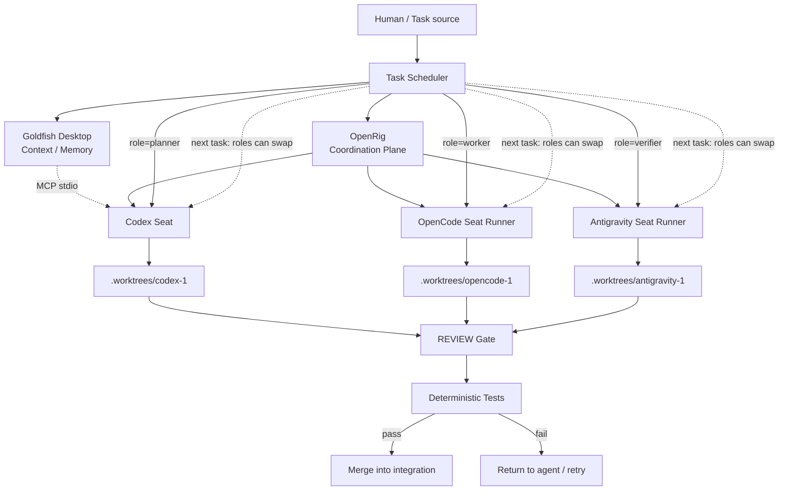
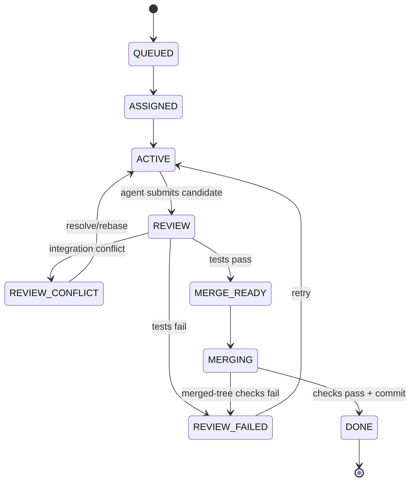
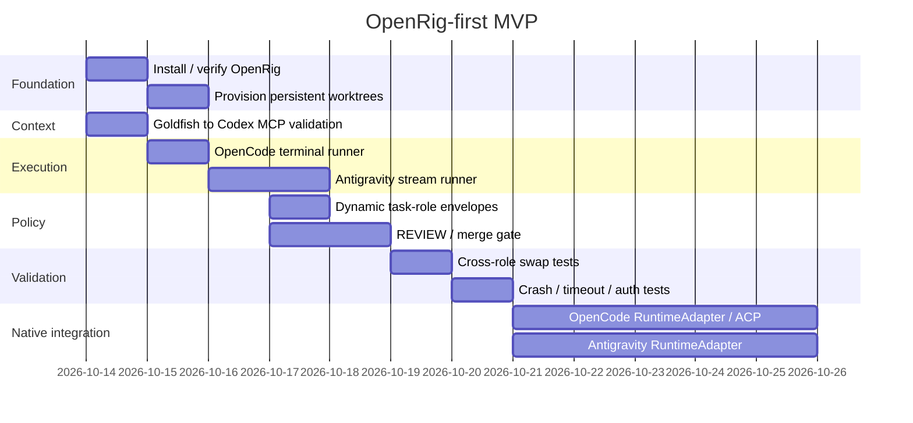

# OpenRig-First Multi-Agent Coding Orchestration: Design, Validation, and Implementation Report

## Executive summary

The best architecture for your requirements is **not** “replace OpenRig with another orchestrator.” It is:

> **OpenRig = persistent team/control plane**  
> **Goldfish = shared historical memory/context plane**  
> **Codex / OpenCode / Antigravity = interchangeable execution engines**  
> **Git worktrees + deterministic tests = safety boundary**

That distinction matters. OpenRig already has the difficult “keep a team of agents alive and addressable” machinery: a local Hono daemon, SQLite state, tmux sessions, RigSpec topology, persistent seats, messaging, queues, restore/snapshot behavior, MCP access, and runtime adapters. Its current upstream runtimes are Claude Code, Codex, Pi, OMP, terminal, and stub; OpenCode and Antigravity are **not currently upstream native runtimes**. citeturn14view2turn14view4

Your uploaded research reached essentially the same architectural conclusion and correctly corrected the OpenRig database location to `$OPENRIG_HOME/openrig.sqlite`, usually `~/.openrig/openrig.sqlite`, rather than `~/.openrig/openrig.db`. fileciteturn0file0 OpenRig's current architecture confirms that path and says the database runs with WAL mode and foreign keys. citeturn14view2

The biggest conceptual change I recommend is this:

**Do not encode “Codex = lead, OpenCode = worker, Antigravity = verifier” into your topology.**

Instead, create:

```text
codex-1
opencode-1
antigravity-1
```

and send each one a task envelope containing:

```json
{
  "task_id": "T-104",
  "role": "verifier",
  "goal": "...",
  "repo": "...",
  "base_branch": "integration",
  "acceptance_criteria": ["..."],
  "test_commands": ["npm test"],
  "max_attempts": 2
}
```

Tomorrow that same `opencode-1` seat could receive `"role": "planner"`, while Antigravity receives `"role": "worker"` and Codex receives `"role": "verifier"`.

This is especially important because OpenRig's current RigSpec `role` field is a **seat-side static role declaration** used for role resolution. It is optional for normal agent seats, and it is explicitly rejected for `runtime: terminal` seats. Therefore, using RigSpec's `role` field as your application-level planner/worker/verifier assignment would fight your interchangeability requirement. citeturn13view1turn13view2

### The recommended architecture



Think of this like a classroom:

- **OpenRig is the teacher managing desks.**
- **Codex, OpenCode, and Antigravity are three students.**
- The desks do not say “writer,” “checker,” or “planner.”
- Each new assignment tells a student what job it has *this time*.
- **Goldfish is the class notebook containing what happened yesterday.**
- **Git worktrees are separate exercise books**, so students cannot scribble over each other's work.
- **Tests are the answer key.**
- Saying “I'm finished” means “please check my work,” not “put it into the final book.”

That should be your governing model.

The first milestone should therefore **not** be writing full native OpenRig adapters. Start by proving these four things:

| Proof | What it establishes |
|---|---|
| Codex inside OpenRig can call Goldfish | Context plane works |
| OpenCode wrapper survives multiple tasks | OpenCode execution plane works |
| Antigravity wrapper survives multiple streamed turns and detects `result` | Antigravity execution plane works |
| All three can receive different `role` values in different tasks | Your core interchangeability requirement works |

Only after those succeed should you invest in native `RuntimeAdapter`s.

There is also an important correction to the previous research: **OpenRig issue #824 is not evidence that upstream OpenRig has a broken native Antigravity runtime.** The issue reporter used a fork containing an `agy` adapter derived from PR #348. OpenRig's maintainer explicitly said upstream OpenRig 0.6.3 did **not** contain an `agy` runtime. The one upstream problem confirmed by the maintainer was that continuously repainting terminal programs can look perpetually active because recent terminal motion can upgrade idle/unknown to running. citeturn12view0

So the real missing piece is not “fix OpenRig's existing Antigravity adapter.” The real task is:

> **Create an Antigravity integration, first as a persistent terminal bridge, and eventually as a proper OpenRig RuntimeAdapter.**

The same is true for OpenCode.

## What OpenRig already gives you, and what is genuinely missing

OpenRig is a strong choice precisely because it operates at a lower and more persistent level than most ticket-to-PR orchestrators. Its request path is CLI/TUI/MCP → local Hono daemon → domain services → SQLite/tmux/runtime adapters. It runs an MCP server itself through `rig mcp serve`, uses port 7433 by default for the daemon, and stores state in `$OPENRIG_HOME/openrig.sqlite`. citeturn14view2

Its current product surface includes RigSpec YAML topologies, `rig up`, tmux-managed seats, topology inspection, snapshots/restoration, `rig send`, `rig broadcast`, `rig chatroom`, growing and shrinking rigs, a terminal UI, and MCP tools for agents to manipulate the topology. citeturn14view4

One subtle but very important OpenRig behavior is that:

```bash
rig send some-seat@my-rig "do this task"
```

is **message delivery**, not automatically durable task creation. OpenRig's own onboarding documentation explicitly says sending a message does not itself create a queue item; the receiving agent can record the task in the queue. citeturn14view3

Therefore your architecture should distinguish:

```text
TASK RECORD
    ≠
MESSAGE SENT TO AGENT
```

That is exactly what a reliable orchestrator should do.

A task might exist as:

```json
{
  "task_id": "T-104",
  "state": "ASSIGNED",
  "assigned_seat": "opencode-1"
}
```

while `rig send` is merely the delivery mechanism.

### What OpenRig natively solves

| Capability | OpenRig status | What it means for you |
|---|---:|---|
| Persistent named seats | ✅ Native | Do not rebuild |
| tmux lifecycle | ✅ Native | Do not rebuild |
| SQLite coordination state | ✅ Native | Do not replace with another DB initially |
| RigSpec topology | ✅ Native | Use it |
| Native Codex runtime | ✅ Native | Use immediately |
| Native Claude runtime | ✅ Native | Available if needed |
| Pi / OMP | ✅ Native | Extra future engines |
| Direct terminal nodes | ✅ Native | Ideal MVP substrate for wrappers |
| Agent-to-agent messaging | ✅ Native | Use `rig send` / broadcast / chatroom |
| Queues / owned work | ✅ Native coordination primitive | Use where appropriate |
| Snapshot / restore | ✅ Native | Valuable for persistent teams |
| MCP control surface | ✅ Native | Useful for agents controlling the rig |
| OpenCode runtime | ❌ Not upstream native | Adapter/bridge required |
| Antigravity runtime | ❌ Not upstream native | Adapter/bridge required |
| ACP client | ❌ Not an OpenRig runtime surface today | Future extension |
| Automatic task worktree creation | ⚠️ Not its central task abstraction | Add supervisor |
| Automatic PR/CI feedback loop | ⚠️ Not turnkey | Add CI/supervisor |
| Dynamic task-level semantic roles | ⚠️ Application layer | Add task envelope/scheduler |

OpenRig currently describes six runtime adapter implementations: Claude Code, Codex, Pi, OMP, terminal, and stub. citeturn14view2

### The RuntimeAdapter extension point

This is the most important upstream extension mechanism for you.

Current OpenRig defines the runtime adapter contract around:

```ts
interface RuntimeAdapter {
  readonly runtime: string;

  listInstalled(
    binding: NodeBinding
  ): Promise<InstalledResource[]>;

  project(
    plan: ProjectionPlan,
    binding: NodeBinding
  ): Promise<ProjectionResult>;

  deliverStartup(
    files: ResolvedStartupFile[],
    binding: NodeBinding,
    sendInteractiveText?: (text: string) => Promise<void>
  ): Promise<StartupDeliveryResult>;

  launchHarness(
    binding: NodeBinding,
    opts: {
      name: string;
      resumeToken?: string;
      forkSource?: ForkSource;
    }
  ): Promise<HarnessLaunchResult>;

  checkReady(
    binding: NodeBinding
  ): Promise<ReadinessResult>;
}
```

That is the exact current interface from OpenRig source. The comment calls it a five-method contract: adapters own projection, startup delivery, harness launch/reconciliation, and readiness. citeturn14view0

The terminal adapter is deliberately almost empty: its operations are no-ops, `launchHarness()` immediately succeeds, and `checkReady()` simply returns `{ ready: true }`. citeturn13view5turn13view6

That tells us exactly why terminal wrappers are an excellent **MVP** but an incomplete **production integration**.

Imagine OpenRig asking:

> “Is OpenCode really logged in and ready?”

A terminal adapter says:

> “Well… the shell exists, so yes.”

That is not the same thing.

### What an OpenCode native adapter is missing

A production-quality `OpenCodeRuntimeAdapter` should eventually implement all of these:

| Missing part | Why OpenRig needs it |
|---|---|
| Runtime registration `opencode` | So RigSpec understands `runtime: opencode` |
| Binary/version discovery | Detect whether `opencode` is installed |
| Credential readiness check | Distinguish shell alive from authenticated runtime |
| Startup file projection | Inject OpenRig startup guidance cleanly |
| Harness launch | Start `opencode` in controlled mode |
| Resume/session capture | Restore an OpenCode conversation |
| Readiness detector | Detect login/permission/error gates |
| Input delivery | Send tasks without fragile terminal typing |
| Activity detector | Distinguish idle from working |
| Completion detector | Know when a turn actually finished |
| Permission-state detector | Avoid typing tasks into a confirmation prompt |
| Context/session telemetry | Optional but valuable |
| Scenario tests | Prove restore/readiness/send behavior |
| ACP integration | Best long-term structured transport candidate |

OpenCode provides two particularly useful machine interfaces. `opencode run [message..]` is its noninteractive execution command, supports `--format json`, `--dir`, `--session`, `--continue`, `--attach`, and `--auto`, and can attach to a persistent `opencode serve` backend to avoid restarting MCP infrastructure for every call. citeturn21view1

It also provides:

```bash
opencode acp
```

which launches OpenCode as an ACP-compatible subprocess speaking JSON-RPC over stdin/stdout. citeturn22view2

That makes ACP the more attractive **long-term** integration.

But ACP does not magically make OpenRig support OpenCode. OpenRig still needs something that speaks ACP and maps it into the RuntimeAdapter semantics:

```text
OpenRig RuntimeAdapter
        ↓
ACP client implementation
        ↓ JSON-RPC / stdio
opencode acp
```

So I would **not** build a giant ACP implementation before the MVP. Prove `opencode run` first. Then upgrade.

### What an Antigravity native adapter is missing

Antigravity is similar but its machine-readable stream is already particularly convenient.

A production `AntigravityRuntimeAdapter` needs:

| Missing part | Required behavior |
|---|---|
| Runtime registration `agy` | Native RigSpec seat |
| Binary/version detection | `agy --version` |
| Auth readiness | Detect missing keyring login |
| Headless harness launch | Prefer structured stream over TUI scraping |
| Prompt delivery | Send stream-JSON user envelopes |
| Progress parsing | Parse `step_update` |
| Tool activity | Parse tool steps and `tool_info` |
| Turn completion | Terminal `result` event |
| Result status mapping | SUCCESS / ERROR / WAITING / etc. |
| Conversation ID capture | Resume/restore support |
| Permission-state mapping | sandbox/scoped permissions/bypass |
| Activity events | Tell OpenRig working vs idle truthfully |
| Context usage | Parse usage from stream rather than pane |
| Crash/restart handling | Relaunch stream process |
| Scenario tests | Reboot, permission denial, timeout, auth failure |

This is much cleaner than trying to infer readiness from a constantly repainting Antigravity TUI.

And, again, issue #824 strongly supports that conclusion indirectly: the reporter's fork struggled with activity detection in the interactive TUI, while upstream's maintainer clarified that `agy` was not actually shipped upstream. citeturn12view0

## Integration surfaces and exact configuration

Goldfish is the simplest integration in the whole design.

Goldfish Desktop's official documentation says it exposes a **local stdio MCP server with no arguments**. On macOS the path is usually:

```text
/Applications/Goldfish.app/Contents/MacOS/goldfish-mcp
```

and on Windows usually:

```text
%LOCALAPPDATA%\goldfish\bin\goldfish-mcp.exe
```

Goldfish explicitly lists Codex among the applications it can configure automatically, and its official manual Codex command is:

```bash
codex mcp add goldfish -- /Applications/Goldfish.app/Contents/MacOS/goldfish-mcp
```

citeturn21view0

That resolves an earlier possible confusion: this project is **Goldfish Desktop from goldfish.sh**, not an unrelated GitHub memory project.

### Goldfish to Codex

The lowest-risk setup is simply:

```bash
codex mcp add goldfish -- /Applications/Goldfish.app/Contents/MacOS/goldfish-mcp

codex mcp list
```

Goldfish's documentation says the AI client launches the local MCP process when it first uses a Goldfish tool; Goldfish itself does not have to already be open. citeturn21view0

You can also configure Codex directly in:

```text
~/.codex/config.toml
```

with:

```toml
[mcp_servers.goldfish]
command = "/Applications/Goldfish.app/Contents/MacOS/goldfish-mcp"
startup_timeout_sec = 20
tool_timeout_sec = 60
required = true
default_tools_approval_mode = "prompt"
```

Codex's current official MCP configuration supports `command`, `args`, `startup_timeout_sec`, `tool_timeout_sec`, `required`, tool allow/deny lists, and approval modes including `auto`, `prompt`, `writes`, and `approve`. citeturn22view0turn22view1

During initial testing, I recommend:

```toml
default_tools_approval_mode = "prompt"
```

After you have inspected the available Goldfish tools and are comfortable letting the agent query memory unattended, you could change it to:

```toml
default_tools_approval_mode = "auto"
```

Goldfish warns that although its MCP server is local and accepts connections only from the same machine, anything an external AI client reads from Goldfish becomes part of that client's conversation and therefore falls under that client's privacy behavior. citeturn21view0

### Goldfish on Windows and WSL

There is one important unverified boundary.

Goldfish officially documents its native Windows executable path. citeturn21view0 OpenRig's current installation model treats WSL2 as the Windows route rather than running its Unix/tmux architecture directly in PowerShell. citeturn14view4

So on Windows you need to test whether a Codex process running inside WSL can reliably launch the native Goldfish Windows MCP executable, for example through a converted `/mnt/c/.../goldfish-mcp.exe` path.

Do not assume that cross-OS launch works until tested.

### OpenCode

Official OpenCode currently provides:

```bash
opencode run "prompt"
opencode run "prompt" --format json
opencode run --dir /repo/worktree "prompt"
opencode run --auto "prompt"
```

and supports attaching `run` calls to a long-running backend:

```bash
opencode serve

opencode run \
  --attach http://localhost:4096 \
  --format json \
  "prompt"
```

citeturn21view1

The second arrangement is attractive once your basic bridge works because the server remains warm.

For the first version, however:

```text
Persistent OpenRig seat runner
        ↓
one `opencode run` child per task
```

is easier to recover from.

The important trick is:

> **The runner stays alive. The OpenCode child is allowed to exit.**

This prevents OpenRig's seat from becoming a one-shot process.

OpenCode also officially stores provider credentials created by:

```bash
opencode auth login
```

at:

```text
~/.local/share/opencode/auth.json
```

and loads that file at startup. citeturn21view1

Therefore, as long as the OpenRig seat executes as the **same OS user with the same effective `HOME`**, you do not need a second login.

Its global configuration lives at:

```text
~/.config/opencode/opencode.json
```

on the usual macOS/Linux user configuration path. citeturn20search0turn20search1

A reasonable unattended baseline is:

```json
{
  "$schema": "https://opencode.ai/config.json",
  "permission": {
    "external_directory": "deny",
    "question": "deny"
  }
}
```

and then launch with:

```bash
opencode run --auto ...
```

`--auto` approves permissions that are not explicitly denied; it does not override explicit denies. citeturn21view1

Do **not** translate “unattended” into “the agent gets the whole machine.” Your worktree boundary should remain part of the security model.

### Antigravity

Antigravity's official one-shot interface is:

```bash
agy -p "your prompt"
```

For machine-readable output:

```bash
agy -p "your prompt" \
  --output-format stream-json
```

For a long-running bidirectional session:

```bash
agy \
  --input-format stream-json \
  --output-format stream-json
```

Then send newline-delimited messages such as:

```json
{"event":"user","message":{"content":"Run the unit tests."}}
```

Google documents the output sequence precisely:

```text
init
step_update
step_update
...
result
```

and says the final `result` object carries the status for the completed turn. Tool calls occur as `step_update` records with `step_type: "tool"` and details under `tool_info`. citeturn22view3

This is important because one earlier hypothesis was to wait for top-level events named `tool_call` or `turn_complete`.

**Do not do that.**

The correct terminal event is:

```json
{
  "event": "result",
  "result": {
    "status": "SUCCESS"
  }
}
```

citeturn22view3

Permission-related headless flags currently include:

```bash
--sandbox
--dangerously-skip-permissions
```

and one-shot runs support:

```bash
--print-timeout 15m
```

citeturn20search5

My production default would be:

```bash
agy ... --sandbox
```

with scoped permissions.

I would **not** make this your default:

```bash
--dangerously-skip-permissions
```

except on disposable worktrees and hosts where unrestricted tool execution is explicitly acceptable.

Antigravity authentication is also no longer an unknown. Google's current documentation explicitly says local `agy` attempts silent login through the native OS secure keyring: Apple Keychain on macOS, Linux Secret Service/D-Bus on Linux, and Windows Credential Manager on Windows. If a valid saved token profile exists, it signs in without opening a browser. citeturn22view4

That means the bridge should run under the same desktop/OS user and environment that authenticated Antigravity.

### Neutral RigSpec

Here is the important design rule:

**The RigSpec identifies execution engines, not permanent semantic jobs.**

Current RigSpec requires `cwd` for members, and terminal seats require the exact combination:

```yaml
agent_ref: builtin:terminal
profile: none
runtime: terminal
```

Terminal members cannot carry a RigSpec `role`. citeturn13view0turn14view1

Therefore:

```yaml
version: "1"
name: interchangeable-coding

summary: >
  OpenRig pool whose runtime seats receive planner, worker,
  reviewer, or verifier roles dynamically per task.

pods:
  - id: engineering
    label: Interchangeable coding engines

    members:
      - id: codex-1
        agent_ref: local:agents/codex-neutral.yaml
        profile: default
        runtime: codex
        cwd: .worktrees/codex-1

      - id: opencode-1
        agent_ref: builtin:terminal
        profile: none
        runtime: terminal
        cwd: .worktrees/opencode-1

      - id: antigravity-1
        agent_ref: builtin:terminal
        profile: none
        runtime: terminal
        cwd: .worktrees/antigravity-1
```

There is intentionally **no**:

```yaml
role: lead
```

or:

```yaml
role: verifier
```

on those seats.

`agents/codex-neutral.yaml` must be a valid AgentSpec available to the installation. I have deliberately not invented an AgentSpec schema here: the RigSpec source verifies that nonterminal `agent_ref`s must resolve through `local:` or `path:` references, so use a valid neutral Codex AgentSpec from your installed OpenRig version rather than pasting a speculative one. citeturn13view0turn14view1

The initial task can still make Codex the lead:

```json
{
  "task_id": "BOOT-001",
  "role": "planner",
  "goal": "Break feature X into independent tasks"
}
```

That makes Codex the coordinator **for that task**, not forever.

Tomorrow:

```json
{
  "task_id": "REVIEW-009",
  "role": "verifier",
  "goal": "Review commit abc123 against the acceptance criteria"
}
```

can go to the same Codex seat.

Before `rig up`, provision the paths:

```bash
mkdir -p .worktrees
```

Then use the worktree supervisor shown later to create:

```text
.worktrees/codex-1
.worktrees/opencode-1
.worktrees/antigravity-1
```

Only after those directories exist should OpenRig launch the seats.

This is important because the current RigSpec makes `cwd` part of the seat binding, and an OpenRig 0.6.4 issue documents that changing RigSpec `cwd` does not relocate an already-existing seat. Treat `cwd` as launch-time seat identity rather than a per-task mutable property. citeturn13view2

## Persistent OpenCode and Antigravity runners

The wrappers below implement the **MVP bridge layer**, not the final OpenRig native adapters.

They preserve the OpenRig seat process while spawning or maintaining the coding engine underneath it.

The scripts below were additionally syntax-checked during this analysis with `bash -n` and Python bytecode compilation. That proves syntax, **not** real-provider end-to-end behavior. You still need the validation tests in the final section.

### OpenCode persistent seat runner

Message format:

```json
{
  "task_id": "T-104",
  "role": "worker",
  "goal": "Implement refresh-token rotation",
  "repo": "my-service",
  "base_branch": "integration",
  "acceptance_criteria": [
    "old refresh token is rejected after rotation",
    "all auth tests pass"
  ],
  "test_commands": [
    "npm test"
  ],
  "max_attempts": 2,
  "timeout_sec": 1800
}
```

The runner intentionally treats OpenCode's exit status as **agent-turn completion**, not merge authorization.

```bash
#!/usr/bin/env bash
set -uo pipefail

SEAT_ID="${OPENRIG_SEAT_ID:-opencode-1}"
NOTIFY_SEAT="${OPENRIG_NOTIFY_SEAT:-}"
RUNTIME_DIR="${XDG_RUNTIME_DIR:-${TMPDIR:-/tmp}}"
SAFE_SEAT="${SEAT_ID//[^A-Za-z0-9_.-]/_}"

FIFO="${OPENCODE_SEAT_FIFO:-$RUNTIME_DIR/openrig-$SAFE_SEAT.fifo}"
LOG="${OPENCODE_SEAT_LOG:-$PWD/.openrig-opencode-seat.log}"

AUTH_FILE="${OPENCODE_AUTH_FILE:-$HOME/.local/share/opencode/auth.json}"
DEFAULT_TIMEOUT="${OPENCODE_TASK_TIMEOUT_SEC:-1800}"

LAST_RC=0
FEEDER_PID=""
CURRENT_CHILD=""
WATCHDOG_PID=""

need() {
  command -v "$1" >/dev/null 2>&1 || {
    echo "missing required command: $1" >&2
    exit 127
  }
}

need opencode
need jq

if [[ ! -r "$AUTH_FILE" ]]; then
  echo "warning: OpenCode auth file not readable at $AUTH_FILE" >&2
  echo "run 'opencode auth login' as this OS user if authentication fails" >&2
fi

rm -f "$FIFO"
mkfifo -m 600 "$FIFO"

event() {
  local name="$1"
  local task_id="$2"
  local role="$3"
  local rc="${4:-}"
  local status="${5:-}"

  local payload line

  payload="$(
    jq -cn \
      --arg runtime opencode \
      --arg seat "$SEAT_ID" \
      --arg event "$name" \
      --arg task_id "$task_id" \
      --arg role "$role" \
      --arg status "$status" \
      --argjson exit_code "${rc:-null}" \
      '{
        v: 1,
        runtime: $runtime,
        seat: $seat,
        event: $event,
        task_id: $task_id,
        role: $role,
        status: $status,
        exit_code: $exit_code
      }'
  )"

  line="BRIDGE_EVENT $payload"

  printf '%s\n' "$line"

  if [[ -n "$NOTIFY_SEAT" ]] && command -v rig >/dev/null 2>&1; then
    rig send "$NOTIFY_SEAT" "$line" >/dev/null 2>&1 || true
  fi
}

cleanup() {
  trap - EXIT INT TERM HUP

  [[ -n "$WATCHDOG_PID" ]] &&
    kill "$WATCHDOG_PID" 2>/dev/null || true

  [[ -n "$CURRENT_CHILD" ]] &&
    kill "$CURRENT_CHILD" 2>/dev/null || true

  [[ -n "$FEEDER_PID" ]] &&
    kill "$FEEDER_PID" 2>/dev/null || true

  rm -f "$FIFO"
}

trap cleanup EXIT INT TERM HUP

# rig send types a line into the terminal.
# This background process is the only reader of that terminal.
# OpenCode itself receives /dev/null on stdin.
(
  while IFS= read -r line; do
    [[ -z "$line" ]] && continue
    printf '%s\n' "$line" > "$FIFO" || exit 0
  done
) &

FEEDER_PID=$!

SEQ=0

while true; do
  IFS= read -r message < "$FIFO" || continue

  case "$message" in
    :quit|:exit)
      break
      ;;
  esac

  SEQ=$((SEQ + 1))

  if [[ "$message" == \{* ]]; then
    if ! jq -e . >/dev/null 2>&1 <<<"$message"; then
      event task_result "$SEAT_ID-$SEQ" unknown 2 INVALID_JSON
      continue
    fi

    task_id="$(jq -r '.task_id // empty' <<<"$message")"
    role="$(jq -r '.role // "worker"' <<<"$message")"
    timeout_sec="$(jq -r '.timeout_sec // empty' <<<"$message")"

    [[ -n "$task_id" ]] || task_id="$SEAT_ID-$SEQ"

    [[ "$timeout_sec" =~ ^[0-9]+$ ]] ||
      timeout_sec="$DEFAULT_TIMEOUT"

    prompt="You are an interchangeable OpenRig seat.
The role for THIS task is '$role'; it is not your permanent identity.
Execute this task envelope exactly.
Stay inside the current worktree.
Report evidence:
- changed files
- commands/tests run
- commit SHA
- unresolved risks

TASK_ENVELOPE=$message"

  else
    # Convenient manual fallback.
    task_id="$SEAT_ID-$SEQ"
    role="worker"
    timeout_sec="$DEFAULT_TIMEOUT"
    prompt="$message"
  fi

  event task_started "$task_id" "$role" null RUNNING

  timeout_marker="${RUNTIME_DIR}/openrig-${SAFE_SEAT}-${SEQ}.timeout"
  rm -f "$timeout_marker"

  cmd=(
    opencode
    run
    --dir "$PWD"
    --format json
    --auto
  )

  # Optional optimization:
  # export OPENCODE_ATTACH_URL=http://127.0.0.1:4096
  if [[ -n "${OPENCODE_ATTACH_URL:-}" ]]; then
    cmd+=(--attach "$OPENCODE_ATTACH_URL")
  fi

  cmd+=("$prompt")

  "${cmd[@]}" \
    </dev/null \
    > >(tee -a "$LOG") \
    2> >(tee -a "$LOG" >&2) &

  CURRENT_CHILD=$!

  (
    sleep "$timeout_sec"

    if kill -0 "$CURRENT_CHILD" 2>/dev/null; then
      : > "$timeout_marker"

      kill -TERM "$CURRENT_CHILD" 2>/dev/null || true
      sleep 5
      kill -KILL "$CURRENT_CHILD" 2>/dev/null || true
    fi
  ) &

  WATCHDOG_PID=$!

  wait "$CURRENT_CHILD"
  rc=$?
  CURRENT_CHILD=""

  kill "$WATCHDOG_PID" 2>/dev/null || true
  wait "$WATCHDOG_PID" 2>/dev/null || true
  WATCHDOG_PID=""

  if [[ -f "$timeout_marker" ]]; then
    rc=124
    rm -f "$timeout_marker"
    status=TIMEOUT

  elif [[ "$rc" -eq 0 ]]; then
    status=SUCCESS

  else
    status=ERROR
  fi

  LAST_RC=$rc

  event task_result \
    "$task_id" \
    "$role" \
    "$rc" \
    "$status"
done

exit "$LAST_RC"
```

OpenCode supports precisely the `run`, `--format json`, `--dir`, `--attach`, and `--auto` surfaces used here. citeturn21view1 Its auth file path is also documented as `~/.local/share/opencode/auth.json`. citeturn21view1

Start it after the terminal seat exists:

```bash
rig send opencode-1@interchangeable-coding \
  './scripts/opencode-seat-runner.sh'
```

Then send:

```bash
rig send opencode-1@interchangeable-coding \
'{"task_id":"T-1","role":"planner","goal":"Inspect the repository and propose three independent implementation tasks","base_branch":"integration","acceptance_criteria":["Return a dependency-aware task plan"],"test_commands":[],"max_attempts":1,"timeout_sec":900}'
```

Later, same seat:

```bash
rig send opencode-1@interchangeable-coding \
'{"task_id":"T-2","role":"verifier","goal":"Review the current branch against the acceptance criteria","base_branch":"integration","acceptance_criteria":["No regression","Tests pass"],"test_commands":["npm test"],"max_attempts":1,"timeout_sec":900}'
```

That is role interchangeability.

**What the wrapper still cannot tell OpenRig natively:** provider readiness, native session resume, context usage, OpenCode-specific activity/idle, or whether a permission error occurred beyond the process/output. Those are reasons to eventually replace this wrapper with a real RuntimeAdapter.

### Antigravity persistent JSON-stream bridge

This bridge uses Google's actual stream protocol rather than trying to scrape the interactive TUI.

It deliberately correlates a result with the OpenRig task **inside the bridge**, because Google's stream uses its own `conversation_id`, not your `task_id`.

```python
#!/usr/bin/env python3

from __future__ import annotations

import json
import os
import selectors
import subprocess
import sys
import threading
import time
from dataclasses import dataclass
from typing import Any, TextIO


SEAT_ID = os.environ.get(
    "OPENRIG_SEAT_ID",
    "antigravity-1",
)

NOTIFY_SEAT = os.environ.get(
    "OPENRIG_NOTIFY_SEAT",
    "",
)

DEFAULT_TIMEOUT = int(
    os.environ.get(
        "AGY_TASK_TIMEOUT_SEC",
        "1800",
    )
)

HEARTBEAT_SEC = int(
    os.environ.get(
        "AGY_HEARTBEAT_SEC",
        "20",
    )
)

# Recommended default:
# different task_id => new Antigravity conversation.
#
# This prevents task A's planner conversation from leaking into
# task B where the same seat may now be acting as verifier.
RESET_ON_TASK_CHANGE = (
    os.environ.get("AGY_SESSION_SCOPE", "task")
    == "task"
)


def bridge_event(
    name: str,
    task_id: str,
    role: str,
    **extra: Any,
) -> None:
    payload = {
        "v": 1,
        "runtime": "antigravity",
        "seat": SEAT_ID,
        "event": name,
        "task_id": task_id,
        "role": role,
        **extra,
    }

    line = (
        "BRIDGE_EVENT "
        + json.dumps(
            payload,
            separators=(",", ":"),
            ensure_ascii=False,
        )
    )

    print(line, flush=True)

    if NOTIFY_SEAT:
        try:
            subprocess.run(
                [
                    "rig",
                    "send",
                    NOTIFY_SEAT,
                    line,
                ],
                stdin=subprocess.DEVNULL,
                stdout=subprocess.DEVNULL,
                stderr=subprocess.DEVNULL,
                check=False,
            )
        except FileNotFoundError:
            pass


def pump_stderr(pipe: TextIO) -> None:
    for line in pipe:
        sys.stderr.write(line)
        sys.stderr.flush()


@dataclass
class AgyProcess:
    proc: subprocess.Popen[str]
    selector: selectors.BaseSelector

    @classmethod
    def start(cls) -> "AgyProcess":
        args = [
            "agy",
            "--input-format",
            "stream-json",
            "--output-format",
            "stream-json",
        ]

        # Safer default.
        if os.environ.get("AGY_SANDBOX", "1") == "1":
            args.append("--sandbox")

        # Explicit opt-in only.
        if (
            os.environ.get(
                "AGY_DANGEROUS_SKIP_PERMISSIONS"
            )
            == "1"
        ):
            args.append(
                "--dangerously-skip-permissions"
            )

        proc = subprocess.Popen(
            args,
            stdin=subprocess.PIPE,
            stdout=subprocess.PIPE,
            stderr=subprocess.PIPE,
            text=True,
            bufsize=1,
        )

        assert proc.stdin is not None
        assert proc.stdout is not None
        assert proc.stderr is not None

        threading.Thread(
            target=pump_stderr,
            args=(proc.stderr,),
            daemon=True,
        ).start()

        selector = selectors.DefaultSelector()
        selector.register(
            proc.stdout,
            selectors.EVENT_READ,
        )

        return cls(
            proc=proc,
            selector=selector,
        )

    def stop(self) -> None:
        try:
            self.selector.close()
        except Exception:
            pass

        if self.proc.poll() is not None:
            return

        try:
            if self.proc.stdin:
                self.proc.stdin.close()
        except Exception:
            pass

        self.proc.terminate()

        try:
            self.proc.wait(timeout=3)
        except subprocess.TimeoutExpired:
            self.proc.kill()
            self.proc.wait(timeout=3)

    def run_turn(
        self,
        prompt: str,
        task_id: str,
        role: str,
        timeout_sec: int,
    ) -> tuple[int, str]:

        if self.proc.poll() is not None:
            return (
                self.proc.returncode or 1,
                "PROCESS_EXIT",
            )

        assert self.proc.stdin is not None
        assert self.proc.stdout is not None

        user_event = {
            "event": "user",
            "message": {
                "content": prompt,
            },
        }

        self.proc.stdin.write(
            json.dumps(
                user_event,
                ensure_ascii=False,
            )
            + "\n"
        )
        self.proc.stdin.flush()

        started = time.monotonic()
        next_heartbeat = (
            started + HEARTBEAT_SEC
        )

        conversation_id: str | None = None

        while True:
            now = time.monotonic()

            if (
                now - started
                >= timeout_sec
            ):
                return 124, "TIMEOUT"

            wait_for = min(
                1.0,
                max(
                    0.05,
                    next_heartbeat - now,
                ),
            )

            ready = self.selector.select(
                timeout=wait_for
            )

            if not ready:
                if self.proc.poll() is not None:
                    return (
                        self.proc.returncode
                        or 1,
                        "PROCESS_EXIT",
                    )

                if (
                    time.monotonic()
                    >= next_heartbeat
                ):
                    bridge_event(
                        "heartbeat",
                        task_id,
                        role,
                        elapsed_sec=int(
                            time.monotonic()
                            - started
                        ),
                    )

                    next_heartbeat = (
                        time.monotonic()
                        + HEARTBEAT_SEC
                    )

                continue

            line = self.proc.stdout.readline()

            if line == "":
                return (
                    self.proc.poll() or 1,
                    "PROCESS_EXIT",
                )

            # Preserve Google's raw NDJSON
            # for debugging and audit.
            sys.stdout.write(line)
            sys.stdout.flush()

            try:
                evt = json.loads(line)
            except json.JSONDecodeError:
                continue

            event_name = evt.get("event")

            if event_name == "init":
                conversation_id = (
                    evt.get(
                        "conversation_id"
                    )
                    or (
                        evt.get("conversation")
                        or {}
                    ).get("id")
                    or conversation_id
                )

                bridge_event(
                    "runtime_ready",
                    task_id,
                    role,
                    conversation_id=(
                        conversation_id
                    ),
                )

                continue

            if event_name == "step_update":
                step = (
                    evt.get("step_update")
                    if isinstance(
                        evt.get(
                            "step_update"
                        ),
                        dict,
                    )
                    else evt
                )

                bridge_event(
                    "progress",
                    task_id,
                    role,
                    step_type=step.get(
                        "step_type"
                    ),
                    tool_name=step.get(
                        "tool_name"
                    ),
                )

                continue

            if event_name != "result":
                continue

            result = (
                evt.get("result")
                if isinstance(
                    evt.get("result"),
                    dict,
                )
                else evt
            )

            status = str(
                result.get(
                    "status",
                    "UNKNOWN",
                )
            ).upper()

            conversation_id = (
                result.get(
                    "conversation_id"
                )
                or conversation_id
            )

            rc = (
                0
                if status == "SUCCESS"
                else 1
            )

            bridge_event(
                "task_result",
                task_id,
                role,
                status=status,
                exit_code=rc,
                conversation_id=(
                    conversation_id
                ),
            )

            return rc, status


def parse_message(
    raw: str,
    seq: int,
) -> tuple[str, str, int, str]:

    try:
        obj = json.loads(raw)
    except json.JSONDecodeError:
        return (
            f"{SEAT_ID}-{seq}",
            "worker",
            DEFAULT_TIMEOUT,
            raw,
        )

    if not isinstance(obj, dict):
        raise ValueError(
            "task message must be "
            "a JSON object"
        )

    task_id = str(
        obj.get("task_id")
        or f"{SEAT_ID}-{seq}"
    )

    role = str(
        obj.get("role")
        or "worker"
    )

    timeout = obj.get(
        "timeout_sec",
        DEFAULT_TIMEOUT,
    )

    if (
        not isinstance(timeout, int)
        or timeout <= 0
    ):
        timeout = DEFAULT_TIMEOUT

    prompt = (
        "You are an interchangeable OpenRig "
        f"seat. Your role for THIS task is "
        f"{role!r}; it is not your permanent "
        "identity. Stay inside the current "
        "worktree. Return evidence: "
        "findings/changes, commands/tests, "
        "commit SHA if any, and unresolved "
        "risks. "
        "TASK_ENVELOPE="
        + json.dumps(
            obj,
            ensure_ascii=False,
            separators=(",", ":"),
        )
    )

    return (
        task_id,
        role,
        timeout,
        prompt,
    )


def main() -> int:
    seq = 0
    last_rc = 0

    agy: AgyProcess | None = None
    current_task: str | None = None

    try:
        for raw in sys.stdin:
            message = raw.rstrip(
                "\r\n"
            )

            if not message:
                continue

            if message in {
                ":quit",
                ":exit",
            }:
                break

            seq += 1

            try:
                (
                    task_id,
                    role,
                    timeout_sec,
                    prompt,
                ) = parse_message(
                    message,
                    seq,
                )

            except ValueError as exc:
                bridge_event(
                    "task_result",
                    f"{SEAT_ID}-{seq}",
                    "unknown",
                    status="INVALID_JSON",
                    exit_code=2,
                    error=str(exc),
                )

                last_rc = 2
                continue

            new_task = (
                current_task != task_id
            )

            if (
                agy is None
                or agy.proc.poll()
                is not None
                or (
                    RESET_ON_TASK_CHANGE
                    and new_task
                )
            ):
                if agy is not None:
                    agy.stop()

                try:
                    agy = (
                        AgyProcess.start()
                    )

                except FileNotFoundError:
                    bridge_event(
                        "task_result",
                        task_id,
                        role,
                        status=(
                            "AGY_NOT_FOUND"
                        ),
                        exit_code=127,
                    )
                    return 127

                current_task = task_id

            bridge_event(
                "task_started",
                task_id,
                role,
                status="RUNNING",
            )

            rc, status = agy.run_turn(
                prompt,
                task_id,
                role,
                timeout_sec,
            )

            last_rc = rc

            if status in {
                "TIMEOUT",
                "PROCESS_EXIT",
            }:
                bridge_event(
                    "task_result",
                    task_id,
                    role,
                    status=status,
                    exit_code=rc,
                )

                agy.stop()
                agy = None
                current_task = None

    finally:
        if agy is not None:
            agy.stop()

    return last_rc


if __name__ == "__main__":
    raise SystemExit(main())
```

Google's current stream specification explicitly supports the sequence and fields this parser relies upon: `init`, zero or more `step_update` records, tool steps carrying `tool_name`/`tool_info`, and one terminal `result` per turn. citeturn22view3

Start the bridge:

```bash
rig send antigravity-1@interchangeable-coding \
  'python3 ./scripts/antigravity-seat-runner.py'
```

Send a task:

```bash
rig send antigravity-1@interchangeable-coding \
'{"task_id":"T-4","role":"worker","goal":"Implement input validation","base_branch":"integration","acceptance_criteria":["Invalid input returns 400","Tests pass"],"test_commands":["pytest"],"max_attempts":2,"timeout_sec":1200}'
```

The key feature is this line of the design:

```text
new task_id -> reset Antigravity subprocess/conversation
same task_id -> keep its conversation
```

That prevents a nasty role-swapping problem.

Imagine Antigravity spent 40 minutes as a planner on:

```text
TASK-A
```

and then immediately receives:

```text
TASK-B
role = verifier
```

If you reuse the same conversation, old assumptions from TASK-A contaminate TASK-B.

The runner remains persistent for OpenRig, while the underlying Antigravity conversation can be reset at task boundaries.

That is the right separation.

## Worktree isolation, verification gates, and interchangeable roles

The safest model is **persistent worktree per seat**, not worktree per task.

That may initially sound wrong because many orchestrators use “one task = one worktree.”

The reason is an OpenRig-specific constraint: your seat's `cwd` is established when the seat launches. Current RigSpec requires a nonempty `cwd`, and current OpenRig does not give you a simple “move this live tmux seat to another cwd” primitive. citeturn13view2

Therefore:

```text
codex-1        -> .worktrees/codex-1
opencode-1     -> .worktrees/opencode-1
antigravity-1  -> .worktrees/antigravity-1
```

stay fixed.

The **branch inside the worktree changes between tasks**:

```text
seat/opencode-1
        ↓ assignment
task/T-104
        ↓ merge completed
seat/opencode-1
        ↓ next assignment
task/T-109
```

This gives you both:

- persistent OpenRig seat directory,
- transient branch per task.

### Task lifecycle

Use:

```text
QUEUED
   ↓
ASSIGNED
   ↓
ACTIVE
   ↓
REVIEW
   ↓
MERGE_READY
   ↓
MERGING
   ↓
DONE
```

Never:

```text
agent says finished
       ↓
DONE
```

Instead:

```text
agent says finished
       ↓
REVIEW
       ↓
deterministic checks
       ↓
merge candidate
       ↓
checks AGAIN on merged tree
       ↓
DONE
```

This is the heart of the safety model.



### Supervisor script

The following script implements:

- persistent seat worktrees,
- transient `task/<id>` branches,
- automatic transition into `REVIEW`,
- deterministic tests,
- merge locking,
- integration-branch recheck,
- post-merge tests,
- crash recovery,
- cleanup only after `DONE`.

```bash
#!/usr/bin/env bash
set -euo pipefail

ROOT="$(
  git rev-parse --show-toplevel 2>/dev/null
)" || {
  echo "not inside a Git repository" >&2
  exit 2
}

ROOT="$(cd "$ROOT" && pwd)"

INTEGRATION_BRANCH="${
  INTEGRATION_BRANCH:-integration
}"

WORKTREE_ROOT="${
  OPENRIG_WORKTREE_ROOT:-$ROOT/.worktrees
}"

STATE_DIR="${
  OPENRIG_GATE_STATE_DIR:-
  $ROOT/.openrig-bridge/tasks
}"

COMMON_GIT_DIR="$(
  git -C "$ROOT" rev-parse --git-common-dir
)"

[[ "$COMMON_GIT_DIR" = /* ]] ||
  COMMON_GIT_DIR="$ROOT/$COMMON_GIT_DIR"

COMMON_GIT_DIR="$(
  cd "$COMMON_GIT_DIR" && pwd
)"

LOCK_DIR="$COMMON_GIT_DIR/openrig-merge.lock"

LOCK_STALE_SEC="${
  OPENRIG_LOCK_STALE_SEC:-7200
}"

HOST="$(
  hostname 2>/dev/null ||
  printf unknown
)"

mkdir -p \
  "$WORKTREE_ROOT" \
  "$STATE_DIR"


usage() {
  cat >&2 <<'USAGE'
usage:
  worktree-gate.sh init-seat <seat-id>

  worktree-gate.sh assign \
    <task-id> <seat-id>

  worktree-gate.sh review \
    <task-id> <seat-id> [verify-command]

  worktree-gate.sh release \
    <task-id> <seat-id>

  worktree-gate.sh status \
    <task-id>

  worktree-gate.sh recover [--force]
USAGE

  exit 2
}


safe_id() {
  [[ "$1" =~ ^[A-Za-z0-9._-]+$ ]] || {
    echo "unsafe id: $1" >&2
    exit 2
  }
}


state_file() {
  printf '%s/%s.state\n' \
    "$STATE_DIR" \
    "$1"
}


seat_file() {
  printf '%s/%s.seat\n' \
    "$STATE_DIR" \
    "$1"
}


set_state() {
  local task="$1"
  local state="$2"
  local file

  file="$(state_file "$task")"

  printf '%s\n' "$state" > "$file.tmp"
  mv "$file.tmp" "$file"

  printf \
    'GATE_EVENT task=%s state=%s\n' \
    "$task" \
    "$state"
}


branch_worktree() {
  local wanted="refs/heads/$1"
  local wt=""
  local line

  while IFS= read -r line; do
    case "$line" in

      worktree\ *)
        wt="${line#worktree }"
        ;;

      branch\ *)
        if [[ "${line#branch }" == "$wanted" ]]; then
          printf '%s\n' "$wt"
          return 0
        fi
        ;;
    esac

  done < <(
    git -C "$ROOT" \
      worktree list \
      --porcelain
  )

  return 1
}


require_clean() {
  local dir="$1"

  if [[ -n "$(
    git -C "$dir" status --porcelain
  )" ]]; then
    echo "worktree is dirty: $dir" >&2
    return 1
  fi
}


run_checks() {
  local dir="$1"
  local custom="${2:-}"
  local ran=0

  if [[ -n "$custom" ]]; then
    (
      cd "$dir"
      bash -lc "$custom"
    )
    return
  fi

  if [[ -f "$dir/package.json" ]]; then
    ran=1

    (
      cd "$dir"

      npm run lint --if-present
      npm test
    )
  fi

  if [[ \
    -f "$dir/pyproject.toml" ||
    -f "$dir/pytest.ini" ||
    -f "$dir/setup.cfg"
  ]]; then

    ran=1

    (
      cd "$dir"

      python3 -m compileall -q .
      pytest
    )
  fi

  if [[ "$ran" -ne 1 ]]; then
    echo \
      "no verifier detected; pass an explicit verify-command" \
      >&2

    return 2
  fi
}


acquire_lock() {
  if mkdir "$LOCK_DIR" 2>/dev/null; then
    printf '%s\n' "$$" \
      > "$LOCK_DIR/pid"

    printf '%s\n' "$HOST" \
      > "$LOCK_DIR/host"

    date +%s \
      > "$LOCK_DIR/started"

    return 0
  fi

  echo \
    "merge lock already exists: $LOCK_DIR" \
    >&2

  echo \
    "run '$0 recover' after checking no merge gate is active" \
    >&2

  return 75
}


release_lock() {
  rm -rf "$LOCK_DIR" \
    2>/dev/null || true
}


recover() {
  local force="${1:-}"
  local pid=""
  local lock_host=""
  local started=0
  local now
  local age=0
  local int_wt=""

  if int_wt="$(
    branch_worktree \
      "$INTEGRATION_BRANCH" \
      2>/dev/null
  )"; then

    if git \
      -C "$int_wt" \
      rev-parse \
      -q \
      --verify \
      MERGE_HEAD \
      >/dev/null 2>&1; then

      echo \
        "aborting incomplete merge in $int_wt" \
        >&2

      git \
        -C "$int_wt" \
        merge --abort ||
        true
    fi
  fi

  [[ -d "$LOCK_DIR" ]] ||
    return 0

  pid="$(
    cat "$LOCK_DIR/pid" \
      2>/dev/null || true
  )"

  lock_host="$(
    cat "$LOCK_DIR/host" \
      2>/dev/null || true
  )"

  started="$(
    cat "$LOCK_DIR/started" \
      2>/dev/null ||
      printf 0
  )"

  now="$(date +%s)"

  [[ "$started" =~ ^[0-9]+$ ]] ||
    started=0

  age=$((now - started))

  if [[ "$force" == "--force" ]]; then
    rm -rf "$LOCK_DIR"
    return 0
  fi

  if [[ \
    "$lock_host" == "$HOST" &&
    "$pid" =~ ^[0-9]+$
  ]] &&
    kill -0 "$pid" 2>/dev/null; then

    echo \
      "refusing recovery: lock owner pid $pid is still alive" \
      >&2

    return 75
  fi

  if (( age < LOCK_STALE_SEC )); then
    echo \
      "lock is only ${age}s old; use recover --force after manual inspection" \
      >&2

    return 75
  fi

  rm -rf "$LOCK_DIR"
}


cmd="${1:-}"

shift || true


case "$cmd" in

  init-seat)

    [[ $# -eq 1 ]] || usage

    seat="$1"
    safe_id "$seat"

    git \
      -C "$ROOT" \
      show-ref \
      --verify \
      --quiet \
      "refs/heads/$INTEGRATION_BRANCH" ||
      {
        echo \
          "missing integration branch: $INTEGRATION_BRANCH" \
          >&2

        exit 2
      }

    wt="$WORKTREE_ROOT/$seat"
    parking="seat/$seat"

    if [[ -e "$wt" ]]; then
      git \
        -C "$wt" \
        rev-parse \
        --is-inside-work-tree \
        >/dev/null 2>&1 ||
        {
          echo \
            "$wt exists but is not a worktree" \
            >&2

          exit 2
        }

      echo \
        "seat worktree already exists: $wt"

      exit 0
    fi

    if git \
      -C "$ROOT" \
      show-ref \
      --verify \
      --quiet \
      "refs/heads/$parking"; then

      git \
        -C "$ROOT" \
        worktree add \
        "$wt" \
        "$parking"

    else

      git \
        -C "$ROOT" \
        worktree add \
        -b "$parking" \
        "$wt" \
        "$INTEGRATION_BRANCH"
    fi
    ;;


  assign)

    [[ $# -eq 2 ]] || usage

    task="$1"
    seat="$2"

    safe_id "$task"
    safe_id "$seat"

    wt="$WORKTREE_ROOT/$seat"
    branch="task/$task"

    git \
      -C "$wt" \
      rev-parse \
      --is-inside-work-tree \
      >/dev/null 2>&1 ||
      {
        echo \
          "run init-seat $seat before rig up" \
          >&2

        exit 2
      }

    require_clean "$wt"

    if other="$(
      branch_worktree "$branch" \
        2>/dev/null
    )" &&
      [[ "$other" != "$wt" ]]; then

      echo \
        "$branch is already checked out in $other" \
        >&2

      exit 2
    fi

    if git \
      -C "$ROOT" \
      show-ref \
      --verify \
      --quiet \
      "refs/heads/$branch"; then

      git \
        -C "$wt" \
        switch "$branch"

    else

      git \
        -C "$wt" \
        switch \
        -c "$branch" \
        "$INTEGRATION_BRANCH"
    fi

    printf '%s\n' "$seat" \
      > "$(seat_file "$task")"

    set_state "$task" ACTIVE
    ;;


  review)

    [[ $# -ge 2 && $# -le 3 ]] ||
      usage

    task="$1"
    seat="$2"
    verify_cmd="${3:-}"

    safe_id "$task"
    safe_id "$seat"

    wt="$WORKTREE_ROOT/$seat"
    branch="task/$task"

    [[ "$(
      git -C "$wt" branch --show-current
    )" == "$branch" ]] ||
      {
        echo \
          "$wt is not on $branch" \
          >&2

        exit 2
      }

    require_clean "$wt" ||
      {
        set_state \
          "$task" \
          REVIEW_FAILED

        exit 1
      }

    # Agent completion becomes REVIEW,
    # never directly DONE.
    set_state "$task" REVIEW

    # Catch integration drift before tests.
    if ! git \
      -C "$wt" \
      merge \
      --no-edit \
      "$INTEGRATION_BRANCH"; then

      git \
        -C "$wt" \
        merge --abort \
        >/dev/null 2>&1 ||
        true

      set_state \
        "$task" \
        REVIEW_CONFLICT

      exit 1
    fi

    if ! run_checks \
      "$wt" \
      "$verify_cmd"; then

      set_state \
        "$task" \
        REVIEW_FAILED

      exit 1
    fi

    set_state \
      "$task" \
      MERGE_READY

    int_wt="$(
      branch_worktree \
        "$INTEGRATION_BRANCH"
    )" ||
      {
        echo \
          "integration branch must be checked out in a non-agent worktree" \
          >&2

        set_state \
          "$task" \
          REVIEW_FAILED

        exit 2
      }

    require_clean "$int_wt" ||
      {
        set_state \
          "$task" \
          REVIEW_FAILED

        exit 2
      }

    acquire_lock ||
      {
        set_state "$task" REVIEW
        exit 75
      }

    trap \
      release_lock \
      EXIT INT TERM HUP

    # Integration could have changed while
    # the first test suite was running.
    if ! git \
      -C "$wt" \
      merge \
      --no-edit \
      "$INTEGRATION_BRANCH"; then

      git \
        -C "$wt" \
        merge --abort \
        >/dev/null 2>&1 ||
        true

      set_state \
        "$task" \
        REVIEW_CONFLICT

      exit 1
    fi

    if ! run_checks \
      "$wt" \
      "$verify_cmd"; then

      set_state \
        "$task" \
        REVIEW_FAILED

      exit 1
    fi

    set_state \
      "$task" \
      MERGING

    if ! git \
      -C "$int_wt" \
      merge \
      --no-ff \
      --no-commit \
      "$branch"; then

      git \
        -C "$int_wt" \
        merge --abort \
        >/dev/null 2>&1 ||
        true

      set_state \
        "$task" \
        REVIEW_CONFLICT

      exit 1
    fi

    # Already merged/no-op.
    if ! git \
      -C "$int_wt" \
      rev-parse \
      -q \
      --verify \
      MERGE_HEAD \
      >/dev/null 2>&1; then

      if run_checks \
        "$int_wt" \
        "$verify_cmd"; then

        set_state "$task" DONE

      else

        set_state \
          "$task" \
          REVIEW_FAILED

        exit 1
      fi

      exit 0
    fi

    # Test the exact combined tree,
    # not only the agent branch.
    if ! run_checks \
      "$int_wt" \
      "$verify_cmd"; then

      git \
        -C "$int_wt" \
        merge --abort \
        >/dev/null 2>&1 ||
        true

      set_state \
        "$task" \
        REVIEW_FAILED

      exit 1
    fi

    git \
      -C "$int_wt" \
      commit \
      -m "Merge $branch after deterministic verification"

    set_state "$task" DONE
    ;;


  release)

    [[ $# -eq 2 ]] || usage

    task="$1"
    seat="$2"

    safe_id "$task"
    safe_id "$seat"

    [[ "$(
      cat "$(state_file "$task")" \
        2>/dev/null || true
    )" == "DONE" ]] ||
      {
        echo \
          "refusing release: task is not DONE" \
          >&2

        exit 2
      }

    wt="$WORKTREE_ROOT/$seat"
    branch="task/$task"
    parking="seat/$seat"

    require_clean "$wt"

    git \
      -C "$wt" \
      switch "$parking"

    git \
      -C "$wt" \
      reset \
      --hard \
      "$INTEGRATION_BRANCH"

    git \
      -C "$ROOT" \
      branch \
      -d "$branch" \
      >/dev/null 2>&1 ||
      true
    ;;


  status)

    [[ $# -eq 1 ]] || usage

    safe_id "$1"

    cat "$(state_file "$1")"
    ;;


  recover)

    [[ $# -le 1 ]] || usage
    recover "${1:-}"
    ;;


  *)

    usage
    ;;
esac
```

### Bootstrapping worktrees

Assume:

```text
main
```

is your stable branch and:

```text
integration
```

is where approved tasks land.

Set it up:

```bash
git switch main

git branch integration main

mkdir -p .worktrees

git worktree add \
  .worktrees/_integration \
  integration
```

Ignore the worktree directory locally:

```bash
printf '%s\n' '.worktrees/' \
  >> .git/info/exclude
```

Provision persistent seats **before** OpenRig:

```bash
./scripts/worktree-gate.sh \
  init-seat codex-1

./scripts/worktree-gate.sh \
  init-seat opencode-1

./scripts/worktree-gate.sh \
  init-seat antigravity-1
```

Now:

```bash
rig up rig.yaml
```

Assign a task:

```bash
./scripts/worktree-gate.sh \
  assign T-104 opencode-1
```

Send it:

```bash
rig send opencode-1@interchangeable-coding \
'{"task_id":"T-104","role":"worker","goal":"Implement token rotation","repo":"my-project","base_branch":"integration","acceptance_criteria":["Rotation works","Old token rejected"],"test_commands":["npm test"],"max_attempts":2,"timeout_sec":1800}'
```

After the agent submits a **committed** candidate:

```bash
./scripts/worktree-gate.sh \
  review T-104 opencode-1 \
  'npm run lint && npm test'
```

Successful output eventually becomes:

```text
REVIEW
MERGE_READY
MERGING
DONE
```

Then:

```bash
./scripts/worktree-gate.sh \
  release T-104 opencode-1
```

The seat's directory still exists. It is now parked and ready for a completely different task and role.

### Dynamic role schema

Your canonical task should be approximately:

```json
{
  "task_id": "T-104",
  "role": "worker",
  "goal": "Implement refresh-token rotation",
  "repo": "auth-service",
  "base_branch": "integration",
  "acceptance_criteria": [
    "old refresh tokens become invalid",
    "new tokens authenticate successfully"
  ],
  "test_commands": [
    "npm run lint",
    "npm test"
  ],
  "max_attempts": 2
}
```

I would extend it slightly:

```json
{
  "task_id": "T-104",
  "role": "worker",
  "goal": "...",

  "repo": "auth-service",
  "base_branch": "integration",

  "acceptance_criteria": [],
  "test_commands": [],

  "max_attempts": 2,
  "attempt": 1,

  "timeout_sec": 1800,

  "assigned_seat": "opencode-1",

  "candidate_branch": "task/T-104",

  "requires": [
    "filesystem-write",
    "shell"
  ]
}
```

Notice what is **not** in the schema:

```text
role_for_codex
role_for_opencode
role_for_antigravity
```

Role belongs to the task assignment.

Runtime belongs to the seat.

That separation gives you:

```text
Task role × Runtime engine
```

rather than:

```text
Task role = Runtime engine
```

### Role negotiation protocol

Eventually, let the scheduler negotiate instead of blindly assigning.

For example:

```json
{
  "v": 1,
  "event": "task.offer",
  "task_id": "T-207",
  "role": "verifier",
  "requires": [
    "shell",
    "read-repo"
  ]
}
```

Seat can reply:

```json
{
  "v": 1,
  "event": "task.accept",
  "task_id": "T-207",
  "seat": "antigravity-1"
}
```

or:

```json
{
  "v": 1,
  "event": "task.reject",
  "task_id": "T-207",
  "seat": "antigravity-1",
  "reason": "missing-auth"
}
```

Then assignment:

```json
{
  "v": 1,
  "event": "task.assign",
  "task_id": "T-207",
  "role": "verifier",
  "goal": "...",
  "acceptance_criteria": ["..."]
}
```

Runtime reports:

```text
task.started
task.progress
task.submitted
task.failed
```

Verification layer reports:

```text
verification.started
verification.failed
verification.passed
```

Supervisor alone reports:

```text
task.done
```

That last distinction is critical.

An LLM is allowed to say:

```text
task.submitted
```

It is **not** authoritative for:

```text
task.done
```

## OpenRig versus Composio/Orchestrator, Rove, Cezar, Vibe Kanban, Ivy Tendril, and Open Session

The earlier recommendation to replace OpenRig with “Composio Agent Orchestrator” is too broad for your goals.

More importantly, that project's identity has changed: the old `ComposioHQ/agent-orchestrator` URL currently redirects to `OrchestratorInc/agent-orchestrator`, whose current product positions itself as Orchestrator.inc, a local desktop workspace with per-worker branches/worktrees, PR state, CI, review state, and a live Kanban. citeturn19view0

So this is no longer simply “Composio versus OpenRig” in the sense originally described.

### Comparison matrix

| Capability | **OpenRig** | **Orchestrator.inc / former Composio AO** | **Rove** | **Cezar** | **Vibe Kanban** | **Ivy Tendril** | **Open Session** |
|---|---|---|---|---|---|---|---|
| Core abstraction | Persistent agent **team/seats** | Task/worker workspace | Task multiplexer | Task/workflow orchestrator | Kanban/task workspace | Agentic IDE/orchestration | Durable hosted session/workspace |
| Persistent seat identity | **Excellent** | Task/session focused | **Strong** | Strong | Task-attempt focused | Strong | **Strong** |
| tmux | **Native core** | Runtime-dependent/current desktop daemon | Persistent host sessions | Agent processes/workflows | Not the key abstraction | Not core thesis | Server sessions |
| SQLite control state | **Yes** | Own daemon/application state | Own application state | **No DB; `.ai/cezar/` files** | Application state | App state | Server state |
| Topology-as-code | **RigSpec** | Configuration/workspaces | Limited vs RigSpec | YAML workflows | No equivalent RigSpec | Plans/plugins | Recipes/automations |
| Agent-to-agent topology | **Strong** | Orchestrator/worker model | Parent/child task reporting | Child tasks/workflows | Mostly human task board | Yes, orchestration | Sub-agents |
| Native Codex | **Yes** | Yes | Yes | Yes | Yes | Supported ecosystem | Via Pi/model infrastructure rather than OpenRig-style CLI seat |
| Native OpenCode | **No upstream adapter yet** | Listed agent option | Yes | **Yes** | Yes | Ecosystem integration | Not its primary direct CLI model |
| Native Antigravity | **No upstream adapter** | Not established | Generic CLI potentially, not verified lifecycle adapter | Not advertised in primary supported set inspected | Not in official supported list inspected | Needs validation | Not direct CLI-seat design |
| Generic arbitrary CLI | Terminal node gives escape hatch | Plugin architecture | **Yes** | Extensible runner model | Agent adapters | Plugin model | Pi/tool model |
| ACP integration | **No native ACP layer** | Not central | No ACP claim needed | Not established | Not established | Not established | Not its model |
| Per-task Git worktree | Needs supervisor in this design | **Native** | **Native** | **Native** | **Native workspace** | **Native** | **Native** |
| Persistent per-seat worktree | **Natural with static `cwd`** | Worker-oriented | Task-oriented | Task-oriented | Task-oriented | Task-oriented | Session/workspace-oriented |
| Automatic CI feedback | Custom/CI integration needed | **Strong** | Some lifecycle/check support; not AO-style core | Workflow checks/retries | PR/review UX | Verification-oriented | Automation/PR flows |
| Deterministic merge gate | Custom | Strong workflow support | `land` workflow, human/automation | Does not auto-merge by design | PR/merge UI | Workflow dependent | PR-centric |
| Durable queue/state | **Strong** | Strong lifecycle state | Persistent tasks | Queue + file state | Board state | Plan state | Durable sessions/prompt queue |
| Crash recovery | **Strong seat/rig focus** | Workflow/session focus | Persistent sessions + recovery | Server/task recovery | Workspace state | Yes | **Durable sessions** |
| UI | TUI + maintenance-mode web UI | Rich desktop/Kanban | **TUI** | Web cockpit | **Rich web Kanban** | Rich UI | **Rich web/mobile** |
| Best at | Persistent “agent organization” | Issue/task → PR | Parallel local CLI tasks | Workflow automation | Human planning/review | Agentic IDE | Team/cloud session infrastructure |
| Fit for *your* foundation | **Best match** | Better inspiration than replacement | Excellent pattern source | **Excellent pattern source** | Pattern source only | Interesting but licensing concern | Different architectural layer |

OpenRig explicitly describes itself as managing “the system that coding agents form,” with topologies, persistent seats, restoration and inter-agent communication. citeturn14view4 This is exactly why it fits your architecture better than tools whose fundamental unit is a ticket or worktree.

Rove is particularly valuable as an **idea donor**. Its official project gives each task a worktree/branch, keeps sessions alive when the TUI disconnects, allows each task to choose Claude Code, Codex, Gemini CLI, OpenCode or another registered CLI, exposes an agent API, supports parent/child reporting, and has plugin hooks for finished agent turns. citeturn18view0

But Rove's model is:

```text
task
 ├─ worktree
 ├─ branch
 └─ sessions
```

whereas OpenRig's model is more naturally:

```text
persistent team
 ├─ seat
 ├─ seat
 └─ seat
```

For you, the second is the desired center of gravity.

Cezar is possibly the best source of workflow ideas. Its current README explicitly supports Claude Code, Codex, OpenCode and others, creates a worktree for every task, queues excess work, lets workflows mix agents by step, supports child tasks in their own worktrees, and deliberately does **not** auto-merge GitHub issue work. It stores orchestration state as plain files under `.ai/cezar/` rather than a database. citeturn19view4

The pattern worth stealing is:

```text
workflow step
    has role
    chooses runtime dynamically
    runs checks
    retry/fail/proceed
```

That is almost exactly what you want **on top of OpenRig**.

Vibe Kanban is a poor choice for your core now despite its large historical community. The official repository currently states that Vibe Kanban is sunsetting, although its source remains available. Its design did include task workspaces with branches/terminals/dev servers, diff review, PR creation/merge, and support for many coding agents including Codex and OpenCode. citeturn16search0turn19view2

That means:

> Borrow UI/workspace ideas.  
> Do not center your new infrastructure on a sunset product.

Ivy Tendril is also worth correcting from the previous recommendation: its own repository calls it agent-agnostic orchestration with parallel worktrees, but its license is the **Functional Source License FSL-1.1-ALv2**, so it is source-available rather than a straightforward permissively licensed project like MIT/Apache software. citeturn16search1

Do not casually copy implementation code from it into OpenRig integration without reviewing the license.

Open Session is impressive, but it is architecturally different. Its official description says it is a self-hosted agent infrastructure server with worktrees, PR review, Slack/Linear/GitHub integrations, durable sessions, automations and sub-agents. Its website explains that the actual agent engine is **Pi**, which then connects to model providers; Open Session manages the surrounding sessions/worktrees/PRs. citeturn17search0turn19view1

So it is misleading to describe Open Session as simply a drop-in direct Codex/OpenCode/Antigravity CLI seat manager.

### What to borrow without replacing OpenRig

The sweet spot is:

| Project | Borrow this idea | Do **not** replace |
|---|---|---|
| Rove | Task/worktree lifecycle, engine registration, parent-child reporting | OpenRig persistent team |
| Cezar | Per-step agent choice, retry/check workflow | OpenRig control plane |
| Orchestrator.inc | CI/review feedback loop, branch/PR state UX | OpenRig runtime/topology |
| Vibe Kanban | Review UX / task workspace mental model | Core infrastructure |
| Ivy Tendril | Plan → execute → verify concepts | Be cautious copying code due licensing |
| Open Session | Durable session/prompt queue and automation ideas | Direct local runtime architecture |
| GitHub/GitLab CI | Deterministic external verification | Never replace with LLM judgment |

The architecture I would actually build is therefore:

```text
                 YOUR SMALL POLICY LAYER
      task schema + role allocator + verification state
                         |
                         v
                    OPENRIG
       seats + tmux + SQLite + messages + queues
          /               |                 \
         /                |                  \
     Codex             OpenCode           Antigravity
     native              bridge              bridge
       |                   |                   |
       +-------------------+-------------------+
                           |
                    Git worktrees
                           |
                     REVIEW gate
                           |
                 deterministic tests
                           |
                    integration branch
                           |
                          CI
```

This preserves OpenRig as the authoritative orchestration engine while borrowing the best task-lifecycle ideas from its competitors.

## Risks, validation tests, troubleshooting, and implementation roadmap

There are several things you should deliberately treat as **unproven until you run them on your machine**.

| Assumption / risk | Current confidence | Exact validation |
|---|---:|---|
| Goldfish macOS binary path | High, officially documented as usual path | `test -x /Applications/Goldfish.app/Contents/MacOS/goldfish-mcp` |
| Goldfish Windows path | High for native Windows | Verify Dashboard “Copy” command |
| Goldfish from WSL2 | **Unknown** | Launch Windows `.exe` from WSL and perform MCP handshake |
| Goldfish Codex registration | High | `codex mcp list`, then ask Codex to “Check Goldfish…” |
| OpenCode auth path | High on documented CLI path | `opencode auth list`; verify same `$HOME` inside tmux |
| OpenCode `run --format json` | High | Send trivial one-shot and inspect NDJSON/events |
| OpenCode `--auto` | High | Verify allowed command proceeds and explicit deny stays denied |
| OpenCode ACP | High protocol availability | Start `opencode acp`; perform ACP initialize/session test |
| ACP → OpenRig mapping | **Not implemented** | Prototype RuntimeAdapter |
| Antigravity stream envelope | High | Verify `init → step_update → result` |
| Antigravity tool events | High | Trigger harmless `echo` and inspect `step_type:"tool"` |
| Antigravity keyring reuse | High docs, machine-dependent | Authenticate interactively, then run headless from tmux |
| `--sandbox` behavior | Official flag exists | Try file access outside worktree and inspect result |
| Antigravity dangerous bypass | High | Only test on disposable worktree |
| OpenRig native `agy` | **No upstream adapter currently** | Do not assume issue #824 fork code is upstream |
| Terminal-seat provider readiness | Weak by design | Deliberately logout provider and observe OpenRig still sees shell |
| Static seat cwd model | High | Provision before `rig up`; do not relocate live seats |
| Branch switching under live seat | Needs E2E test | Switch only when runner reports idle; run `pwd` + `git branch --show-current` |
| Multiple concurrent merge gates | Must be protected | Launch two gate commands; second must hit lock |
| Crash halfway through merge | Must recover | SIGKILL gate during MERGING then run `recover` |
| Agent “success” means correct code | **False by design** | Break a test intentionally and ensure task stops at REVIEW_FAILED |

The Antigravity protocol itself is strongly documented now: Google says streaming output begins with `init`, uses `step_update` records, and terminates each turn with `result`. citeturn22view3 The machine-specific uncertainties are primarily authentication environment, permissions, and OpenRig integration behavior.

### Minimal verification commands

**OpenRig**

```bash
rig --version

rig ps --nodes

rig queue list \
  --destination codex-1@interchangeable-coding \
  --limit 1000
```

Remember that a `rig send` does not by itself create a queue item. citeturn14view3

**Goldfish**

```bash
codex mcp list
```

Then inside Codex:

```text
Check Goldfish and summarize the most recent
architecture decisions for this project.
```

Goldfish recommends explicitly saying “Check Goldfish” when you want to force the client to use its memory tools. citeturn21view0

**OpenCode**

```bash
opencode auth list

test -r \
  "$HOME/.local/share/opencode/auth.json"

opencode run \
  --auto \
  --format json \
  'Reply exactly: OPENCODE_OK'
```

Those authentication and headless surfaces are documented by OpenCode. citeturn21view1

**OpenCode ACP**

```bash
opencode acp
```

It should remain alive waiting for ACP JSON-RPC rather than behave like a one-shot prompt command. OpenCode documents it specifically as an ACP subprocess over stdio. citeturn22view2

**Antigravity authentication**

```bash
agy --version

agy -p \
  'Reply exactly: AGY_OK' \
  --output-format json
```

A locally authenticated Antigravity CLI should reuse a valid token profile in the native keyring. citeturn22view4

**Antigravity stream**

```bash
printf '%s\n' \
'{"event":"user","message":{"content":"Reply exactly: STREAM_OK"}}' \
| agy \
    --input-format stream-json \
    --output-format stream-json
```

The expected terminal event is:

```json
{
  "event": "result",
  "result": {
    "status": "SUCCESS"
  }
}
```

citeturn22view3

**Worktrees**

```bash
git worktree list

git -C .worktrees/opencode-1 \
  branch --show-current

git -C .worktrees/opencode-1 \
  status --short
```

### Failure troubleshooting

If OpenCode appears frozen:

```bash
opencode auth list
```

then manually run:

```bash
cd .worktrees/opencode-1

opencode run \
  --auto \
  --format json \
  'Reply OK'
```

If that works outside OpenRig but fails inside the seat, compare:

```bash
echo "$HOME"
which opencode
opencode --version
env | sort
```

inside and outside the tmux session.

If Antigravity hangs, first bypass OpenRig completely:

```bash
agy -p \
  'Reply OK' \
  --output-format stream-json \
  --print-timeout 1m
```

Then test persistent streaming. Only then blame the bridge.

If the Antigravity seat appears permanently “running” when using its interactive TUI, remember that OpenRig issue #824 confirmed an upstream problem where terminal motion can cause idle/unknown to appear as running for continuously repainting interfaces. The issue did **not** establish that upstream ships the reporter's `agy` adapter. citeturn12view0

If worktree assignment fails:

```bash
git worktree list --porcelain
git branch --all --verbose
```

Check that `task/<id>` is not already checked out by another seat.

If a merge crashes:

```bash
./scripts/worktree-gate.sh recover
```

If you have manually verified that no gate is currently executing:

```bash
./scripts/worktree-gate.sh recover --force
```

### Prioritized implementation timeline

My estimate for a strong MVP is roughly **one focused development week**, with native adapters as a later phase rather than blocking the prototype.



A practical milestone breakdown is:

| Milestone | Work | Estimated focused effort | Proof required |
|---|---|---:|---|
| Foundation | OpenRig + tmux + three worktrees | 0.5–1 day | All seats survive detach/reattach |
| Context | Codex ↔ Goldfish MCP | 0.5 day | Codex retrieves known Goldfish fact |
| OpenCode bridge | FIFO runner | 0.5–1 day | Five sequential tasks without seat dying |
| Antigravity bridge | Stream runner | 1–2 days | Five turns; completion on `result`; timeout recovery |
| Dynamic roles | Scheduler/task envelope | 1–2 days | Every runtime performs at least two different roles |
| Verification | REVIEW/test/merge supervisor | 1–2 days | Intentionally broken candidate cannot merge |
| Hardening | Crash/auth/permission testing | 1–2 days | Restart/recovery matrix passes |
| Native OpenCode | RuntimeAdapter + ACP | ~3–6 days | OpenRig readiness/activity/restore tests |
| Native Antigravity | RuntimeAdapter + stream transport | ~3–6 days | OpenRig readiness/activity/conversation restore |

Those last estimates are engineering estimates, not promises; the largest unknown is how much provider-specific lifecycle behavior you want surfaced in OpenRig rather than merely getting execution working.

### The first thing to do

Do **not** start by writing TypeScript RuntimeAdapters.

Tomorrow morning, do this in order:

```text
1. Create integration branch.

2. Create:
   .worktrees/codex-1
   .worktrees/opencode-1
   .worktrees/antigravity-1

3. Start OpenRig with:
   Codex native seat
   OpenCode terminal seat
   Antigravity terminal seat

4. Register Goldfish with Codex.

5. Prove:
   Codex -> Goldfish works.

6. Start opencode-seat-runner.sh.

7. Prove:
   OpenRig -> OpenCode -> result works twice
   without seat restart.

8. Start antigravity-seat-runner.py.

9. Prove:
   OpenRig -> agy stream -> result works twice
   without seat restart.

10. Give each runtime:
    one planner task,
    one worker task,
    one verifier task.

11. Add REVIEW gate.

12. Deliberately make an agent submit bad code.

13. Prove tests prevent merge.

14. Only then begin native adapters.
```

That sequence answers the architectural questions for perhaps 10–20% of the engineering cost of implementing two production runtime adapters.

The most important MVP test is this matrix:

| Runtime | Planner | Worker | Verifier |
|---|---:|---:|---:|
| Codex | ✅ must pass | ✅ must pass | ✅ must pass |
| OpenCode | ✅ must pass | ✅ must pass | ✅ must pass |
| Antigravity | ✅ must pass | ✅ must pass | ✅ must pass |

You are **not** testing which one is best at each role yet.

You are testing:

> **“Can my orchestration system assign roles independently of agent brand?”**

Once every square is green, you have achieved the architectural property you actually care about.

### Primary sources

The most important primary references used in this report are:

- [OpenRig repository](https://github.com/mvschwarz/openrig) — current runtime/topology/messaging behavior. citeturn14view4
- [OpenRig architecture](https://github.com/mvschwarz/openrig/blob/main/ARCHITECTURE.md) — Hono/SQLite/tmux/runtime architecture and database location. citeturn14view2
- [OpenRig RuntimeAdapter source](https://github.com/mvschwarz/openrig/blob/main/packages/daemon/src/domain/runtime-adapter.ts) — exact extension contract. citeturn14view0
- [OpenRig RigSpec schema](https://github.com/mvschwarz/openrig/blob/main/packages/daemon/src/domain/rigspec-schema.ts) — `cwd`, terminal seat and static-role behavior. citeturn13view0turn14view1
- [OpenRig issue #824](https://github.com/mvschwarz/openrig/issues/824) — crucial clarification that the reporter's `agy` runtime was from a fork, not upstream OpenRig. citeturn12view0
- [Goldfish MCP client guide](https://docs.goldfish.sh/guides/ai-clients/) — exact local MCP paths and Codex command. citeturn21view0
- [OpenAI Codex MCP documentation](https://developers.openai.com/codex/mcp) — `config.toml` MCP format and timeout/approval controls. citeturn22view0turn22view1
- [OpenCode CLI documentation](https://opencode.ai/docs/cli/) — headless execution, JSON output, `--auto`, auth path and server attachment. citeturn21view1
- [OpenCode ACP documentation](https://opencode.ai/docs/acp/) — `opencode acp` JSON-RPC stdio process. citeturn22view2
- [OpenCode configuration](https://opencode.ai/docs/config/) — configuration hierarchy and global config location. citeturn20search0turn20search1
- [Antigravity headless documentation](https://antigravity.google/docs/cli/headless/) — stream input/output, event envelopes, sandbox and permissions. citeturn22view3turn20search5
- [Antigravity installation/auth](https://antigravity.google/docs/cli/install/) — native OS keyring credential reuse. citeturn22view4
- [Rove](https://github.com/Sma1lboy/rove) — task/worktree and generic-engine patterns worth borrowing. citeturn18view0
- [Cezar](https://github.com/open-mercato/cezar) — dynamic workflow/agent-selection and worktree patterns. citeturn19view4
- [Orchestrator.inc / former Composio Agent Orchestrator](https://github.com/OrchestratorInc/agent-orchestrator) — worktree/PR/CI workflow comparison. citeturn19view0
- [Vibe Kanban](https://github.com/BloopAI/vibe-kanban) — useful UX/workspace patterns, but currently sunset. citeturn16search0turn19view2
- [Ivy Tendril](https://github.com/Ivy-Interactive/Ivy-Tendril) — parallel worktree ideas, with FSL licensing caveat. citeturn16search1
- [Open Session](https://github.com/tellahq/opensession) — durable session/worktree/automation architecture built around the Pi agent engine. citeturn17search0turn19view1

**Bottom line:** keep OpenRig. Do not rebuild its seat, tmux, topology, messaging, persistence, or Codex integration layers. Add a very small policy layer for dynamic task roles and deterministic verification; use terminal bridges to prove OpenCode and Antigravity first; then replace those bridges with native RuntimeAdapters once you know exactly which lifecycle features matter. The work worth borrowing from Rove, Cezar and Orchestrator.inc is primarily **worktree lifecycle, task-state transitions, retry/check semantics, and CI feedback**—not their orchestration engines themselves.