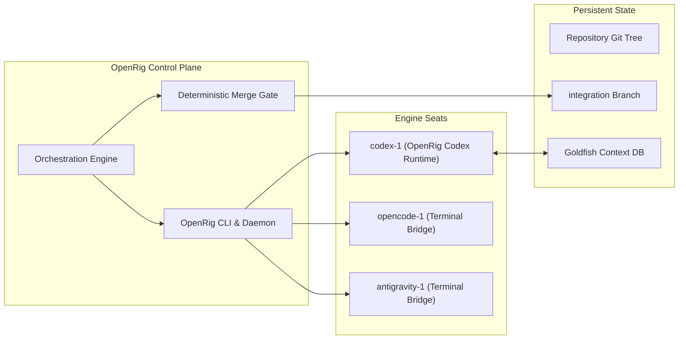
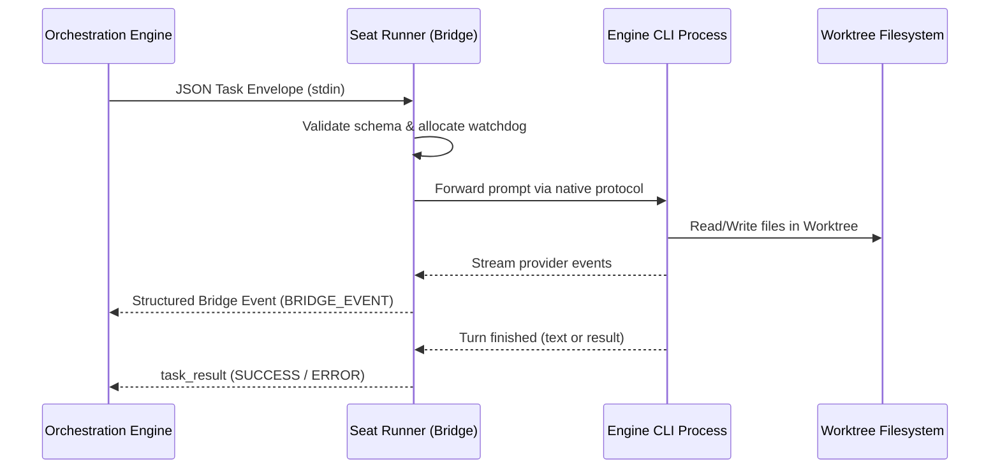
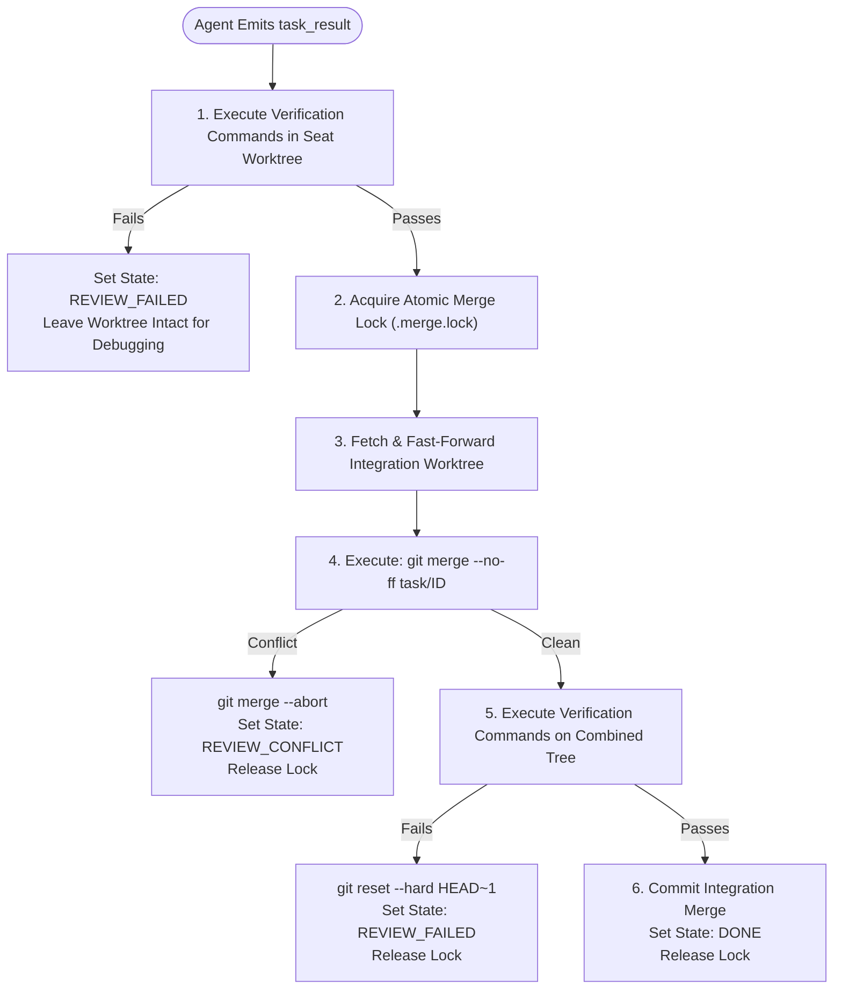

# Boss Rig Architecture Specification

This document provides the formal architectural specification for the **Boss Rig** multi-agent coding orchestration system.

---

## 1. System Overview & Invariants

Boss Rig is a local-first multi-agent development environment designed around three invariant foundations:

1. **OpenRig Exclusivity**: OpenRig is the sole coordinator. It holds the seat registry, lifecycle management, and seat dispatch topology.
2. **Decoupled Identity & Roles**: Engine identities (`codex-1`, `opencode-1`, `antigravity-1`) are persistent physical runtimes. Semantic roles (`planner`, `implementer`, `reviewer`, `verifier`, `coordinator`) are transient contracts assigned dynamically per task.
3. **Deterministic Quality Gate**: Software completion is independent of agent belief. Completion is defined solely by deterministic verification commands passing against the combined integration branch.



---

## 2. Process & Worktree Isolation Model

OpenRig seats maintain a static working directory post-startup. To eliminate cross-task contamination and file contention, Boss Rig implements persistent per-seat Git worktrees:

```text
.worktrees/
├── _integration/          # Canonical verification worktree (tracking integration)
├── codex-1/               # Persistent worktree for seat codex-1
├── opencode-1/            # Persistent worktree for seat opencode-1
└── antigravity-1/         # Persistent worktree for seat antigravity-1
```

### Worktree State Transitions
1. **Init (`init-seat <seat>`)**:
   Creates `.worktrees/<seat>` checked out to a dedicated parking branch `seat/<seat>` branched from `integration`.
2. **Assign (`assign <task_id> <seat>`)**:
   Switches the seat worktree from its parked branch to `task/<task_id>`. Sets task state to `ACTIVE`.
3. **Review & Merge (`review <task_id> <seat> "<cmd>"`)**:
   Executes deterministic test commands. On success, acquires `.merge.lock`, refreshes integration, merges `task/<task_id>` into `integration`, releases lock, and sets state to `DONE`.
4. **Release (`release <task_id> <seat>`)**:
   Requires task state `DONE`. Switches worktree back to `seat/<seat>`, deletes local branch `task/<task_id>`.
5. **Crash Recovery (`reset-seat <seat>`)**:
   Forcefully executes `git reset --hard HEAD`, `git clean -fd`, checks out `seat/<seat>`, and syncs with `integration`.

---

## 3. Persistent Bridge Protocol & Process Architecture

For engines that lack native OpenRig runtime adapters (`opencode` and `antigravity`), Boss Rig hosts persistent bridge processes inside OpenRig terminal seats.



### OpenCode Bridge Design
- **Invocation**: `opencode run --format json`
- **Process Group Isolation**: Spawned with `start_new_session=True`. Timeouts trigger `os.killpg(pid, SIGTERM)` with graceful fallback to `SIGKILL`.
- **Exit Code & Stream Handling**: Exit code 0 indicates turn completion; non-zero indicates runtime failure; exit code 124 represents watchdog timeout.

### Antigravity Bridge Design
- **Invocation**: `agy --input-format stream-json --output-format stream-json --dangerously-skip-permissions`
- **Native Event Mapping**:
  - `init` $\rightarrow$ `runtime_ready` (records conversation ID and available tool surface)
  - `step_update` $\rightarrow$ `progress` (streams token deltas and step status)
  - Lookahead turn detection: When `step_type == "agent_response"` is `DONE`, runner peeks ahead with an 800ms window. If an immediate tool execution step arrives, processing continues. If no event follows, the agent turn is complete and `task_result` is emitted.

---

## 4. Policy Engine & Guardrails

The policy engine ([orchestrator/policy.py](file:///c:/Users/jacob/Boss%20Agent/orchestrator/policy.py)) enforces three mandatory invariants:

### 1. Independent Review Policy
```python
if role == "reviewer" and task.implementer == engine:
    raise PolicyViolation("Reviewer cannot be the implementer (Self-review forbidden)")
```

### 2. Commit-Pinned Verification Policy
```python
if role == "verifier" and not task.candidate_commit:
    raise PolicyViolation("Cannot verify task before candidate commit is pinned")
```

### 3. Capability-Based Routing
Seats are verified against task requirement envelopes:
- `filesystem_write`: Requires engine with file-writing privileges.
- `shell`: Requires shell access for running test suites.
- `git`: Requires git CLI access.

---

## 5. Deterministic Verification Gate

The verification gate is implemented in [scripts/worktree-gate.sh](file:///c:/Users/jacob/Boss%20Agent/scripts/worktree-gate.sh).



---

## 6. Memory Plane: Goldfish Desktop Integration

Boss Rig integrates **Goldfish Desktop** (`goldfish-mcp.exe`) via native Model Context Protocol (MCP) over `stdio`.

- **Transport**: Standard Input/Output JSON-RPC 2.0
- **Seat Mapping**: Configured directly inside `config/rig.yaml` under the native Codex seat.
- **Operations Supported**:
  - `goldfish.get_snapshots`: Retrieves point-in-time contextual snapshots.
  - `goldfish.search_memory`: Semantic vector search across previous conversation contexts and codebase changes.
  - `goldfish.save_context`: Stores high-value architectural decisions for subsequent agent retrieval.
- **Proven Retrieval**: Live retrieval of injected snapshot `ORANGE-ELEPHANT-4721` was verified end-to-end through Codex under OpenRig supervision.
