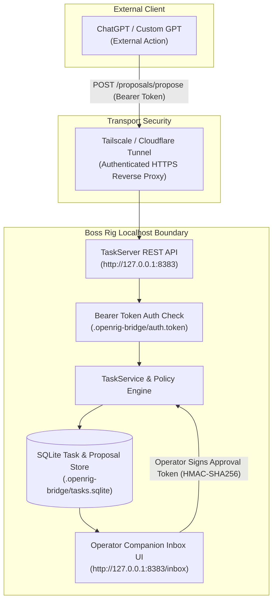

# Boss Rig — ChatGPT & External Client Adapter Guide (Milestone M4)

This document provides setup instructions, security boundaries, and OpenAPI specifications for connecting ChatGPT (via Custom GPT Actions) or any external LLM client to Boss Rig.

---

## 1. Architectural Model & Security Boundary



### Strict Eligibility Constraints
1. **No Direct Execution Privilege**: External clients like ChatGPT are **strictly untrusted** for direct task execution. They are **ONLY permitted to propose tasks** (`POST /proposals/propose`) or query task status (`GET /tasks/<task_id>`).
2. **Self-Approval Is Prohibited**: Submissions attempting to claim `approved: true` with `source: operator_cli` or `source: local_web` from external endpoints without a valid cryptographic HMAC signature generated by the operator's local secret key are rejected with `HTTP 403 Forbidden` (`ApprovalVerificationError`).
3. **Mandatory Human-in-the-Loop**: All proposals submitted via ChatGPT appear in the **Boss Rig Companion Inbox** at `http://127.0.0.1:8383/inbox`. The operator reviews the repo path, goal, constraints, verification commands, and assigned agents before clicking **"Approve & Dispatch"**, which signs a cryptographic single-use HMAC token with a fresh nonce.
4. **Local Secret Isolation**: The local secret token stored in `.openrig-bridge/auth.token` is **never shared** with external cloud models or ChatGPT Action schemas. ChatGPT only receives an API access token for authenticated proposal submission.

---

## 2. Setting Up the Local Server

Start the Boss Rig task server on localhost:
```bash
python -m orchestrator.bridge_cli serve --host 127.0.0.1 --port 8383
```

To view the generated Bearer Token:
```bash
python -m orchestrator.bridge_cli token
```

---

## 3. Exposing via Secure Tunnel (Tailscale Funnel or Cloudflare)

Boss Rig should never be exposed to the public internet without mutual authentication or HTTPS encryption.

### Option A: Cloudflare Tunnel (Recommended)
1. Install `cloudflared`:
   ```bash
   cloudflared tunnel --url http://127.0.0.1:8383
   ```
2. Note the generated HTTPS tunnel URL (e.g., `https://boss-rig-secure.yourdomain.com`).

### Option B: Tailscale Funnel
```bash
tailscale funnel 8383
```

---

## 4. Custom GPT Action Configuration (OpenAPI 3.1 Schema)

In OpenAI's Custom GPT editor, navigate to **Configure -> Actions -> Create new action**.

### Authentication
- **Authentication Type**: `API Key`
- **Auth Type**: `Bearer`
- **Token**: `<Your Boss Rig Bearer Token>`

### OpenAPI 3.1.0 Specification

```yaml
openapi: 3.1.0
info:
  title: Boss Rig Task Proposal and Status Bridge
  description: Secure conversational bridge for proposing tasks and querying execution status on Boss Rig.
  version: 1.0.0
servers:
  - url: https://your-tunnel-domain.example.com
paths:
  /proposals/propose:
    post:
      summary: Propose a new coding task for operator review
      operationId: proposeTask
      requestBody:
        required: true
        content:
          application/json:
            schema:
              type: object
              required:
                - repo
                - goal
                - verification_commands
              properties:
                repo:
                  type: string
                  description: Absolute path to the allowed local repository.
                  example: "<REPO_ROOT>/.disposable-live-repo"
                goal:
                  type: string
                  description: Clear, concise goal description for the multi-agent rig.
                  example: "Implement say_hello() function in hello.py returning 'hello'"
                acceptance_criteria:
                  type: array
                  items:
                    type: string
                  description: Bullet points describing required acceptance criteria.
                constraints:
                  type: array
                  items:
                    type: string
                  description: Safety and behavioral constraints (e.g. no network calls).
                verification_commands:
                  type: array
                  items:
                    type: string
                  description: Exact test commands that must exit with code 0.
                  example: ["python -c \"import hello; assert hello.say_hello() == 'hello'\""]
                allowed_merge_target:
                  type: string
                  default: "integration"
                  description: Target merge branch (must be 'integration').
                conversation_id:
                  type: string
                  description: Unique identifier of the external chat thread.
      responses:
        '200':
          description: Proposal successfully created and queued for human review.
          content:
            application/json:
              schema:
                type: object
                properties:
                  proposal_id:
                    type: string
                  spec_id:
                    type: string
                  status:
                    type: string
                    example: "PENDING_APPROVAL"
                  message:
                    type: string

  /tasks/{task_id}:
    get:
      summary: Check status and evidence for an enrolled task
      operationId: getTaskStatus
      parameters:
        - name: task_id
          in: path
          required: true
          schema:
            type: string
      responses:
        '200':
          description: Current task status and execution outcome.
          content:
            application/json:
              schema:
                type: object
                properties:
                  task_id:
                    type: string
                  state:
                    type: string
                    example: "DONE"
                  goal:
                    type: string
                  candidate_commit:
                    type: string
                  merge_commit:
                    type: string

  /tasks/{task_id}/events:
    get:
      summary: Read ordered timeline events and review evidence
      operationId: getTaskEvents
      parameters:
        - name: task_id
          in: path
          required: true
          schema:
            type: string
        - name: after_seq
          in: query
          required: false
          schema:
            type: integer
            default: 0
      responses:
        '200':
          description: Ordered list of lifecycle and outbox events.
```

---

## 5. End-to-End Workflow with ChatGPT

1. **User asks ChatGPT**: *"Add a health check endpoint to `.disposable-live-repo`."*
2. **ChatGPT creates a proposal**: It formats the task parameters and calls `POST /proposals/propose`.
3. **Boss Rig logs proposal**: Proposal is stored in SQLite in `PENDING_APPROVAL` status. Zero agents run.
4. **Operator reviews**: The operator opens `http://127.0.0.1:8383/inbox`, reviews the goal, constraints, and commands, and clicks **"Approve & Dispatch"**.
5. **Execution & Evidence**: OpenRig runs planner, implementer, reviewer, and merge gate. Outbox timeline events are recorded in SQLite.
6. **ChatGPT checks progress**: ChatGPT calls `GET /tasks/{task_id}` or `GET /tasks/{task_id}/events` to provide the user with the candidate commit SHA and verification results.
