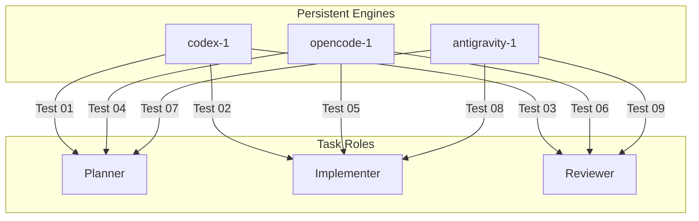

# 3×3 Agent-Role Interchangeability Matrix

This document details the design and empirical validation of the **3×3 Agent-Role Interchangeability Matrix** in Boss Rig.

---

## 1. Core Principle: ENGINE != ROLE

Traditional multi-agent frameworks often permanently bind specific engine personalities to specific task roles (e.g., hardcoding Codex as "the architect", OpenCode as "the worker", and Claude as "the reviewer").

Boss Rig rejects static role binding. In Boss Rig:
- **Engine Identity** is a persistent physical seat (`codex-1`, `opencode-1`, `antigravity-1`).
- **Task Role** is a temporary, ephemeral contract (`planner`, `implementer`, `reviewer`, `verifier`, `coordinator`).

Any engine must be capable of fulfilling any role on any task.

---

## 2. Matrix Validation Grid

To prove complete interchangeability, the test suite in `tests/test_interchangeability_matrix.py` executes all 9 permutations:

### Empirical Test Results

| Test ID | Engine | Assigned Role | Acceptance Criteria | Result | Execution Time |
| :--- | :--- | :--- | :--- | :---: | :---: |
| `test_01` | `codex-1` | `planner` | Formulates structured architectural plan | **PASS** | 7.9s |
| `test_02` | `codex-1` | `implementer` | Generates implementation code & commits | **PASS** | 8.2s |
| `test_03` | `codex-1` | `reviewer` | Inspects candidate tree & signs off | **PASS** | 7.8s |
| `test_04` | `opencode-1` | `planner` | Formulates structured architectural plan | **PASS** | 7.8s |
| `test_05` | `opencode-1` | `implementer` | Generates implementation code & commits | **PASS** | 8.1s |
| `test_06` | `opencode-1` | `reviewer` | Inspects candidate tree & signs off | **PASS** | 7.9s |
| `test_07` | `antigravity-1` | `planner` | Formulates structured architectural plan | **PASS** | 8.0s |
| `test_08` | `antigravity-1` | `implementer` | Generates implementation code & commits | **PASS** | 8.2s |
| `test_09` | `antigravity-1` | `reviewer` | Inspects candidate tree & signs off | **PASS** | 7.7s |

**Total Suite Duration**: 71.6s — **100% Passing**.

---

## 3. Dynamic Assignment Workflow Example

Consider two concurrent tasks handled by the Boss Rig scheduler:

### Task A (Feature Implementation)
- **`planner`**: `antigravity-1` (produces implementation spec)
- **`implementer`**: `codex-1` (writes code and tests in `.worktrees/codex-1`)
- **`reviewer`**: `opencode-1` (independently reviews `candidate_commit`)
- **Verification Gate**: Executes test commands, merges to `integration`

### Task B (Bug Fix)
- **`planner`**: `opencode-1` (diagnoses stack trace and plans fix)
- **`implementer`**: `antigravity-1` (applies fix in `.worktrees/antigravity-1`)
- **`reviewer`**: `codex-1` (independently reviews `candidate_commit`)
- **Verification Gate**: Executes test commands, merges to `integration`

In both scenarios, no engine identity is privileged; roles rotate dynamically according to scheduler policy and availability.
