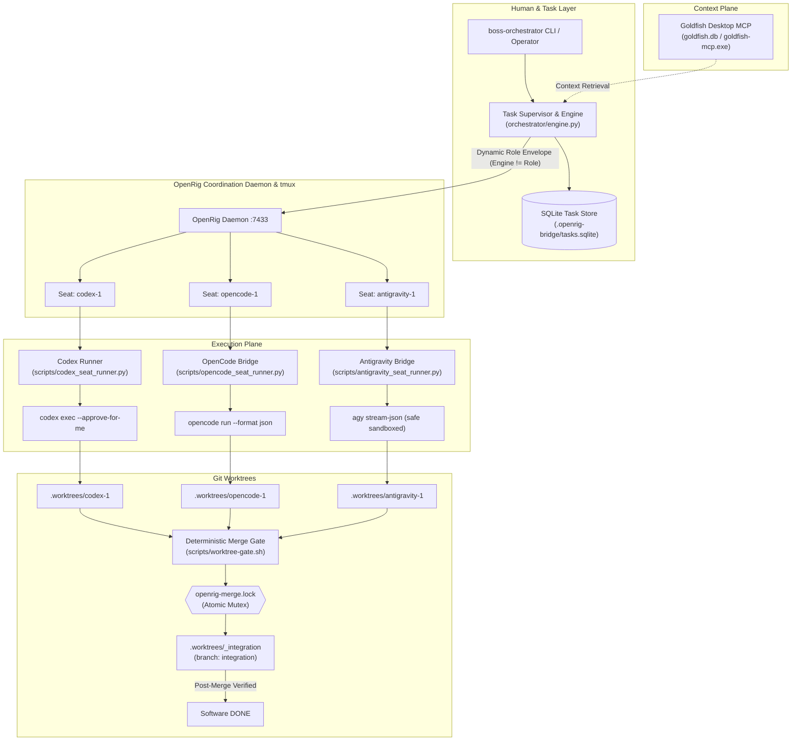

# Boss Rig v0.1 — Operator & Daily Operations Guide

Boss Rig is a production-minded, local-first, multi-agent coding orchestration system centered exclusively on **OpenRig** (`@openrig/cli`) as its control plane.

---

## 1. System Topology & Core Architectural Principles



### Mandatory System Invariants
1. **OpenRig is the ONLY control plane**: No competing orchestrators (Temporal, Inngest, LangGraph).
2. **`ENGINE != ROLE`**: Persistent engines (`codex-1`, `opencode-1`, `antigravity-1`) are completely decoupled from temporary task roles (`planner`, `implementer`, `reviewer`, etc.). Any engine can perform any role on any task.
3. **Independent Review Policy**: Self-review is strictly forbidden. The reviewer engine must never match the implementer engine (`reviewer != implementer`).
4. **Candidate Commit Pinning**: Every review and gate verification operates strictly on an immutable candidate commit SHA recorded at implementation completion.
5. **Agent Completion is NEVER Software DONE**: An agent's turn completion only advances a task to `REVIEW`. Only deterministic verification on both the feature branch and the integrated merge tree produces software `DONE`.

---

## 2. Quickstart & Daily Operations

### Environment Bootstrap
Ensure all tools, worktrees, and seat branches are provisioned:
```bash
./scripts/bootstrap.sh
```

### Inspect System Status
Check active seats, current worktree branches, merge locks, and task counts:
```bash
./scripts/boss-orchestrator status
```

Output:
```
═══════════════════════════════════════════════════════════════
                    BOSS RIG SYSTEM STATUS                     
═══════════════════════════════════════════════════════════════

[Active Seats]
  • codex-1         | Branch: seat/codex-1              | Runtime: codex
  • opencode-1      | Branch: seat/opencode-1           | Runtime: opencode
  • antigravity-1   | Branch: seat/antigravity-1        | Runtime: antigravity

[Merge Lock]: FREE

[Task Summary]
  • QUEUED         : 0
  • ACTIVE         : 0
  • REVIEW         : 0
  • DONE           : 3
  • BLOCKED        : 0
  • CANCELLED      : 0
═══════════════════════════════════════════════════════════════
```

### Run an Autonomous Feature Workflow
Dispatch a multi-agent feature workflow with dynamic roles and automated verification:
```bash
./scripts/boss-orchestrator run "Implement math helper in math_lib.py with factorial function" \
  --verify "python3 -c 'import math_lib; assert math_lib.factorial(5) == 120'" \
  --planner antigravity-1 \
  --implementer opencode-1 \
  --reviewer codex-1
```

Execution steps executed automatically:
1. `[1/4]` **Planning Turn** (`antigravity-1`): Formulates design plan in plain text without file mutations.
2. `[2/4]` **Implementation Turn** (`opencode-1`): Worktree switches to `task/<id>`, writes code & unit tests, commits changes, and pins candidate SHA.
3. `[3/4]` **Independent Review** (`codex-1`): Inspects candidate commit diff, enforces quality, emits verdict (`PASS`).
4. `[4/4]` **Deterministic Gate**: Tests candidate branch, acquires merge lock, merges to `integration`, tests integrated tree, commits merge, and transitions task to `DONE`.

### Inspect Task Details & Audit Provenance
Inspect full lifecycle history and bridge events for any task:
```bash
./scripts/boss-orchestrator task show T-E2E-WORKFLOW-A-1791972486
```

### Pause, Resume, or Cancel Tasks
- **Pause a running task**:
  ```bash
  ./scripts/boss-orchestrator pause <task_id> --reason "Awaiting external credential"
  ```
- **Resume a paused task**:
  ```bash
  ./scripts/boss-orchestrator resume <task_id>
  ```
- **Cancel a task**:
  ```bash
  ./scripts/boss-orchestrator stop <task_id> --reason "Spec superseded"
  ```

### Manual Operator Intervention & Seat Holds
To manually inspect or operate inside an engine's seat without interference from automated orchestrator injection:
1. **Place the seat on `MANUAL_HOLD`**:
   ```bash
   ./scripts/boss-orchestrator seat hold codex-1 --reason "Manual debugging of worktree divergence"
   ```
   *While on hold, any automated dispatch targeting `codex-1` will be immediately rejected with `SeatHoldError` and marked `BLOCKED`.*
2. **Inspect or edit the seat worktree**:
   ```bash
   cd .worktrees/codex-1
   git status
   # Run ad-hoc tests, debug tools, or OpenRig TUI commands
   ```
3. **Check operational modes across all seats**:
   ```bash
   ./scripts/boss-orchestrator seat status
   ```
4. **Release the seat back to automation**:
   ```bash
   ./scripts/boss-orchestrator seat release codex-1
   ```

---

## 3. OpenRig TUI & Session Inspection

OpenRig manages tmux seats for active agent sessions:

1. **List running tmux seats**:
   ```bash
   tmux list-sessions
   ```
2. **Attach directly to a seat terminal**:
   ```bash
   # Attach to codex seat
   tmux attach -t openrig-engineering-codex-1

   # Attach to opencode seat
   tmux attach -t openrig-engineering-opencode-1
   ```
3. **Send inter-agent messages via OpenRig CLI**:
   ```bash
   rig send codex-1 "Hello from operator"
   ```

---

## 4. Permission Sandboxing Model

| Engine | Default Headless Mode | Opt-In Elevated Flag | Scope |
| :--- | :--- | :--- | :--- |
| **Codex** | `--approve-for-me` (Safe workspace-write sandbox) | `CODEX_DANGEROUS_SKIP_PERMISSIONS=1` (`--dangerously-bypass-approvals-and-sandbox`) | Constrained to `.worktrees/codex-1` |
| **OpenCode** | `--format json --auto` | N/A | Constrained to `.worktrees/opencode-1` |
| **Antigravity** | `permission_mode=request-review` (No dangerous bypass) | `AGY_DANGEROUS_SKIP_PERMISSIONS=1` (`--dangerously-skip-permissions`) | Read-only planning/review by default; headless writes require explicit opt-in |

---

## 5. Fault Injection & Crash Recovery

If a crash, power outage, or kill signal interrupts a task:

1. **Reclaim stale locks & abort incomplete merges**:
   ```bash
   ./scripts/boss-orchestrator recover --force
   ```
2. **Reset individual seat worktree**:
   ```bash
   ./scripts/worktree-gate.sh reset-seat opencode-1
   ```
This resets the worktree back to its parked branch (`seat/<seat-id>`) and deletes any uncommitted scratch files.
