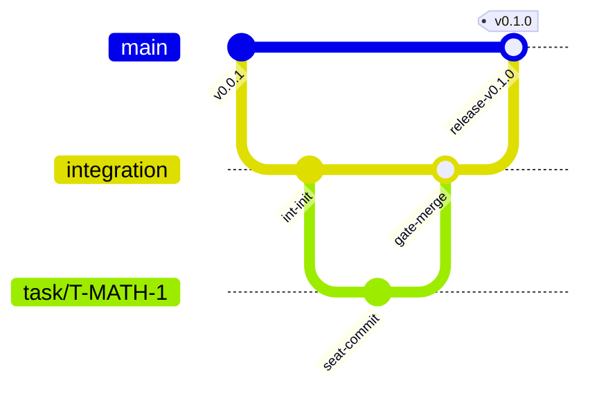

# Boss Rig — Branching & Release Promotion Process

This document defines the strict branch boundary model and release promotion workflow for Boss Rig.

---

## 1. Branch Topology & Flow



### The Three Operational Tiers:

1. **Transient Seat Branches (`task/<task_id>`)**
   - Owned exclusively by an assigned engine seat (e.g. `.worktrees/opencode-1`).
   - Isolated from all other seats.
   - Pinned by an immutable candidate commit SHA upon implementation completion.
   - Deleted or reset automatically when work is released or cancelled.

2. **The Integration Branch (`integration`)**
   - The authoritative pre-release trunk.
   - **Never mutated directly by human or agent commits.**
   - All merges MUST pass through `scripts/worktree-gate.sh review` while holding `openrig-merge.lock`.
   - Gate verifies:
     1. Pre-merge test suite passes on the feature branch.
     2. Merge succeeds cleanly without conflicts.
     3. Post-merge test suite passes on the integrated tree (`.worktrees/_integration`).

3. **The Production Trunk (`main`)**
   - The public, production-ready release branch.
   - Promoted strictly from `integration` after all integration tests, soak tests, and CI workflows pass.
   - Tagged with semantic versions (`v0.1.0`, `v0.1.1`, etc.).

---

## 2. Release Promotion Checklist

Before promoting `integration` into `main` and creating a release tag:

1. **Clean Working Tree**: Ensure no untracked secrets, uncommitted edits, or lingering locks.
2. **Canonical Test Suite Pass**:
   ```bash
   python3 scripts/test_inventory.py
   python3 -m unittest discover tests -v
   ```
3. **15-Task Soak Test Pass**:
   ```bash
   python3 scripts/soak_test.py
   ```
4. **Security Audit Clean**:
   ```bash
   python3 scripts/security_audit.py
   ```
5. **Fresh-Clone Bootstrap Proof**:
   ```bash
   git clone <repo_url> /tmp/fresh_test
   cd /tmp/fresh_test && ./scripts/bootstrap.sh
   ./scripts/boss-orchestrator up
   ./scripts/boss-orchestrator status
   ```

---

## 3. Tagging & Publishing v0.1.0

When all criteria pass:

```bash
# 1. Ensure integration is merged into main
git checkout main
git merge --ff-only integration

# 2. Create signed/annotated semantic release tag
git tag -a v0.1.0 -m "Release v0.1.0: Production-grade OpenRig Multi-Agent Orchestrator"

# 3. Push to remote repository
git push origin main
git push origin integration
git push origin v0.1.0
```
