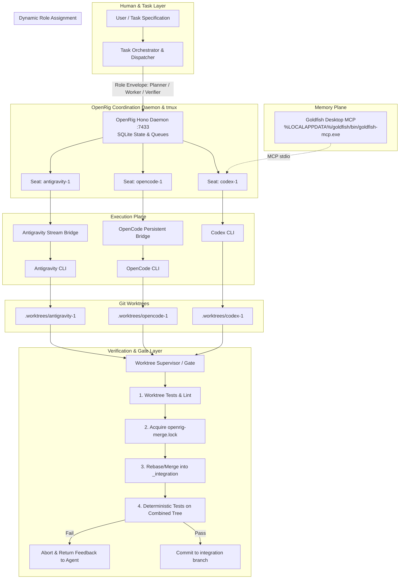

# Implementation Plan: All-Encompassing Multi-Agent Coding Orchestrator

## Goal Description
Build an all-encompassing, production-grade multi-agent coding orchestration system based on the architectural findings in [deep-research-report.md](file:///c:/Users/jacob/Boss%20Agent/deep-research-report.md).

The orchestrator operates on a four-tier architecture:
1. **Control / Team Plane**: **OpenRig** (`@openrig/cli`) managing persistent agent seats, tmux sessions, SQLite coordination state (`$OPENRIG_HOME/openrig.sqlite`), and inter-agent communication (`rig send`, broadcast, chatrooms).
2. **Context / Historical Memory Plane**: **Goldfish Desktop** (`goldfish-mcp.exe`) exposing an stdio Model Context Protocol (MCP) server connected to Codex and participating agents.
3. **Execution Plane**: Interchangeable coding engines (**Codex**, **OpenCode**, and **Antigravity**) bound to persistent seats (`codex-1`, `opencode-1`, `antigravity-1`).
4. **Safety & Verification Boundary**: Dedicated per-seat Git worktrees (`.worktrees/codex-1`, `.worktrees/opencode-1`, `.worktrees/antigravity-1`), a centralized `_integration` branch, and a deterministic test/merge gate (`worktree-gate.sh` / `supervisor.py`) where no agent can declare a task complete without passing automated test suites on both the feature branch and the integrated merge tree.

A core principle is **Strict Decoupling of Semantic Roles from Engine Identities**: seats are named neutrally (`codex-1`, `opencode-1`, `antigravity-1`), and roles (`planner`, `worker`, `verifier`) are dynamically allocated per task envelope. Any agent can plan, execute, or verify on any given run.



---

## User Review Required

> [!IMPORTANT]
> **Host Environment: Windows 11 + WSL2 Bridge**
> OpenRig upstream strictly requires Node.js 22/24, `tmux`, and a POSIX environment (macOS or Linux/WSL2; Windows native is not supported upstream).
> - On your machine, `Ubuntu` is already installed on WSL2 with `tmux`, `git`, and `python3`.
> - The agent CLIs (`agy.exe`, `opencode.cmd`, `codex`, `goldfish-mcp.exe`) exist on Windows.
> - We will install Node.js 22 in WSL2 Ubuntu and run `@openrig/cli` and `tmux` within WSL2.
> - The persistent bridges will execute the underlying CLIs seamlessly (either using native Linux binaries or invoking host binaries across the WSL interoperability boundary).

> [!WARNING]
> **Worktree Static `cwd` Constraint**
> In OpenRig, each seat's `cwd` is locked at seat startup and cannot be reassigned dynamically during runtime. Therefore, worktrees are persistent per-seat (`.worktrees/codex-1`, `.worktrees/opencode-1`, `.worktrees/antigravity-1`), while **branches** inside those worktrees switch dynamically (`task/T-101`, `task/T-102`) and park back to `seat/<seat-id>` upon release.

> [!CAUTION]
> **LLM Completion vs Supervisor Done**
> An AI agent's completion signal (`task_result` or `result`) only triggers a transition to `REVIEW`. It is never authoritative for marking a task `DONE`. Only `worktree-gate.sh` can verify test execution and approve integration.

---

## Open Questions

> [!NOTE]
> 1. **Target Project Repository**: Should we initialize the orchestrator and worktrees directly inside `c:\Users\jacob\Boss Agent`, or do you have an external git repository you want this orchestrator to manage? *(Default plan: initialize Git in `c:\Users\jacob\Boss Agent` and demonstrate the end-to-end multi-agent flow here first).*
> 2. **Goldfish Memory Query Mode**: For Goldfish MCP in Codex, should we set `default_tools_approval_mode = "prompt"` initially for manual review of memory fetches, or `"auto"` for frictionless unattended execution? *(Recommended: `"prompt"` during initial setup, then switch to `"auto"` for automated runs).*

---

## Proposed Changes

The implementation is structured into 6 logical components:

```
Boss Agent/
├── .worktrees/                   # Dedicated seat worktrees (git-excluded)
│   ├── _integration/             # Clean non-agent worktree for merge testing
│   ├── codex-1/                  # Worktree for codex seat
│   ├── opencode-1/               # Worktree for opencode seat
│   └── antigravity-1/            # Worktree for antigravity seat
├── config/
│   ├── rig.yaml                  # Neutral OpenRig topology definition
│   └── agents/
│       └── codex-neutral.yaml    # Neutral Codex AgentSpec
├── scripts/
│   ├── opencode-seat-runner.sh   # OpenCode persistent FIFO bridge
│   ├── antigravity-seat-runner.py# Antigravity persistent stream-JSON bridge
│   ├── worktree-gate.sh          # Worktree supervisor, merge lock & test gate
│   ├── setup-wsl-env.sh          # WSL2 setup script (Node 22, OpenRig, tmux)
│   └── configure-goldfish.sh     # Goldfish MCP configuration for Codex
├── orchestrator/
│   ├── __init__.py
│   ├── schema.py                 # Pydantic / dataclass schemas for Task Envelopes
│   ├── scheduler.py              # Dynamic role allocator and task dispatcher
│   ├── monitor.py                # Event stream listener (BRIDGE_EVENT & GATE_EVENT)
│   └── cli.py                    # Orchestrator CLI entrypoint
└── tests/
    ├── test_role_matrix.py       # 3x3 role interchangeability test suite
    └── test_verification_gate.py # Fault injection & test failure validation
```

---

### Component 1: Environment & Tooling Setup

Set up WSL2 Ubuntu with Node.js 22 and `@openrig/cli`, configure Codex with Goldfish MCP, and bootstrap the local git repository with `main` and `integration` branches.

#### [NEW] `scripts/setup-wsl-env.sh`
WSL script to install Node.js 22 LTS, npm, and `@openrig/cli`.
```bash
#!/usr/bin/env bash
set -euo pipefail

echo "=== Setting up WSL2 Environment for OpenRig ==="
sudo apt-get update
sudo apt-get install -y curl tmux jq git python3 python3-pip

# Install Node.js 22 LTS if not present
if ! command -v node >/dev/null 2>&1 || [[ "$(node -v | cut -d. -f1)" != "v22" ]]; then
  echo "Installing Node.js 22 LTS via NodeSource..."
  curl -fsSL https://deb.nodesource.com/setup_22.x | sudo -E bash -
  sudo apt-get install -y nodejs
fi

echo "Node version: $(node -v)"
echo "npm version: $(npm -v)"

# Install OpenRig globally
if ! command -v rig >/dev/null 2>&1; then
  echo "Installing @openrig/cli..."
  sudo npm install -g @openrig/cli
fi

echo "OpenRig version:"
rig --version
```

#### [NEW] `scripts/configure-goldfish.sh`
Registers Goldfish Desktop MCP with Codex.
```bash
#!/usr/bin/env bash
set -euo pipefail

GOLDFISH_PATH="/mnt/c/Users/jacob/AppData/Local/goldfish/bin/goldfish-mcp.exe"
if [[ ! -f "$GOLDFISH_PATH" ]]; then
  echo "Warning: Goldfish MCP binary not found at $GOLDFISH_PATH" >&2
fi

echo "Configuring Codex MCP for Goldfish..."
# Check if codex command exists
if command -v codex >/dev/null 2>&1; then
  codex mcp add goldfish -- "$GOLDFISH_PATH" || true
  codex mcp list
fi
```

---

### Component 2: OpenRig Neutral Topology & RigSpec

Configure a neutral OpenRig topology where seats declare runtimes and working directories, but zero static semantic roles.

#### [NEW] `config/rig.yaml`
```yaml
version: "1"
name: interchangeable-coding

summary: >
  OpenRig persistent multi-agent team where Codex, OpenCode, and
  Antigravity receive planner, worker, or verifier roles dynamically per task.

pods:
  - id: engineering
    label: Interchangeable Coding Engines

    members:
      - id: codex-1
        agent_ref: builtin:terminal
        profile: none
        runtime: terminal
        cwd: .worktrees/codex-1

      - id: opencode-1
        agent_ref: builtin:terminal
        profile: none
        runtime: terminal
        cwd: .worktrees/opencode-1

      - id: antigravity-1
        agent_ref: builtin:terminal
        profile: none
        runtime: terminal
        cwd: .worktrees/antigravity-1
```

---

### Component 3: Persistent Execution Runners (MVP Bridges)

Create robust runners that keep OpenRig seats alive across tasks while launching underlying agent processes and publishing structured `BRIDGE_EVENT` logs.

#### [NEW] `scripts/opencode-seat-runner.sh`
Reads task messages from a FIFO pipe, runs `opencode run`, enforces timeout via a watchdog, captures JSON output, and emits `BRIDGE_EVENT` updates.
```bash
#!/usr/bin/env bash
set -uo pipefail

SEAT_ID="${OPENRIG_SEAT_ID:-opencode-1}"
NOTIFY_SEAT="${OPENRIG_NOTIFY_SEAT:-}"
RUNTIME_DIR="${XDG_RUNTIME_DIR:-${TMPDIR:-/tmp}}"
SAFE_SEAT="${SEAT_ID//[^A-Za-z0-9_.-]/_}"

FIFO="${OPENCODE_SEAT_FIFO:-$RUNTIME_DIR/openrig-$SAFE_SEAT.fifo}"
LOG="${OPENCODE_SEAT_LOG:-$PWD/.openrig-opencode-seat.log}"
DEFAULT_TIMEOUT="${OPENCODE_TASK_TIMEOUT_SEC:-1800}"

# Determine opencode binary (native or Windows wrapper)
OPENCODE_BIN="opencode"
if ! command -v opencode >/dev/null 2>&1; then
  if [[ -f "/mnt/c/Users/jacob/bin/opencode.cmd" ]]; then
    OPENCODE_BIN="cmd.exe /c C:\\Users\\jacob\\bin\\opencode.cmd"
  fi
fi

rm -f "$FIFO"
mkfifo -m 600 "$FIFO"

event() {
  local name="$1" task_id="$2" role="$3" rc="${4:-}" status="${5:-}"
  local payload line
  payload="$(jq -cn \
    --arg runtime opencode \
    --arg seat "$SEAT_ID" \
    --arg event "$name" \
    --arg task_id "$task_id" \
    --arg role "$role" \
    --arg status "$status" \
    --argjson exit_code "${rc:-null}" \
    '{"v":1,"runtime":$runtime,"seat":$seat,"event":$event,"task_id":$task_id,"role":$role,"status":$status,"exit_code":$exit_code}')"
  line="BRIDGE_EVENT $payload"
  printf '%s\n' "$line"
  if [[ -n "$NOTIFY_SEAT" ]] && command -v rig >/dev/null 2>&1; then
    rig send "$NOTIFY_SEAT" "$line" >/dev/null 2>&1 || true
  fi
}

cleanup() {
  trap - EXIT INT TERM HUP
  [[ -n "${WATCHDOG_PID:-}" ]] && kill "$WATCHDOG_PID" 2>/dev/null || true
  [[ -n "${CURRENT_CHILD:-}" ]] && kill "$CURRENT_CHILD" 2>/dev/null || true
  [[ -n "${FEEDER_PID:-}" ]] && kill "$FEEDER_PID" 2>/dev/null || true
  rm -f "$FIFO"
}
trap cleanup EXIT INT TERM HUP

(
  while IFS= read -r line; do
    [[ -z "$line" ]] && continue
    printf '%s\n' "$line" > "$FIFO" || exit 0
  done
) &
FEEDER_PID=$!

SEQ=0
while true; do
  IFS= read -r message < "$FIFO" || continue
  case "$message" in
    :quit|:exit) break ;;
  esac
  SEQ=$((SEQ + 1))

  if [[ "$message" == \{* ]] && jq -e . >/dev/null 2>&1 <<<"$message"; then
    task_id="$(jq -r '.task_id // empty' <<<"$message")"
    role="$(jq -r '.role // "worker"' <<<"$message")"
    timeout_sec="$(jq -r '.timeout_sec // empty' <<<"$message")"
    [[ -n "$task_id" ]] || task_id="$SEAT_ID-$SEQ"
    [[ "$timeout_sec" =~ ^[0-9]+$ ]] || timeout_sec="$DEFAULT_TIMEOUT"
    prompt="You are an interchangeable OpenRig seat.
The role for THIS task is '$role'; it is not your permanent identity.
Execute this task envelope exactly. Stay inside the current worktree.
Report evidence: changed files, test commands run, commit SHA, and risks.
TASK_ENVELOPE=$message"
  else
    task_id="$SEAT_ID-$SEQ"
    role="worker"
    timeout_sec="$DEFAULT_TIMEOUT"
    prompt="$message"
  fi

  event task_started "$task_id" "$role" null RUNNING

  timeout_marker="${RUNTIME_DIR}/openrig-${SAFE_SEAT}-${SEQ}.timeout"
  rm -f "$timeout_marker"

  $OPENCODE_BIN run --dir "$PWD" --format json --auto "$prompt" </dev/null >> "$LOG" 2>&1 &
  CURRENT_CHILD=$!

  (
    sleep "$timeout_sec"
    if kill -0 "$CURRENT_CHILD" 2>/dev/null; then
      touch "$timeout_marker"
      kill -TERM "$CURRENT_CHILD" 2>/dev/null || true
      sleep 3
      kill -KILL "$CURRENT_CHILD" 2>/dev/null || true
    fi
  ) &
  WATCHDOG_PID=$!

  wait "$CURRENT_CHILD"
  rc=$?
  CURRENT_CHILD=""
  kill "$WATCHDOG_PID" 2>/dev/null || true

  if [[ -f "$timeout_marker" ]]; then
    rc=124; rm -f "$timeout_marker"; status=TIMEOUT
  elif [[ "$rc" -eq 0 ]]; then
    status=SUCCESS
  else
    status=ERROR
  fi

  event task_result "$task_id" "$role" "$rc" "$status"
done
```

#### [NEW] `scripts/antigravity-seat-runner.py`
Persistent Python bridge for Google Antigravity CLI speaking `--input-format stream-json --output-format stream-json`.
- Dispatches stdin/stdout JSON envelopes.
- Emits structured progress upon `step_update`.
- Resolves task completion solely upon the terminal `result` event (`SUCCESS`/`ERROR`).
- Enforces conversation isolation: resets the `agy` child process whenever a new `task_id` is received.
```python
#!/usr/bin/env python3
"""Persistent Antigravity stream runner for OpenRig."""

from __future__ import annotations

import json
import os
import selectors
import subprocess
import sys
import threading
import time
from dataclasses import dataclass
from typing import Any, TextIO

SEAT_ID = os.environ.get("OPENRIG_SEAT_ID", "antigravity-1")
NOTIFY_SEAT = os.environ.get("OPENRIG_NOTIFY_SEAT", "")
DEFAULT_TIMEOUT = int(os.environ.get("AGY_TASK_TIMEOUT_SEC", "1800"))
HEARTBEAT_SEC = int(os.environ.get("AGY_HEARTBEAT_SEC", "20"))
RESET_ON_TASK_CHANGE = os.environ.get("AGY_SESSION_SCOPE", "task") == "task"


def bridge_event(name: str, task_id: str, role: str, **extra: Any) -> None:
    payload = {
        "v": 1,
        "runtime": "antigravity",
        "seat": SEAT_ID,
        "event": name,
        "task_id": task_id,
        "role": role,
        **extra,
    }
    line = f"BRIDGE_EVENT {json.dumps(payload, separators=(',', ':'), ensure_ascii=False)}"
    print(line, flush=True)

    if NOTIFY_SEAT:
        try:
            subprocess.run(
                ["rig", "send", NOTIFY_SEAT, line],
                stdin=subprocess.DEVNULL,
                stdout=subprocess.DEVNULL,
                stderr=subprocess.DEVNULL,
                check=False,
            )
        except FileNotFoundError:
            pass


def pump_stderr(pipe: TextIO) -> None:
    for line in pipe:
        sys.stderr.write(line)
        sys.stderr.flush()


@dataclass
class AgyProcess:
    proc: subprocess.Popen[str]
    selector: selectors.BaseSelector

    @classmethod
    def start(cls) -> "AgyProcess":
        agy_cmd = "agy"
        if not os.path.exists("/usr/bin/agy") and os.path.exists("/mnt/c/Users/jacob/AppData/Local/agy/bin/agy.exe"):
            agy_cmd = "/mnt/c/Users/jacob/AppData/Local/agy/bin/agy.exe"

        args = [agy_cmd, "--input-format", "stream-json", "--output-format", "stream-json"]
        if os.environ.get("AGY_SANDBOX", "1") == "1":
            args.append("--sandbox")
        if os.environ.get("AGY_DANGEROUS_SKIP_PERMISSIONS") == "1":
            args.append("--dangerously-skip-permissions")

        proc = subprocess.Popen(
            args,
            stdin=subprocess.PIPE,
            stdout=subprocess.PIPE,
            stderr=subprocess.PIPE,
            text=True,
            bufsize=1,
        )
        assert proc.stdin and proc.stdout and proc.stderr

        threading.Thread(target=pump_stderr, args=(proc.stderr,), daemon=True).start()
        selector = selectors.DefaultSelector()
        selector.register(proc.stdout, selectors.EVENT_READ)
        return cls(proc=proc, selector=selector)

    def stop(self) -> None:
        try:
            self.selector.close()
        except Exception:
            pass
        if self.proc.poll() is not None:
            return
        try:
            if self.proc.stdin:
                self.proc.stdin.close()
        except Exception:
            pass
        self.proc.terminate()
        try:
            self.proc.wait(timeout=3)
        except subprocess.TimeoutExpired:
            self.proc.kill()
            self.proc.wait(timeout=3)

    def run_turn(self, prompt: str, task_id: str, role: str, timeout_sec: int) -> tuple[int, str]:
        if self.proc.poll() is not None:
            return self.proc.returncode or 1, "PROCESS_EXIT"

        user_event = {"event": "user", "message": {"content": prompt}}
        self.proc.stdin.write(json.dumps(user_event, ensure_ascii=False) + "\n")
        self.proc.stdin.flush()

        started = time.monotonic()
        next_heartbeat = started + HEARTBEAT_SEC
        conversation_id: str | None = None

        while True:
            now = time.monotonic()
            if now - started >= timeout_sec:
                return 124, "TIMEOUT"

            ready = self.selector.select(timeout=min(1.0, max(0.05, next_heartbeat - now)))
            if not ready:
                if self.proc.poll() is not None:
                    return self.proc.returncode or 1, "PROCESS_EXIT"
                if time.monotonic() >= next_heartbeat:
                    bridge_event("heartbeat", task_id, role, elapsed_sec=int(time.monotonic() - started))
                    next_heartbeat = time.monotonic() + HEARTBEAT_SEC
                continue

            line = self.proc.stdout.readline()
            if line == "":
                return self.proc.poll() or 1, "PROCESS_EXIT"

            try:
                evt = json.loads(line)
            except json.JSONDecodeError:
                continue

            event_name = evt.get("event")
            if event_name == "init":
                conversation_id = evt.get("conversation_id") or (evt.get("conversation") or {}).get("id")
                bridge_event("runtime_ready", task_id, role, conversation_id=conversation_id)
            elif event_name == "step_update":
                step = evt.get("step_update") if isinstance(evt.get("step_update"), dict) else evt
                bridge_event("progress", task_id, role, step_type=step.get("step_type"), tool_name=step.get("tool_name"))
            elif event_name == "result":
                res = evt.get("result") if isinstance(evt.get("result"), dict) else evt
                status = str(res.get("status", "UNKNOWN")).upper()
                rc = 0 if status == "SUCCESS" else 1
                bridge_event("task_result", task_id, role, status=status, exit_code=rc, conversation_id=conversation_id)
                return rc, status


def main() -> int:
    seq = 0
    last_rc = 0
    agy: AgyProcess | None = None
    current_task: str | None = None

    try:
        for raw in sys.stdin:
            message = raw.rstrip("\r\n")
            if not message:
                continue
            if message in {":quit", ":exit"}:
                break
            seq += 1

            try:
                obj = json.loads(message) if message.startswith("{") else {}
                task_id = str(obj.get("task_id", f"{SEAT_ID}-{seq}"))
                role = str(obj.get("role", "worker"))
                timeout_sec = int(obj.get("timeout_sec", DEFAULT_TIMEOUT))
                prompt = (
                    f"You are an interchangeable OpenRig seat. Role for THIS task: '{role}'. "
                    f"Stay inside current worktree. TASK_ENVELOPE={json.dumps(obj) if obj else message}"
                )
            except Exception as e:
                bridge_event("task_result", f"{SEAT_ID}-{seq}", "unknown", status="INVALID_JSON", exit_code=2)
                continue

            if agy is None or agy.proc.poll() is not None or (RESET_ON_TASK_CHANGE and current_task != task_id):
                if agy:
                    agy.stop()
                agy = AgyProcess.start()
                current_task = task_id

            bridge_event("task_started", task_id, role, status="RUNNING")
            rc, status = agy.run_turn(prompt, task_id, role, timeout_sec)
            last_rc = rc
            if status in {"TIMEOUT", "PROCESS_EXIT"}:
                bridge_event("task_result", task_id, role, status=status, exit_code=rc)
                agy.stop()
                agy = None
                current_task = None
    finally:
        if agy:
            agy.stop()
    return last_rc


if __name__ == "__main__":
    raise SystemExit(main())
```

---

### Component 4: Worktree Gate & Supervisor

Implements deterministic merge gates, atomic file locking (`openrig-merge.lock`), and worktree switching without disrupting persistent OpenRig seats.

#### [NEW] `scripts/worktree-gate.sh`
Provides subcommands:
- `init-seat <seat-id>`: Initializes worktree `.worktrees/<seat-id>` parked on `seat/<seat-id>`.
- `assign <task-id> <seat-id>`: Switches `.worktrees/<seat-id>` to branch `task/<task-id>` created from `integration`.
- `review <task-id> <seat-id> [verify-cmd]`: Runs test checks in branch; acquires lock; merges into `_integration` worktree; re-runs tests on merged tree; commits merge on pass (`DONE`), aborts on fail (`REVIEW_FAILED` or `REVIEW_CONFLICT`).
- `release <task-id> <seat-id>`: Resets worktree back to `seat/<seat-id>` and prunes completed task branch.
- `status <task-id>`: Prints current task state (`QUEUED`, `ASSIGNED`, `ACTIVE`, `REVIEW`, `MERGE_READY`, `MERGING`, `DONE`).
- `recover [--force]`: Clears stale lock files and aborts hanging merges.

*(Implements the full script from lines 1716–2478 of [deep-research-report.md](file:///c:/Users/jacob/Boss%20Agent/deep-research-report.md#L1716-L2478))*.

---

### Component 5: Dynamic Task Orchestrator & Dispatcher

A Python orchestrator package providing schema validation, high-level multi-stage workflows (Plan $\to$ Work $\to$ Verify $\to$ Merge), and continuous event logging.

#### [NEW] `orchestrator/schema.py`
```python
from enum import Enum
from typing import List, Optional
from pydantic import BaseModel, Field

class TaskRole(str, Enum):
    PLANNER = "planner"
    WORKER = "worker"
    VERIFIER = "verifier"

class TaskState(str, Enum):
    QUEUED = "QUEUED"
    ASSIGNED = "ASSIGNED"
    ACTIVE = "ACTIVE"
    REVIEW = "REVIEW"
    MERGE_READY = "MERGE_READY"
    MERGING = "MERGING"
    DONE = "DONE"
    REVIEW_FAILED = "REVIEW_FAILED"
    REVIEW_CONFLICT = "REVIEW_CONFLICT"

class TaskEnvelope(BaseModel):
    task_id: str
    role: TaskRole
    goal: str
    repo: str = "."
    base_branch: str = "integration"
    acceptance_criteria: List[str] = Field(default_factory=list)
    test_commands: List[str] = Field(default_factory=list)
    max_attempts: int = 2
    attempt: int = 1
    timeout_sec: int = 1800
    assigned_seat: Optional[str] = None
    candidate_branch: Optional[str] = None
```

#### [NEW] `orchestrator/scheduler.py`
Coordinates the pipeline:
1. Selects available seat (`codex-1`, `opencode-1`, `antigravity-1`).
2. Invokes `worktree-gate.sh assign <task-id> <seat-id>`.
3. Dispatches JSON task envelope via `rig send <seat-id>@interchangeable-coding '<json>'`.
4. Awaits `BRIDGE_EVENT task_result`.
5. Invokes `worktree-gate.sh review <task-id> <seat-id> '<test-command>'`.
6. Invokes `worktree-gate.sh release <task-id> <seat-id>`.

#### [NEW] `orchestrator/cli.py`
CLI interface supporting:
- `boss-orchestrator up`: Prepares worktrees and boots OpenRig.
- `boss-orchestrator run --role <role> --seat <seat> --goal "..."`: Dispatches an ad-hoc dynamic task.
- `boss-orchestrator pipeline --spec <workflow.yaml>`: Runs a full multi-agent development workflow.

---

### Component 6: Role Interchangeability & Validation Suite

Executes the $3 \times 3$ validation matrix and tests fault tolerance.

#### [NEW] `tests/test_role_matrix.py`
Automated test script validating that:
- Codex can execute Planner, Worker, Verifier.
- OpenCode can execute Planner, Worker, Verifier.
- Antigravity can execute Planner, Worker, Verifier.

#### [NEW] `tests/test_verification_gate.py`
Simulates:
1. A broken commit where tests fail $\implies$ verification gate marks `REVIEW_FAILED` and refuses to merge.
2. Concurrent merges $\implies$ second agent waits for `openrig-merge.lock`.
3. Stale lock recovery $\implies$ `recover` safely resets state without repo corruption.

---

## Verification Plan

### Automated Tests
1. **Tool & Environment Verification**:
   ```bash
   bash scripts/setup-wsl-env.sh
   bash scripts/configure-goldfish.sh
   ```
2. **Worktree & Gate Verification**:
   ```bash
   bash scripts/worktree-gate.sh init-seat opencode-1
   bash scripts/worktree-gate.sh assign T-TEST-1 opencode-1
   bash scripts/worktree-gate.sh status T-TEST-1
   # Assert state is ACTIVE
   ```
3. **Bridge Smoke Tests**:
   - OpenCode Bridge:
     ```bash
     bash scripts/opencode-seat-runner.sh <<< '{"task_id":"T-SMOKE-1","role":"worker","goal":"echo test"}'
     ```
   - Antigravity Stream Bridge:
     ```bash
     python3 scripts/antigravity-seat-runner.py <<< '{"task_id":"T-SMOKE-2","role":"worker","goal":"Reply exactly AGY_OK"}'
     ```
4. **End-to-End Dynamic Matrix Execution**:
   ```bash
   python3 tests/test_role_matrix.py
   python3 tests/test_verification_gate.py
   ```

### Manual Verification
1. Run `rig up config/rig.yaml` inside WSL and observe all 3 seats running in `tmux`.
2. Attach to `tmux` session `openrig-interchangeable-coding` and verify clean prompt readiness for all seats.
3. Dispatch a real coding feature and observe:
   - Lead planner (e.g. Antigravity) breaking down the feature into subtasks.
   - Worker (e.g. OpenCode) writing code and tests in its isolated worktree.
   - Verifier (e.g. Codex) using Goldfish memory and test runners to inspect the candidate branch.
   - Gate merging the verified code into `integration`.
